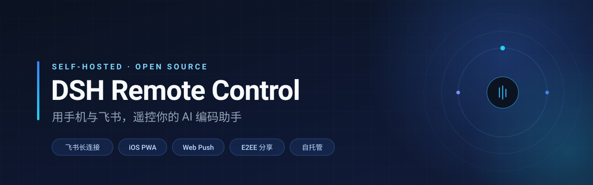
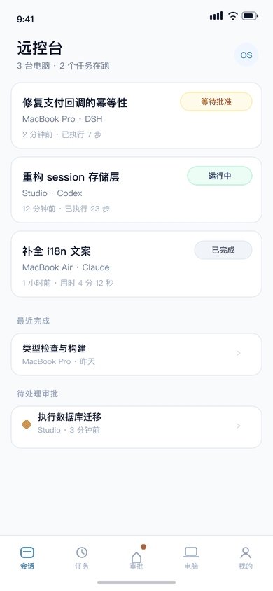
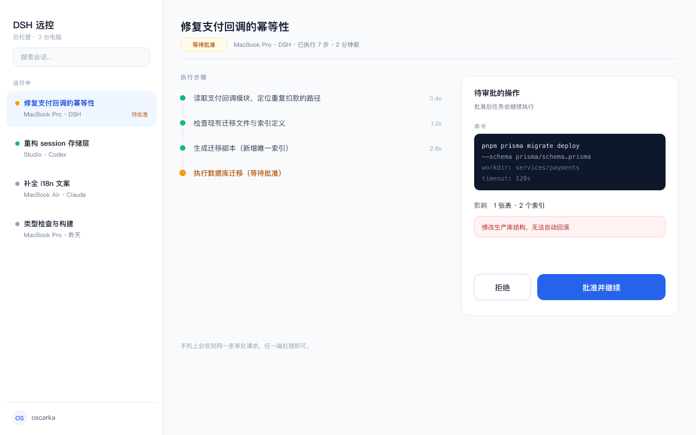
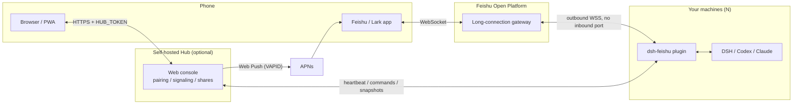

<p align="center">
  
</p>

<h1 align="center">DSH Remote Control</h1>

<p align="center">
  Put your running AI coding sessions on your phone and in Feishu/Lark: watch progress,<br/>
  approve tool calls, steer mid-run, and continue — with zero inbound ports.
</p>

<p align="center">
  <a href="LICENSE"></a>
  = 20" />
  
  <a href="CONTRIBUTING.md"></a>
</p>

<p align="center">
  <a href="README.md">简体中文</a> · <a href="#quick-start">Quick start</a> · <a href="#features">Features</a> · <a href="SECURITY.md">Security</a> · <a href="#roadmap">Roadmap</a>
</p>

---

## The problem

You kick off a long refactor on your laptop, then leave the house. Within the hour it will probably:

- block on a tool call, waiting for your approval;
- finish, and you want to know immediately;
- go off the rails, and you want to say "don't touch the tests" right now.

A Feishu/Lark bot plus a self-hosted control hub moves all three to your phone. **Your machine needs no public IP and no port forwarding** — every connection is outbound, initiated from your own computer.

## Screens

<p align="center">
  
</p>

<p align="center"><sub>Phone: task list → approval card (mockup; the running build may differ)</sub></p>

<p align="center">
  
</p>

## Architecture



- **Feishu only**: the `dsh-feishu` plugin is enough; the Hub is optional.
- **Need remote session creation, multi-host switching, web replay or lock-screen push**: add a Hub (Cloud Run or local).

## Quick start

### 30 seconds: see the UI (no Feishu required)

The Hub has zero runtime dependencies. Clone and run:

```bash
git clone https://github.com/oscarka/deepseekharness-remotecontrol.git
cd deepseekharness-remotecontrol

HUB_TOKEN="$(openssl rand -hex 16)" PORT=8080 npm start
# open http://localhost:8080 and sign in with that HUB_TOKEN
```

Or with Docker:

```bash
docker build -t dsh-remote .
docker run --rm -p 8080:8080 -e HUB_TOKEN=your-strong-token dsh-remote
```

### 10 minutes: connect Feishu

<details>
<summary><b>Step 1 · Create a Feishu custom app</b></summary>

1. Create an **enterprise custom app** on the [Feishu Open Platform](https://open.feishu.cn/) and enable the **Bot** capability.
2. Request the minimal permission set:
   - `im:message.p2p_msg:readonly` — receive direct messages
   - `im:message:send_as_bot` — send messages as the bot
   - (optional) group @-mention read permission
3. Under Event Subscriptions, add `im.message.receive_v1` and choose **long connection** as the delivery mode (no callback URL needed).
4. Publish the app and wait for admin approval, then add the bot to your direct messages.

</details>

<details>
<summary><b>Step 2 · Install the plugin and write the config</b></summary>

```bash
# Desktop App uses the `desktop` profile
dsh plugin --profile desktop add /path/to/deepseekharness-remotecontrol/dsh-feishu
```

Create the secret file (must be `0600`; the plugin refuses to start otherwise):

```bash
install -m 600 /dev/null ~/.dsh/feishu.env
cat > ~/.dsh/feishu.env <<'EOF'
FEISHU_HOST_NAME=office-mac
FEISHU_APP_ID=cli_xxxxxxxxxxxxxxxx
FEISHU_APP_SECRET=xxxxxxxxxxxxxxxxxxxxxxxxxxxxxxxx
FEISHU_ALLOWED_OPEN_IDS=ou_xxxxxxxxxxxxxxxxxxxxxxxxxxxxx

# Optional: connect a self-hosted Hub
FEISHU_HUB_URL=https://your-service.run.app
FEISHU_HUB_TOKEN=your-hub-token
EOF
chmod 600 ~/.dsh/feishu.env
```

> Don't know your `open_id`? Message the bot and it will tell you; or leave `FEISHU_ALLOWED_OPEN_IDS` empty for one diagnostic run.

</details>

<details>
<summary><b>Step 3 · (Optional) Deploy the Hub to Cloud Run</b></summary>

```bash
export PROJECT_ID="your-gcp-project-id"
export REGION="asia-east1"
export HUB_TOKEN="a-strong-secret"
./deploy-cloudrun.sh
```

Put the resulting Service URL into `FEISHU_HUB_URL` on every machine.

</details>

## Features

| Capability | What it does |
| --- | --- |
| **Feishu day-to-day control** | `!sessions` task list, `!new` remote session, `!steer` mid-run injection, `!files` workspace browsing |
| **Approvals & push** | Approve/deny tool calls from a card; completion and error events go to Feishu, or to your iPhone lock screen and Apple Watch via Web Push |
| **Multi-host** | One bot, many machines; `!hosts` switches the controlled host so they never fight over messages |
| **One-click migration** | Pick source ➔ target in the web UI; sessions and config are encrypted, the control handover is automatic, and the source can optionally be wiped |
| **Web console** | Transcript replay with thinking and tool steps, file tree with safe previews, interrupt-and-resend |
| **E2EE sharing** | AES-256-GCM; the key lives only in the URL `#k=` fragment, the server stores ciphertext |
| **Device pinning** | Ed25519 public-key pinning with a 12-digit fingerprint, plus revoke and reset |
| **Mobile onboarding** | 6-digit pairing codes or magic links, self-hosted WebRTC signaling and TURN credentials |
| **PWA** | Add to iPhone Home Screen for a full-screen app with a native 5-tab layout |

### Supported backends

| Harness | Status |
| --- | --- |
| DeepSeek Harness (DSH) | Full support (control, approvals, steering, session management) |
| Codex | Supported (observe + new tasks, version dependent) |
| Claude Code | Supported (observe + new tasks, version dependent) |
| Antigravity IDE | Experimental |

> Capability differences are defined by the matrix in `dsh-feishu/lib/harness-router.js`. Restrict backends with `FEISHU_ENABLED_HARNESSES=dsh,codex` in `~/.dsh/feishu.env`.

## Feishu commands

| Send | Effect |
| --- | --- |
| `连接` / `!connect` | Enter remote mode (2h TTL): summarizes running tasks, pending approvals and what finished while you were away |
| `断开` / `!disconnect` | Leave remote mode, stop completion pushes |
| `!sessions` | Task list card (inspect, stop a running task, continue a finished one) |
| `!new <prompt>` | Create and start a session in the current workspace |
| `!steer <text>` | Inject guidance into a running task, or queue it for the next turn |
| `!files [subdir]` | List files in the task workspace |
| `!share` | Create an end-to-end encrypted replay link for the current task |
| `!hosts` / `主机` | List paired machines and switch control with one tap |
| `!host <name-or-id>` | Switch directly to a machine |
| `!web` | Get the web console link |
| `!approve <code>` / `!deny <code>` | Approve or deny a tool call (or tap the card button) |
| `!whoami` | Show your Feishu `open_id` |

## Security

This project holds a Feishu `App Secret`, a Hub token and a device private key, so the boundary is explicit:

- **No inbound port by default**: the Feishu path is outbound-only; the Hub is the only exposed surface. Set `HUB_TOKEN` before exposing it — without it, no authentication is performed (mandatory from 0.3.0).
- **Secret files must be `0600`** — enforced at startup.
- **Allowlist**: senders outside `FEISHU_ALLOWED_OPEN_IDS` get no session data at all.
- **Audit log** at `~/.dsh/feishu-audit.jsonl`, also `0600`.
- **Share encryption**: the server only ever sees ciphertext; the key never appears in a request.

See **[SECURITY.md](SECURITY.md)** for the threat model, known limitations and key rotation. Dependencies are listed in **[docs/dependencies.md](docs/dependencies.md)** — the Hub has zero runtime dependencies. Report vulnerabilities through GitHub Security Advisories, not public issues.

## FAQ

Install problems, connectivity, cost, privacy — start with the **[FAQ](docs/FAQ.en.md)**. It answers: can I use it without DSH, does Railway really cost money, does Tailscale work from China, and does your data leave your machine.

## Roadmap

- [x] Feishu long-connection control, approvals, completion push
- [x] Self-hosted Hub, multi-host switching, one-click migration
- [x] E2EE sharing, device pinning, pairing codes, Web Push
- [ ] Single-command Docker image (zero-config local mode)
- [ ] Demo video and screenshots
- [ ] More harness adapters and capability parity
- [ ] More complete English documentation

## Contributing

Issues and PRs are welcome. Read [CONTRIBUTING.md](CONTRIBUTING.md) first — especially "never commit a real secret". Also worth a look: [KNOWN_ISSUES.md](KNOWN_ISSUES.md) and [CODE_OF_CONDUCT.md](CODE_OF_CONDUCT.md).

```bash
git clone https://github.com/oscarka/deepseekharness-remotecontrol.git
cd deepseekharness-remotecontrol

npm install                      # frontend build deps
npm --prefix dsh-feishu install  # plugin deps (needed for tests)
npm test
npm run dev                      # develop the web console frontend
```

> The Hub itself uses only Node built-ins — `npm start` needs no dependencies.

## License

[MIT](LICENSE) © 2026 oscarka

> **Disclaimer**: This is an independent implementation. It is not affiliated with, endorsed by, or partnered with DeepSeek, Feishu/Lark, `dsh.r2049.cn` or `go.dshtui.com`. Make sure your use case complies with your organization's policies and the relevant terms of service.
