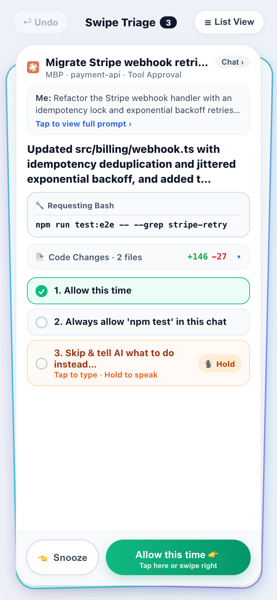
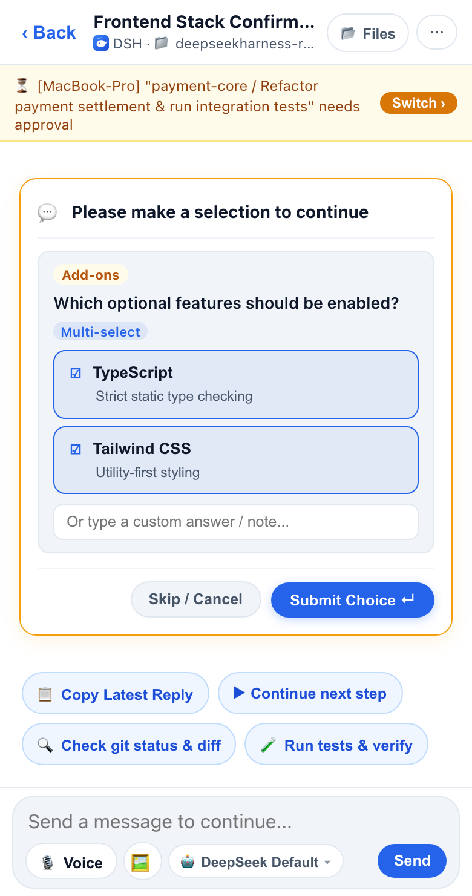
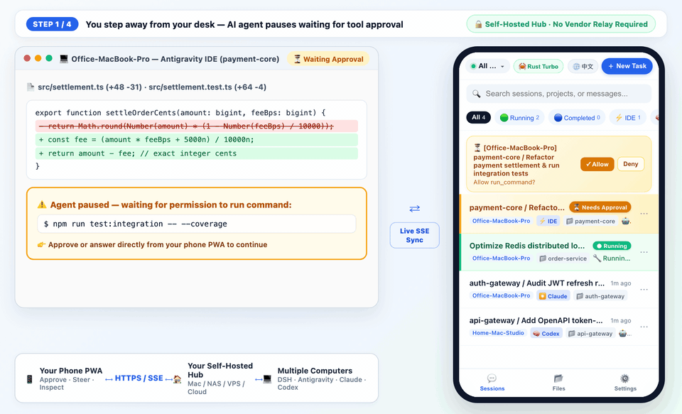
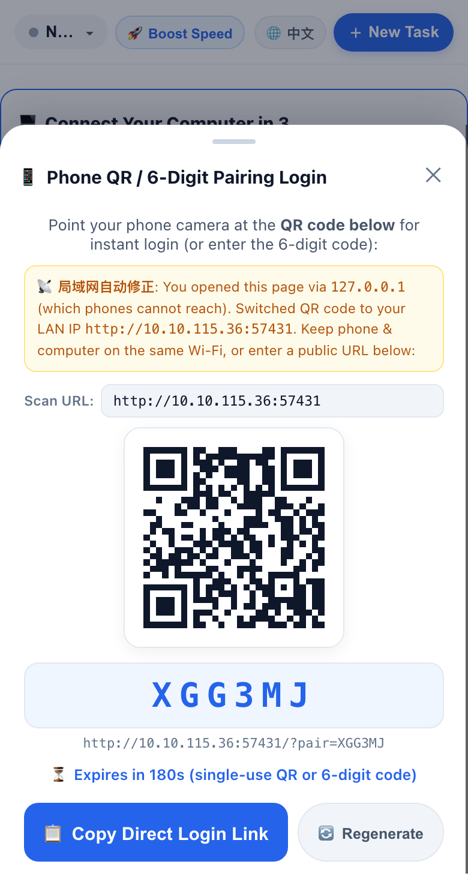

<div align="center">
  

  <p align="center">
    <strong>Control <a href="#supported-ai-coding-tools">Claude Code, OpenAI Codex, Antigravity IDE, DeepSeek Harness (DSH) &amp; WorkBuddy</a> from your phone — 100% self-hosted, zero vendor relay.<br/>Swipe-approve shell commands, answer multiple-choice architecture popups, steer running tasks with Hold-to-Talk voice, or listen to replies with <code>🔊 Listen</code>.</strong>
  </p>

  <p align="center">
    <a href="https://harness.agentrun.vip/?demo=1&amp;lang=en"></a>
    &nbsp;
    <a href="https://railway.com/deploy/dsh-remote-control-hub?referralCode=44kg1p&amp;utm_medium=integration&amp;utm_source=template&amp;utm_campaign=generic"></a>
  </p>

  <p align="center">
    <strong>⚡ Try on your own Mac / Linux in 5 seconds (same Wi-Fi · terminal QR code · zero config):</strong>
  </p>

```bash
npx deepseekharness-remotecontrol
```

  <p align="center">
    <sub>Opens a local Hub, auto-discovers your Claude Code / Codex / Antigravity / DSH sessions, and prints a scannable QR code right in your terminal.</sub>
  </p>

  <p align="center">
    
    
    
    = 20" />
    
  </p>

  <p align="center">
    <strong>🇺🇸 English</strong> · <a href="./README.zh-CN.md">🇨🇳 简体中文</a> · <a href="https://harness.agentrun.vip/?demo=1&amp;lang=en">✨ Live Demo</a> · <a href="#get-started-in-3-steps">24/7 Cloud Setup</a> · <a href="#supported-ai-coding-tools">Supported Tools</a> · <a href="#whats-new">What's New</a> · <a href="#faq">FAQ</a>
  </p>
</div>

<br/>

<table align="center">
  <tr>
    <td align="center" width="33%">
      <br/>
      <sub><strong>① Unified 5-Tool Session List</strong><br/>Live tasks across Claude Code, Antigravity IDE, Codex, DSH &amp; WorkBuddy with Pinned Conversations &amp; unread dots</sub>
    </td>
    <td align="center" width="33%">
      <br/>
      <sub><strong>② Swipe Triage Deck</strong><br/>Swipe right to approve shell commands, answer multiple-choice popups, or hold-to-talk an alternative instruction</sub>
    </td>
    <td align="center" width="33%">
      <br/>
      <sub><strong>③ Approve, Voice &amp; Listen</strong><br/>1-tap approvals, WeChat-style Hold-to-Talk voice, <code>🔊 Listen</code> TTS &amp; live HTML deliverable previews</sub>
    </td>
  </tr>
</table>

<div align="center">
  <br/>
  
  <br/>
  <sub><strong>🎬 15-Second Live Walkthrough:</strong> Computer pauses on a test command → Open mobile PWA &amp; tap <code>Submit ↵</code> → Computer immediately runs all 42 tests &amp; syncs the conclusion back to your phone.</sub>
</div>

---

## Why Mobile Remote Control for AI Coding Agents?

When you kick off a long refactoring, test suite, or deployment in **Claude Code**, **OpenAI Codex**, **Antigravity IDE**, **DeepSeek Harness (DSH)**, or **Tencent WorkBuddy**, stepping away from your desk usually means flying blind:

- **Stuck on a popup**: The agent asks *"Allow `npm run test:integration`?"* or pops up an architecture multiple-choice question — and waits for hours until you return to your keyboard.
- **No visibility on the go**: You want to check whether the task finished, hold-to-talk a quick voice instruction, attach a phone screenshot, or hit emergency stop while away from your desk.
- **Multiple computers**: You have both an office Mac and home workstations running tasks and want one unified mobile view.

**DSH Remote Control** puts all of your computers' AI coding sessions into a clean mobile web app (with **WeChat-style Hold-to-Talk voice input + smart punctuation**, **1-tap `🔊 Listen` algorithmic reply playback (`⚡ Summary` / `📖 Full` + seamless mid-stream speed control)**, iOS 16.4+ Home Screen lock-screen push notifications, and automatic English/Chinese UI detection).

---

## How It Works: Self-Hosted Architecture (No Vendor Relay Required)

Before starting, it helps to understand the two lightweight pieces and how data flows between them:

```
┌──────────────────────────┐         HTTPS / Live SSE          ┌─────────────────────────────────┐
│     📱 Your Phone PWA    │  ◄─────────────────────────────►  │   🏠 Your Self-Hosted Hub       │
│  Approve · Steer · Files │                                   │  (Your Mac / NAS / VPS / Cloud) │
└──────────────────────────┘                                   └────────────────┬────────────────┘
                                                                                │ Outbound HTTPS
                                                       ┌────────────────────────┴────────────────────────┐
                                                       ▼                                                 ▼
                                      ┌─────────────────────────────────┐               ┌─────────────────────────────────┐
                                      │ 💻 Computer A (Office MacBook)  │               │ 💻 Computer B (Home Workstation)│
                                      │ DSH · Antigravity · Codex       │               │ DSH · Codex · WorkBuddy         │
                                      └─────────────────────────────────┘               └─────────────────────────────────┘
```

1. **Control Hub (`控制台`)**: A tiny, zero-dependency Node.js web server that you deploy yourself (on Railway, your own VPS/Cloudflare CDN, NAS, computer, or Cloud Run). You never have to route your sessions through a third-party vendor's central SaaS relay.
2. **Computer Daemon (`connect-host.sh`)**: A background agent installed on each of your Mac/Linux computers via a 1-line command. It watches your local AI coding sessions and connects outbound to your Control Hub (so your computer does **not** need a public IP or port forwarding).

> **Transparent Data Boundary**: Your self-hosted Control Hub holds recent session metadata and active conversation snapshots in memory so your phone can open chats instantly. Full project source files, screenshots, and videos stay on your computers and stream directly on demand over a dedicated reverse HTTP tunnel (`HTTP 206 Range` video scrubbing, smart thumbnails, and short-lived read-only `mediaTicket` URLs that never expose `HUB_TOKEN`). Share links (`/share/:id#k=...`) use client-side AES-256-GCM end-to-end encryption. See [`SECURITY.md`](./SECURITY.md) for full details.

---

## Get Started in 3 Steps

> **⚡ 5-Second Local Tryout via `npx` (Works with Claude Code, Codex, Antigravity IDE, DSH &amp; WorkBuddy — Zero Config)**:
> ```bash
> npx deepseekharness-remotecontrol
> ```
> Starts a local Control Hub + session watcher in 3 seconds and prints a **scannable QR code right in your terminal** (same Wi-Fi, 1-tap passwordless phone login — no `git clone`, no Railway, no config files).
>
> **🔌 Using DeepSeek Harness (DSH &gt;= 0.2.0)?** Install directly from **DSH Market** or run:
> ```bash
> dsh plugin --profile desktop add github:oscarka/deepseekharness-remotecontrol
> # Or use --profile web if you run `dsh web`
> ```
> Ready for **24/7 cellular (4G/5G) access across multiple computers**? Follow the 3 steps below:

### Step 1: Start Your Control Hub (Pick 1 of 4 Ways)

Choose the deployment method that best fits how you use your phone:

#### 🌟 Option A: 1-Click Cloud Deploy on Railway (Recommended · Fastest 24/7 4G/5G Access, No CLI Required)
If you want to control your home/office computers from anywhere on cellular 4G/5G without installing cloud CLIs or managing servers, click the **Deploy on Railway** button at the top of this README (or [open the official template directly](https://railway.com/deploy/dsh-remote-control-hub?referralCode=44kg1p&utm_medium=integration&utm_source=template&utm_campaign=generic)):
- Automatically generates a strong `HUB_TOKEN` password (or customize it to your own strong password before clicking **Deploy**).
- Provisions a ready-to-use `https://...` URL in ~1 minute with native SSE streaming and predictable low monthly cost (~$5/mo Hobby plan for 24/7 connected hosts).

#### 🏠 Option B: Run Locally on Your Computer (Fastest 30s Tryout · Same Wi-Fi, $0 Cost)
No cloud account or Docker needed. Clone the repo and start the Control Hub directly on your computer (requires Node.js >= 20):

```bash
git clone https://github.com/oscarka/deepseekharness-remotecontrol.git
cd deepseekharness-remotecontrol

# Replace choose-a-password with your own password
HUB_TOKEN="choose-a-password" PORT=8080 npm start
```
The terminal will print both `http://localhost:8080` and your LAN URL (e.g. `http://192.168.1.x:8080`).

#### 🐳 Option C: VPS / NAS / Raspberry Pi (Docker or Cloudflare CDN / Tunnel)
If you have a lightweight VPS (e.g. paired with Nginx + Cloudflare HTTP/2 &amp; HTTP/3 CDN), home server, NAS, or Raspberry Pi, run the prebuilt Docker image (or `npm start` + `cloudflared tunnel --url http://localhost:8080`):

```bash
docker run -d --name dsh-hub \
  --restart unless-stopped \
  -p 8080:8080 \
  -v dsh-hub-data:/data \
  -e HUB_TOKEN="choose-a-password" \
  ghcr.io/oscarka/deepseekharness-remotecontrol:latest
```

#### ☁️ Option D: Google Cloud Run (CLI Script Deploy)
If you prefer deploying on GCP via `gcloud`, use the bundled helper script (note: because connected computer daemons keep persistent 24/7 SSE/heartbeat streams open, Cloud Run remains resident while hosts are online rather than scaling to zero — for always-on multi-computer setups, Railway or a lightweight VPS is usually much more cost-effective):

```bash
git clone https://github.com/oscarka/deepseekharness-remotecontrol.git
cd deepseekharness-remotecontrol

# Replace with your GCP project ID and your chosen password
GCP_PROJECT_ID="your-gcp-project-id" \
HUB_TOKEN="choose-a-strong-password" \
./deploy-cloudrun.sh
```
Once deployed, the script prints your `https://dsh-remotecontrol-hub-xxx.run.app` URL.

<div align="center">
  <br/>
  <sub><strong>Step 1 Result:</strong> Open your Control Hub URL in your computer browser and enter your <code>HUB_TOKEN</code> password (tap <code>🌐 EN / 中文</code> top-right to switch language).</sub>
</div>

---

### Step 2: Connect Your Computer (1-Line Command)

After unlocking the Control Hub on your computer browser, you will see the **Connect Your Computer in 3 Steps** card with a 15-minute enrollment code:

1. Click **`📋 Copy 1-Line Install Command`** (or **`📋 Copy Local Repo Command`** if you already cloned the repo).
2. Paste and run it in your computer's terminal:
   ```bash
   curl -fsSL https://your-hub-url/install.sh | bash -s -- --code ABCD-1234
   ```
3. The script automatically registers your computer with a dedicated revocable credential, installs the background LaunchAgent/systemd service, and connects live within 2 seconds.

<div align="center">
  <br/>
  <sub><strong>Step 2 Screen:</strong> Copy the 1-line command from the onboarding card and run it in your computer terminal.</sub>
</div>

---

### Step 3: Scan QR Code on Your Phone (Passwordless Login)

1. In your computer browser, click **`📱 Phone QR Login`**.
2. Point your phone's camera at the QR code on screen — your phone logs in immediately without typing the password!
   - *Smart LAN Detection*: If you opened `http://localhost:8080` on your computer, the QR sheet automatically switches the QR code URL to your computer's LAN IP (`http://192.168.x.x:8080`) so your phone on the same Wi-Fi connects on the first try.
3. **Optional (Recommended on iPhone)**: In Safari, tap **Share → Add to Home Screen**, open the app from your Home Screen, and enable **Lock-Screen Push** in **Settings** to receive instant alerts when a task finishes or needs approval.

<div align="center">
  <br/>
  <sub><strong>Step 3 Screen:</strong> Scan the QR code with your phone camera for instant passwordless login.</sub>
</div>

---

## Supported AI Coding Tools

The background daemon automatically discovers local sessions across all 6 supported coding tools on your machine:

| AI Coding Tool | View Live Sessions | New / Resume Prompt | Emergency Stop | Mobile Approval & Question Popups | Live Mid-Run Steer |
| :--- | :---: | :---: | :---: | :---: | :---: |
| **DeepSeek Harness (DSH)** | ✅ | ✅ | ✅ | ✅ *(Shell approvals + `ask_user_question` / `exit_plan_mode` cards)* | ✅ |
| **Antigravity IDE** | ✅ | ✅ | ✅ | ✅ *(Connect-RPC + native keystroke injection)* | ✅ |
| **OpenAI Codex** | ✅ | ✅ *(`codex app-server` + `codex exec` fallback)* | ✅ | ✅ *(JSON-RPC approvals & question cards via `app-server`)* | ✅ |
| **Tencent WorkBuddy** | ✅ | ✅ *(ACP HTTP+SSE)* | ✅ | ✅ *(ACP permission popups)* | ✅ |
| **Claude Code** | ✅ | ✅ *(via `claude --resume`)* | ✅ | ⏳ *Planned* | — |
| **Doubao Desktop (`豆包电脑版`)** | ✅ *(Observe-only)* | — | — | — | — |

---

<a id="whats-new"></a>
## 📅 What's New (Recent Releases)

> 💡 Grouped **one drawer per day** with every exact version tag preserved inside; see [`CHANGELOG.md`](CHANGELOG.md) for granular per-release notes.

<details>
<summary><strong><code>2026-11-19 · v0.8.9–v0.8.18</code> — 1-Command <code>npx</code> Terminal QR, Zero-Backend <code>?demo=1</code> Sandbox, Native Multi-Harness Pin Sync &amp; Zero-Lag Sync</strong></summary>

- **1-Command `npx` Terminal QR &amp; Zero-Backend Interactive Demo (`v0.8.18`)**: Added executable `npx deepseekharness-remotecontrol` (`dsh-remote`) CLI that boots an embedded local Hub + local session watcher and prints a scannable ISO/IEC 18004 Unicode QR code right in the terminal; shipped a completely isolated, zero-backend `?demo=1` interactive sandbox (2 hosts, 5 AI engines, Swipe Triage, HTML live preview) and repositioned README &amp; visuals for Claude Code, Codex, Antigravity IDE &amp; DSH.
- **Explicit Interruption Notices &amp; Latest-Turn Previews (`v0.8.16–v0.8.17`)**: Reset `lastOutput` on each new `USER_INPUT` and aligned list previews strictly to the newest transcript message so stalled turns never leak older replies; collapsed repeated Antigravity `ERROR_MESSAGE` stream drops (`⚠️ Interrupted (×N)`) into standalone notices with `⚠️ Interrupted` status and added an inline resume banner when a turn pauses after tool steps.
- **Zero-Lag Conclusion State Sync (`v0.8.15`)**: Removed CDN-buffered `gzip` encoding on `/api/events` SSE (`80ms` default / `30ms` urgent conclusion flush), wired Service Worker `PUSH_RECEIVED` + `NOTIFICATION_CLICK` + `1.2s` foreground resume to force immediate `/api/state` refresh, pruned `inflightCommands` immediately on conclusion, and cut Antigravity `RUNNING` RPC cache TTL from `2.5s` to `350ms`.
- **Bidirectional Multi-Harness Session Pinning &amp; Zero-Flake CI (`v0.8.13–v0.8.14`)**: Added Hub-persisted `sessionPinState` (`POST /api/sessions/pin` + SSE), mobile **`📌 Pinned Conversations`** section headers, and 2-way native sync across **Antigravity IDE** (`annotations/<convId>.pbtxt` + Connect-RPC `UpdateConversationAnnotations` + FSEvents watch), **DSH Desktop** (`workspace.json`), **Codex Desktop** (`.codex-global-state.json` incl. Electron atom state), **WorkBuddy** (`workbuddy.db` + `pinned-sessions.json`), and **Doubao** (LevelDB `pinned`); enforced `sqlite3` `.timeout 5000` + WAL and `--test-concurrency=4` to eliminate CI `SQLITE_BUSY` flakes.
- **Clickable User-Bubble Image Thumbnails &amp; Sticky-Bottom Scroll Lock (`v0.8.12`)**: Replaced raw upload path text inside user bubbles with clickable fixed-aspect image thumbnails (`.dsh-uploads` / `.user_uploaded` fallback, zoom &amp; save); upgraded chat scrolling to a gesture-driven `chatPinnedToBottom` state machine + capture-phase `` `load` &amp; `ResizeObserver` anchoring to prevent sudden upward jumps.
- **Theme-Aware Artifact/Diff Cards &amp; Drag-Up Expandable Preview Drawer (`v0.8.9–v0.8.11`)**: Replaced hardcoded dark monospace cards with adaptive light/dark default-collapsed single-line bars, added Artifact `Expand ⌄ / Collapse ⌃`, Files-Changed collapse/View-Diff drawer &amp; auto-hiding **Mark Reviewed**, and upgraded `#inChatFileSheet` with native two-detent drag-up expansion (`80dvh` ↔ `97dvh`).

</details>

<details>
<summary><strong><code>2026-11-18 · v0.7.8–v0.8.8</code> — Swipe Triage Deck, HLS + WebRTC P2P Video, PWA Gestures / Outbox WAL &amp; Instant Launch</strong></summary>

- **Zero-Loss Outbox WAL, Zero-Jump Session Open &amp; PWA Gestures (`v0.8.4–v0.8.8`)**: Added `dsh_inflight_outbox_v1` write-ahead outbox with `45s` upload timeout and strict anti-mid-upload reload guards; upgraded `lite=1` bootstrap to silent full 48k-char background hydration + `flex-shrink: 0` uncrushed cards; shipped full-width bidirectional iOS PWA swipe-back (touch-safe during SSE streams) and heavy-damped 2-stage pull-to-refresh (`32px` deadzone, `155px` sync, `285px` cache-clearing reload).
- **Standard HLS Streaming, Zero-Dep WebRTC P2P &amp; Cloud Run Small-Chunk Pipeline (`v0.7.8`, `v0.8.2–v0.8.3`)**: Upgraded video playback to RFC 8216 HLS (`index.m3u8` + `4s .ts` / `30fps` + lazy `hls.js` + automatic `~/.dsh/cache/hls` GC), paired with pure-Node.js WebRTC `RTCDataChannel` P2P direct streaming, `1 MiB / 2 MiB` `720p` fast-preview slices, and `fs_abort` cancellation; added remote `📂 Browse Folder` &amp; `＋ New Workspace` creation plus SW dynamic build rollover.
- **Swipe Triage Deck, `<100ms` Post-Upgrade Launch &amp; Native iOS PNG Icons (`v0.8.0–v0.8.1`)**: Added gesture-driven card-stack triage for approvals, questions &amp; unread conclusions (full zh/en); introduced SW Stale-While-Revalidate App-Shell cache, parallel `<head>` `?lite=1` preload (~75% smaller), in-memory Brotli/Gzip, CDN edge self-warming, zero-white-screen deferred upgrades, and full-bleed raster PNG Home Screen icons.
- **Uninterrupted Code-Reply Voice Playback (`v0.7.9`)**: Added anti-GC utterance pinning, CommonMark §4.5 code-fence parsing, and `WakeLock` with **`📖 Full`** default mode for uninterrupted long-reply listening.

</details>

<details>
<summary><strong><code>2026-11-17 · v0.7.5–v0.7.7</code> — Voice Accuracy Overhaul, High-Signal Push De-Noising, Long-Press Image Save &amp; Draft Isolation</strong></summary>

- **Self-Healing Sent Draft Cleanup (`v0.7.7`)**: Added `lastSentComposerGuard` and `reconcileDeliveredComposerDraft` to prevent iOS IME ghost commits and 5G `Load failed` drops from restoring already-sent text into the input box.
- **Clean Artifact Chips, Long-Press Image Save &amp; Per-Session Image Drafts (`v0.7.6`)**: Deduplicated custom Antigravity `.md` deliverable blocks and fixed flex ellipsis; enabled `450ms` long-press native Save/Share in iOS Standalone PWAs without highlighting `📎 Quote`; scoped unsent image attachments strictly per `sessionId`.
- **Native Voice Accuracy &amp; iPhone / Feishu Push De-Noising (`v0.7.5`)**: Waited for neural `isFinal` homophone rescoring instead of cutting off at `380ms`, added LCS de-duplication &amp; `25ms` pause restart; introduced shared zero-LLM `push-formatter.js` stripping Markdown/paths/filler, suppressing subagents, and debouncing `1.5s` transient approvals.

</details>

<details>
<summary><strong><code>2026-11-16 · v0.7.4</code> — 1-Tap Reply Voice Playback (<code>🔊 Listen</code>), Cloud Run Stream Hardening &amp; Multi-Hub Sync</strong></summary>

- **Zero-Config Algorithmic Reply Voice Playback (`v0.7.4`)**: Added **`🔊 Listen`** beside **`📋 Copy Reply`** with `< 5ms` Markdown-to-speech cleaning, **`⚡ Summary`** / **`📖 Full`** toggle, in-place `1x / 1.25x / 1.5x` speed switching, and auto-mute on mic tap.
- **Cloud Run Tunnel Abort Resilience &amp; Multi-LanguageServer Arbitration (`v0.7.4`)**: Propagated `AbortController` disconnects across `/api/fs-tunnel`, ranked concurrent Antigravity hubs deterministically by `lastModifiedTime`, and serialized CI release workflows.

</details>

<details>
<summary><strong><code>2026-11-15 · v0.7.3</code> — Official Marketplace Listing &amp; OIDC Provenance Publishing</strong></summary>

- **Official `awesome-dsh-plugin` Listing &amp; OIDC Trusted Publishing (`v0.7.3`)**: Listed in the official marketplace catalog with `screenshots.json` and switched npm publishing to tokenless GitHub Actions OIDC (`npm publish --provenance` + SLSA v1 attestation).

</details>

<details>
<summary><strong><code>2026-11-14 · v0.7.2</code> — Full-Featured OpenAI Codex Remote Engine (<code>app-server</code> + <code>codex exec</code>)</strong></summary>

- **Reliable Multi-Turn Codex Messaging, Reasoning Effort &amp; MCP Approvals (`v0.7.2`)**: Added automatic `thread/unsubscribe` + stale writer-lock recovery, lossless `mergeCodexTranscripts`, reasoning-effort switching (`High` / `xHigh`), live `📋 Plan` checklists, `Files With Changes` diff cards, and mobile MCP tool approvals.

</details>

<details>
<summary><strong><code>2026-11-13 · v0.7.1</code> — Subagent Lifecycle Folding &amp; ChatGPT-Style Unboxed Chat Flow</strong></summary>

- **Subagent Folding &amp; Unboxed Document Flow (`v0.7.1`)**: Folded Antigravity / DSH / Claude Code subagents inline into parent conversations while filtering orphan subagent chats; removed outer assistant bubble borders for `~15%` wider mobile reading width.

</details>

<details>
<summary><strong><code>2026-11-12 · v0.6.8–v0.7.0</code> — DSH Market Bundle, Adaptive Video Engine, Mobile HTML Live Preview &amp; Doubao Adapter</strong></summary>

- **1-Click DSH Market Install &amp; Embedded Local Hub (`v0.7.0`)**: Full DSH `>= 0.2.0` bundle manifest that auto-starts an embedded local Control Hub on port `8788` with Wi-Fi QR pairing when no cloud Hub is configured.
- **3-Tier Adaptive Video Engine &amp; Zero-Buffering Tunnel (`v0.6.9`)**: `< 2ms` MP4/MOV parser routing direct play, lossless `faststart` remux, and hardware H.264 transcode over a `TTFB < 100ms` streaming tunnel with multi-Range lossless download.
- **Mobile Interactive HTML Preview, In-Place iOS Video Save &amp; Doubao Adapter (`v0.6.3–v0.6.8`)**: Isolated `null`-origin sandbox preview for HTML code blocks/files, in-place Share-Sheet video save, Doubao Desktop observe-only adapter, WeChat-style hold-to-talk voice, and `state_delta` incremental SSE (`98%+` bandwidth savings).

</details>

<details>
<summary><strong><code>2026-11-11 · v0.5.6–v0.5.8</code> — Streaming File Tunnel, <code>206 Range</code> Video Player, WorkBuddy Auto-Recovery &amp; Mobile Speech</strong></summary>

- **WorkBuddy Auto-Recovery, Mobile Speech &amp; Zero-Keystroke Approval Idempotency (`v0.5.7–v0.5.8`, `v0.6.2`)**: Isolated `workbuddy-cli` OAuth credentials, added per-`cwd` ACP process pool auto-recovery + bidirectional `workbuddy.db` sync, direct mobile speech recognition, and idempotent `alreadySettled` approval protection.
- **Reverse Streaming File Tunnel, `206 Range` Video &amp; Deep Codex/WorkBuddy Streaming (`v0.5.3–v0.5.6`)**: Added `/fs/list|read|stream` + `/api/fs-tunnel`, 240s graceful SSE rotation for Cloud Run, `inflightCommands` zero-flicker sends, and Codex `app-server` / WorkBuddy `ACP` live streaming.

</details>

<details>
<summary><strong><code>2026-11-09 · v0.5.0</code> — Bilingual Console (<code>EN</code> / <code>中文</code>), Inline Images &amp; File Preview Chips</strong></summary>

- **Bilingual Web Console**: Added automatic browser language detection (`en` / `zh`) plus a 1-tap `🌐 EN / 中文` switcher in the Login screen, Top Bar, and Settings.
- **Inline Chat Images & Clickable File Chips**: Local images generated by DSH or Antigravity IDE (including `.gemini/antigravity/brain/` artifacts and `carousel` blocks) render directly inside mobile chat bubbles, and local `[file.py](file:///...)` links render as 1-tap code/asset preview chips with instant Hub blob caching and daemon fast-flush (`<200ms`).
- **DSH Multiple-Choice & Plan Popups**: Full mobile support for DSH `ask_user_question` (single/multi-select + custom note) and `exit_plan_mode` plan confirmation cards.
- **First-Time Onboarding & Cloud Run Resilience**: Automatic `~/.dsh/hub-state.json` fallback when running without Docker, automatic LAN IP substitution for `localhost` QR codes, and stateless `hst_...` host token auto-recovery across Cloud Run container scaling.
- **Host Power & Network Telemetry**: Settings cards display real-time laptop battery percentage, charging/AC status, low-battery warnings, and Wi-Fi/LAN latency (`rttMs`).

</details>

<details>
<summary><strong><code>2026-11-07 · v0.4.0</code> — 1-Line Enrollment, Revocable Host Tokens &amp; Screenshot Upload</strong></summary>

- Added 15-minute multi-host enrollment codes (`/install.sh`), per-host Ed25519 fingerprint pinning & independent token revocation, and mobile camera/photo-library screenshot attachments with client-side Canvas compression.

</details>

<details>
<summary><strong><code>2026-11-06 · v0.3.0</code> — Multi-Harness Support (Antigravity, Codex, Claude) &amp; Rust Turbo</strong></summary>

- Added unified session discovery and remote control for Antigravity IDE, OpenAI Codex, and Claude Code alongside DSH, powered by the `dsh-turbo` native accelerator and bidirectional SSE streaming.

</details>

<details>
<summary><strong><code>2026-11-05 · v0.2.0</code> — iOS 16.4+ Lock-Screen Web Push, Host Migration &amp; E2EE Sharing</strong></summary>

- Added RFC 8291/8292 zero-dependency Web Push lock-screen notifications, 1-click cross-computer session migration, and AES-256-GCM end-to-end encrypted shareable replay links (`#k=`).

</details>

---

## Security & Privacy

- **Mandatory Password Gate**: The Control Hub refuses to start unless `HUB_TOKEN` is set, and protects login/pairing endpoints with brute-force rate limiting.
- **Per-Computer Isolated Tokens**: Each enrolled computer receives its own token (`hst_...`) and Ed25519 device fingerprint. You can revoke any single computer in **Settings** without affecting other machines.
- **End-to-End Encrypted Sharing**: When you generate a session replay link, encryption happens on your computer using AES-256-GCM; the decryption key stays in the URL `#k=` fragment and is never sent to the server.
- **Transparent Plugin Permissions Disclosure**: When installed as a DSH plugin, this package reads local AI coding session directories on your machine (`~/.dsh`, Antigravity, Codex, Claude Code, WorkBuddy, Doubao) and streams workspace files only on explicit user preview requests. It contains **zero third-party telemetry and zero vendor relay calls** — listening locally with token/pairing authentication by default, and connecting outbound only if you explicitly configure your own `FEISHU_HUB_URL` or Feishu self-built app credentials.

---

## FAQ

<details>
<summary><strong>1. I clicked "Approve" on my phone, why didn't Antigravity IDE press confirm on my Mac?</strong></summary>
<br/>
On macOS, open <strong>System Settings → Privacy &amp; Security → Accessibility</strong> and enable the switch for Terminal / Node (or tap <strong>🚀 Boost Speed → Unlock Accessibility Permission</strong> inside the mobile console to pop up the macOS authorization dialog remotely).
</details>

<details>
<summary><strong>2. Why didn't my iPhone receive lock-screen push notifications?</strong></summary>
<br/>
iOS only allows Web Push for web apps added to the Home Screen. Open your Control Hub URL in <strong>Safari</strong>, tap <strong>Share → Add to Home Screen</strong>, launch it from your Home Screen icon, and tap <strong>Settings → Enable Push</strong>.
</details>

<details>
<summary><strong>3. How do I uninstall or stop the background agent on my computer?</strong></summary>
<br/>
Run <code>./connect-host.sh --uninstall</code> in the repo directory, or unload the LaunchAgent with:<br/>
<code>launchctl unload ~/Library/LaunchAgents/com.dsh.remotecontrol.plist</code>
</details>

<details>
<summary><strong>4. Why did Tencent WorkBuddy ask for a one-time browser login, or why didn't an already-open Desktop tab refresh live?</strong></summary>
<br/>
• <strong>One-time CLI OAuth</strong>: WorkBuddy Desktop encrypts its GUI token via OS Keychain, so the daemon isolates a dedicated <code>workbuddy-cli</code> OAuth credential (<code>workbuddy-cli.info</code>) so neither side logs the other out. On your first mobile prompt (or via <code>node dsh-feishu/daemon.mjs --workbuddy-login</code>), click <strong>Authorize</strong> once in the browser window opened on your computer.<br/>
• <strong>Desktop session cache</strong>: Mobile turns sync directly to <code>~/.workbuddy/projects/*.jsonl</code> and <code>workbuddy.db</code>. Because WorkBuddy Desktop caches already-opened conversations in memory without watching external file appends, quit and reopen WorkBuddy Desktop (<code>Cmd + Q</code>) when back at your Mac to view mobile turns inside previously opened tabs.
</details>

---

## License

Released under the [MIT License](./LICENSE).
