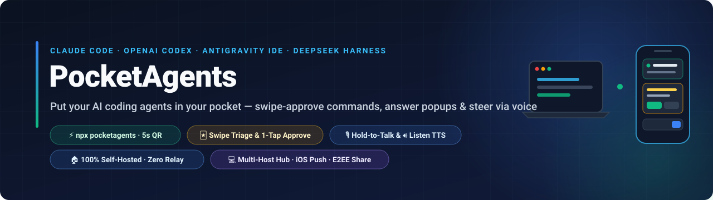
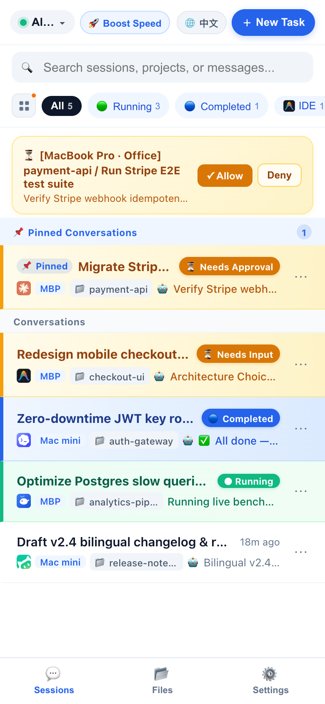
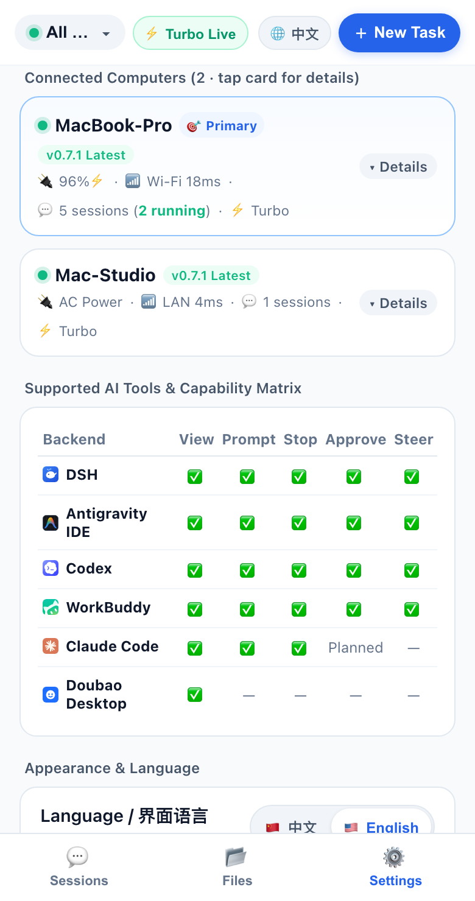
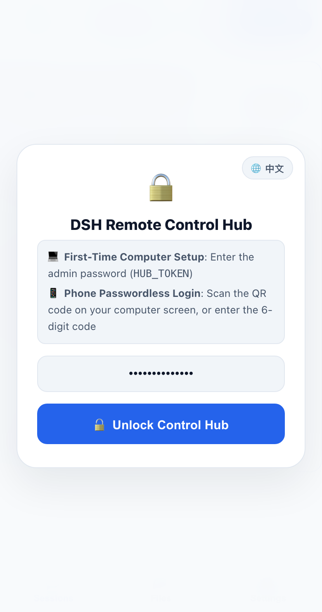
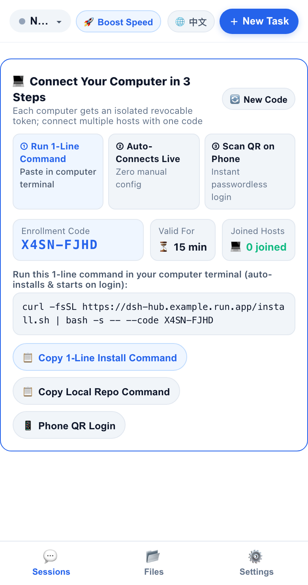

<div align="center">
  

  <p align="center">
    <strong>Your AI Coding Agents, Under Your Control — No Vendor-Managed Relay Required.<br/>Monitor live progress, steer running tasks, stop runaway loops, or tap to approve commands &amp; multiple-choice popups from your phone.<br/>Deploy your own self-hosted Control Hub on Railway, a VPS, NAS, or your computer.</strong>
  </p>

  <p align="center">
    
    
    = 20" />
    
  </p>

  <p align="center">
    <a href="https://railway.com/deploy/dsh-remote-control-hub?referralCode=44kg1p&amp;utm_medium=integration&amp;utm_source=template&amp;utm_campaign=generic"></a><br/>
    <sub>💡 Auto-generates a strong <code>HUB_TOKEN</code> password (or customize it to your own strong password before clicking Deploy).</sub>
  </p>

  <p align="center">
    <strong>🇺🇸 English</strong> · <a href="./README.zh-CN.md">🇨🇳 简体中文</a> · <a href="#get-started-in-3-steps">3-Step Setup</a> · <a href="#supported-ai-coding-tools">Supported Tools</a> · <a href="#whats-new">What's New</a> · <a href="#faq">FAQ</a>
  </p>
</div>

<div align="center">
  
  <br/>
  <sub><strong>🎬 15-Second Live Walkthrough:</strong> Computer pauses on a test command → Open mobile PWA &amp; tap <code>Submit ↵</code> → Computer immediately runs all 42 tests &amp; syncs the conclusion back to your phone.</sub>
</div>

<br/>

<table align="center">
  <tr>
    <td align="center" width="33%">
      <br/>
      <sub><strong>① Unified 5-Tool Session List</strong><br/>Live tasks across DSH, Antigravity IDE, Codex, WorkBuddy &amp; Claude with approval bar &amp; unread dot</sub>
    </td>
    <td align="center" width="33%">
      <br/>
      <sub><strong>② Approve &amp; Answer on Phone</strong><br/>Tap to approve shell commands or answer interactive multiple-choice popups</sub>
    </td>
    <td align="center" width="33%">
      <br/>
      <sub><strong>③ Multi-Host &amp; Telemetry</strong><br/>Monitor connected computers (battery %, AC power, Wi-Fi latency) &amp; switch EN/中文</sub>
    </td>
  </tr>
</table>

---

## Why DSH Remote Control?

When you kick off a long refactoring, test suite, or deployment in **DeepSeek Harness (DSH)**, **Antigravity IDE**, **OpenAI Codex**, **Tencent WorkBuddy**, or **Claude Code**, stepping away from your desk usually means flying blind:

- **Stuck on a popup**: The agent asks *"Allow `npm run test:integration`?"* or pops up an architecture multiple-choice question — and waits for hours until you return to your keyboard.
- **No visibility on the go**: You want to check whether the task finished, hold-to-talk a quick voice instruction, attach a phone screenshot, or hit emergency stop while away from your desk.
- **Multiple computers**: You have both an office Mac and home workstations running tasks and want one unified mobile view.

**DSH Remote Control** puts all of your computers' AI coding sessions into a clean mobile web app (with **WeChat-style Hold-to-Talk voice input + smart punctuation**, **1-tap `🔊 Listen` algorithmic reply playback (`⚡ Summary` / `📖 Full` + seamless mid-stream speed control)**, iOS 16.4+ Home Screen lock-screen push notifications, and automatic English/Chinese UI detection).

---

## How It Works: Self-Hosted Architecture (No Vendor Relay Required)

Before starting, it helps to understand the two lightweight pieces and how data flows between them:

```
┌──────────────────────────┐         HTTPS / Live SSE          ┌─────────────────────────────────┐
│     📱 Your Phone PWA    │  ◄─────────────────────────────►  │   🏠 Your Self-Hosted Hub       │
│  Approve · Steer · Files │                                   │  (Your Mac / NAS / VPS / Cloud) │
└──────────────────────────┘                                   └────────────────┬────────────────┘
                                                                                │ Outbound HTTPS
                                                       ┌────────────────────────┴────────────────────────┐
                                                       ▼                                                 ▼
                                      ┌─────────────────────────────────┐               ┌─────────────────────────────────┐
                                      │ 💻 Computer A (Office MacBook)  │               │ 💻 Computer B (Home Workstation)│
                                      │ DSH · Antigravity · Codex       │               │ DSH · Codex · WorkBuddy         │
                                      └─────────────────────────────────┘               └─────────────────────────────────┘
```

1. **Control Hub (`控制台`)**: A tiny, zero-dependency Node.js web server that you deploy yourself (on Railway, your own VPS/Cloudflare CDN, NAS, computer, or Cloud Run). You never have to route your sessions through a third-party vendor's central SaaS relay.
2. **Computer Daemon (`connect-host.sh`)**: A background agent installed on each of your Mac/Linux computers via a 1-line command. It watches your local AI coding sessions and connects outbound to your Control Hub (so your computer does **not** need a public IP or port forwarding).

> **Transparent Data Boundary**: Your self-hosted Control Hub holds recent session metadata and active conversation snapshots in memory so your phone can open chats instantly. Full project source files, screenshots, and videos stay on your computers and stream directly on demand over a dedicated reverse HTTP tunnel (`HTTP 206 Range` video scrubbing, smart thumbnails, and short-lived read-only `mediaTicket` URLs that never expose `HUB_TOKEN`). Share links (`/share/:id#k=...`) use client-side AES-256-GCM end-to-end encryption. See [`SECURITY.md`](./SECURITY.md) for full details.

---

## Get Started in 3 Steps

> **⚡ Zero-Config 1-Command Install via DSH Market / `dsh plugin` (Instant Same-Wi-Fi Control)**:
> If you already use **DeepSeek Harness (DSH >= 0.2.0)**, install directly from **DSH Market (`dsh-plugin-market`)** or run one command in your terminal:
> ```bash
> dsh plugin --profile desktop add github:oscarka/deepseekharness-remotecontrol
> # Or use --profile web if you run `dsh web`
> ```
> No configuration files needed! Right after enabling, the plugin automatically starts an embedded Local Control Hub on your computer (default `http://localhost:8788`, saving your local admin token to `~/.dsh/local-hub.token` and writing a 1-tap phone pairing URL to `~/.dsh/local-hub-info.json` and the startup log). Connect your phone to the same Wi-Fi to control everything immediately — or follow the 3 steps below anytime to upgrade to 24/7 cellular 4G/5G multi-computer control.

### Step 1: Start Your Control Hub (Pick 1 of 4 Ways)

Choose the deployment method that best fits how you use your phone:

#### 🌟 Option A: 1-Click Cloud Deploy on Railway (Recommended · Fastest 24/7 4G/5G Access, No CLI Required)
If you want to control your home/office computers from anywhere on cellular 4G/5G without installing cloud CLIs or managing servers, click the **Deploy on Railway** button at the top of this README (or [open the official template directly](https://railway.com/deploy/dsh-remote-control-hub?referralCode=44kg1p&utm_medium=integration&utm_source=template&utm_campaign=generic)):
- Automatically generates a strong `HUB_TOKEN` password (or customize it to your own strong password before clicking **Deploy**).
- Provisions a ready-to-use `https://...` URL in ~1 minute with native SSE streaming and predictable low monthly cost (~$5/mo Hobby plan for 24/7 connected hosts).

#### 🏠 Option B: Run Locally on Your Computer (Fastest 30s Tryout · Same Wi-Fi, $0 Cost)
No cloud account or Docker needed. Clone the repo and start the Control Hub directly on your computer (requires Node.js >= 20):

```bash
git clone https://github.com/oscarka/deepseekharness-remotecontrol.git
cd deepseekharness-remotecontrol

# Replace choose-a-password with your own password
HUB_TOKEN="choose-a-password" PORT=8080 npm start
```
The terminal will print both `http://localhost:8080` and your LAN URL (e.g. `http://192.168.1.x:8080`).

#### 🐳 Option C: VPS / NAS / Raspberry Pi (Docker or Cloudflare CDN / Tunnel)
If you have a lightweight VPS (e.g. paired with Nginx + Cloudflare HTTP/2 &amp; HTTP/3 CDN), home server, NAS, or Raspberry Pi, run the prebuilt Docker image (or `npm start` + `cloudflared tunnel --url http://localhost:8080`):

```bash
docker run -d --name dsh-hub \
  --restart unless-stopped \
  -p 8080:8080 \
  -v dsh-hub-data:/data \
  -e HUB_TOKEN="choose-a-password" \
  ghcr.io/oscarka/deepseekharness-remotecontrol:latest
```

#### ☁️ Option D: Google Cloud Run (CLI Script Deploy)
If you prefer deploying on GCP via `gcloud`, use the bundled helper script (note: because connected computer daemons keep persistent 24/7 SSE/heartbeat streams open, Cloud Run remains resident while hosts are online rather than scaling to zero — for always-on multi-computer setups, Railway or a lightweight VPS is usually much more cost-effective):

```bash
git clone https://github.com/oscarka/deepseekharness-remotecontrol.git
cd deepseekharness-remotecontrol

# Replace with your GCP project ID and your chosen password
GCP_PROJECT_ID="your-gcp-project-id" \
HUB_TOKEN="choose-a-strong-password" \
./deploy-cloudrun.sh
```
Once deployed, the script prints your `https://dsh-remotecontrol-hub-xxx.run.app` URL.

<div align="center">
  <br/>
  <sub><strong>Step 1 Result:</strong> Open your Control Hub URL in your computer browser and enter your <code>HUB_TOKEN</code> password (tap <code>🌐 EN / 中文</code> top-right to switch language).</sub>
</div>

---

### Step 2: Connect Your Computer (1-Line Command)

After unlocking the Control Hub on your computer browser, you will see the **Connect Your Computer in 3 Steps** card with a 15-minute enrollment code:

1. Click **`📋 Copy 1-Line Install Command`** (or **`📋 Copy Local Repo Command`** if you already cloned the repo).
2. Paste and run it in your computer's terminal:
   ```bash
   curl -fsSL https://your-hub-url/install.sh | bash -s -- --code ABCD-1234
   ```
3. The script automatically registers your computer with a dedicated revocable credential, installs the background LaunchAgent/systemd service, and connects live within 2 seconds.

<div align="center">
  <br/>
  <sub><strong>Step 2 Screen:</strong> Copy the 1-line command from the onboarding card and run it in your computer terminal.</sub>
</div>

---

### Step 3: Scan QR Code on Your Phone (Passwordless Login)

1. In your computer browser, click **`📱 Phone QR Login`**.
2. Point your phone's camera at the QR code on screen — your phone logs in immediately without typing the password!
   - *Smart LAN Detection*: If you opened `http://localhost:8080` on your computer, the QR sheet automatically switches the QR code URL to your computer's LAN IP (`http://192.168.x.x:8080`) so your phone on the same Wi-Fi connects on the first try.
3. **Optional (Recommended on iPhone)**: In Safari, tap **Share → Add to Home Screen**, open the app from your Home Screen, and enable **Lock-Screen Push** in **Settings** to receive instant alerts when a task finishes or needs approval.

<div align="center">
  <br/>
  <sub><strong>Step 3 Screen:</strong> Scan the QR code with your phone camera for instant passwordless login.</sub>
</div>

---

## Supported AI Coding Tools

The background daemon automatically discovers local sessions across all 6 supported coding tools on your machine:

| AI Coding Tool | View Live Sessions | New / Resume Prompt | Emergency Stop | Mobile Approval & Question Popups | Live Mid-Run Steer |
| :--- | :---: | :---: | :---: | :---: | :---: |
| **DeepSeek Harness (DSH)** | ✅ | ✅ | ✅ | ✅ *(Shell approvals + `ask_user_question` / `exit_plan_mode` cards)* | ✅ |
| **Antigravity IDE** | ✅ | ✅ | ✅ | ✅ *(Connect-RPC + native keystroke injection)* | ✅ |
| **OpenAI Codex** | ✅ | ✅ *(`codex app-server` + `codex exec` fallback)* | ✅ | ✅ *(JSON-RPC approvals & question cards via `app-server`)* | ✅ |
| **Tencent WorkBuddy** | ✅ | ✅ *(ACP HTTP+SSE)* | ✅ | ✅ *(ACP permission popups)* | ✅ |
| **Claude Code** | ✅ | ✅ *(via `claude --resume`)* | ✅ | ⏳ *Planned* | — |
| **Doubao Desktop (`豆包电脑版`)** | ✅ *(Observe-only)* | — | — | — | — |

---

<a id="whats-new"></a>
## 📅 What's New (Recent Releases)

<details>
<summary><strong><code>2026-11-18 · v0.8.6</code> — Heavy-Damped Pull-to-Refresh Thresholds &amp; Anti-Misfire Deadzone</strong></summary>

- **Heavy-Damped Pull-to-Refresh &amp; Deep-Pull Progress Meter (`v0.8.6`)**: Added a `32px` initial deadzone and raised pull thresholds by >2.2× (`STAGE1_DY = 155px` for silent state sync without flashing reconnect banners; `STAGE2_DY = 285px` with live `1%–99%` pull progress for full cache-clearing app reload) in `controller.js`, eliminating accidental refreshes during casual scrolling at the top of the session list.

</details>

<details>
<summary><strong><code>2026-11-18 · v0.8.5</code> — Full-Screen Bidirectional Swipe-Back &amp; Touch-Safe Live Stream Guard for iOS Home Screen PWAs</strong></summary>

- **Full-Width Bidirectional Chat Swipe-Back (`v0.8.5`)**: Overhauled `setupChatSwipeBack` (`controller.js` / `app.css`) for iOS Home Screen standalone PWAs where Safari's native edge-back is disabled — removed X-zone dead strips so **both left-swipes (`dx < 0`) and right-swipes (`dx > 0`)** follow the finger smoothly from anywhere in the session view, added `overflow-x: hidden` on `.chat-messages` so wide transcripts never false-positive as horizontal scrollers, added natural thumb-arc tolerance + 400ms long-press text-selection protection, and deferred `#chatMessages` DOM swaps while a touch is active so live SSE deltas never detach `event.target` mid-gesture.

</details>

<details>
<summary><strong><code>2026-11-18 · v0.8.4</code> — Two-Stage Pull-to-Refresh &amp; Deep-Pull Force App Update for Home Screen PWAs</strong></summary>

- **Two-Stage Elastic Pull-to-Refresh &amp; Force-Update Gesture (`v0.8.4`)**: Added native-feel 2-stage pull-down physics to `#mainViewport` (`App.tsx` / `app.css` / `controller.js`) tailored for iOS Home Screen standalone PWAs that lack a browser URL bar: **light pull (`>= 58px`)** syncs live sessions &amp; SSE state, while **deep pull (`>= 128px`)** triggers haptic feedback, purges local `CacheStorage` (preserving Web Push subscriptions), updates the Service Worker, and reloads the latest frontend bundle immediately; also added a 1-tap `🔄 Force Update App` button in Settings and `WindowClient.navigate` auto-rescue in `/sw.js` (`server.js`).

</details>

<details>
<summary><strong><code>2026-11-18 · v0.8.3</code> — SW Auto-Upgrade Fix, 4s/30fps Cross-Ocean HLS, Remote Folder Browser &amp; New Workspace Creator, Bilingual Triage Deck &amp; iOS Chat Paint/Swipe Fixes</strong></summary>

- **Service Worker Instant Rollover &amp; Cross-Ocean 4s/30fps HLS Tuning (`v0.8.3`)**: Embedded dynamic `dsh-app-shell-v1-<uiBuild>` versioning in `/sw.js` (`hub/server.js`) and fixed `initialUiBuild` DOM bundle hash detection (`controller.js`) so mobile Safari / Home Screen PWAs never remain pinned on stale pre-upgrade bundles; tuned `hls-streamer.js` to `4s` segments with `-fpsmax 30` (`~400 KB` per 4s segment, 3× cross-ocean playback buffer headroom on 60fps high-bitrate renders).
- **Remote Directory Browser, New Workspace Creator, Full English Triage Deck &amp; iOS Chat Polish (`v0.8.3`)**: Added `📂 Browse Folder` and `＋ New Workspace` tabs to the New Task modal (`Sheets.tsx` / `controller.js` / `hub-agent.js` with `~` expansion and automatic `mkdir -p`), shipped full English localization across the Swipe Triage Deck (`triage-deck.js`), restored reliable in-session back-swipe gestures across both left/center rightward drag and right-edge inward swipe, and eliminated iOS WebKit offscreen blank-scroll-tile rendering on session open (`app.css` / `controller.js`).

</details>

<details>
<summary><strong><code>2026-11-18 · v0.8.2</code> — Industry-Standard HLS Segmented Video Streaming (<code>m3u8</code> + <code>2s .ts</code> + Cross-Platform <code>hls.js</code> &amp; Auto Cache GC)</strong></summary>

- **Standard HLS Video Streaming Engine &amp; Automatic Cache Garbage Collection (`v0.8.2`)**: Replaced single-file whole-MP4 preview re-encoding with an industry-standard **RFC 8216 HLS (`index.m3u8` + atomic `2s .ts` segments)** pipeline (`dsh-feishu/lib/hls-streamer.js` / `hub/server.js` / `hub/web/src/utils/hlsPlayer.js`): parses exact ISO BMFF `mvhd` duration in `< 1ms` to serve a complete `#EXT-X-ENDLIST` VOD timeline upfront, streams `-c:v copy` losslessly on lightweight compatible H.264 files or progressive `720p` segments (`~300 KB` per 2s, first segment ready in `< 300ms` with on-demand `-ss` seek-anywhere restarting and `25s` idle encoder auto-stop) on multi-hundred-MB high-bitrate renders; plays natively in iOS/macOS Safari with lazy on-demand `hls.js` MSE support for Windows/Linux/Android/Chrome/Feishu WebViews and automatic `/fs/stream` fallback for older hosts; adds `X-Accel-Buffering: no` across Host SSE &amp; media routes plus automatic `~/.dsh/cache/hls` cleanup (`2h` idle TTL, `512 MiB` / `24`-folder cap, and `10m` background sweeps).

</details>

<details>
<summary><strong><code>2026-11-18 · v0.8.1</code> — Zero-Wait Post-Upgrade Cold/Warm Open (Service Worker App-Shell, Parallel HTTP/2 State Preload &amp; Edge Self-Warm)</strong></summary>

- **Zero-Wait Post-Upgrade Launch (`v0.8.1`)**: Eliminated the 3-stage trans-ocean waterfall (`GET /` → cold `cf-cache: MISS` bundle → sequential `GET /api/state?lite=1`) that slowed down the first open after every upgrade (`server.js` / `hub-core.js` / `index.html` / `controller.js`): upgraded `/sw.js` with an atomic **Stale-While-Revalidate App-Shell Cache (`dsh-app-shell-v1`)** registered automatically after boot so repeat opens render in `< 100ms` from local device storage while pre-caching new hashed bundles silently in the background; added inline `<head>` HTTP/2 parallel `/api/state?lite=1` preloading (`window.__dshPreloadState`) concurrently with JS/CSS download; trimmed `/api/state?lite=1` wire weight by another ~65% (omitting unused file-preview/listing blobs and verbose idle metadata); and added in-memory Brotli-6/Gzip-9 static pre-compression plus automatic `PUBLIC_URL` CDN edge self-warming `800ms` after server startup.

</details>

<details>
<summary><strong><code>2026-11-18 · v0.8.0</code> — Swipe-Review Triage Deck, Mobile Lite-State Instant Load, Anti-White-Screen Guard &amp; Native iOS Home Screen Icons</strong></summary>

- **Swipe-Review Triage Deck (`滑卡批阅模式`, `v0.8.0`)**: Added a gesture-driven card stack (`TriageDeck.tsx` / `triage-deck.js` / `triage-deck.css`) launched from the 4-dot grid button in the filter strip to rapidly review pending approvals, interactive multiple-choice questions, unread conclusions, and interrupted tasks — swipe right to approve/mark read, swipe left to skip, tap `↩ Undo` to revert, or inspect full context in-place.
- **Mobile Lite-State Wire Protocol (`?lite=1`), Fast Auth Verification &amp; SSE Delta Alignment (`v0.8.0`)**: Cut initial mobile `/api/state?lite=1` and `/api/events?lite=1` payloads by ~75% (`hub-core.js` / `server.js` / `controller.js`) while hydrating full cold and active session transcripts seamlessly on demand; added lightweight `POST /api/auth/verify` + token-generation race guards to eliminate slow-network false "wrong password" alerts and pre-login `401` polling storms; aligned `stateSeq` across `lite=1` SSE streams to prevent reconnect/re-fetch loops; capped local snapshot cache staleness (`1h`) and added instant iOS foreground wake-up (`visibilitychange` / `pageshow`) re-sync.
- **Zero-White-Screen Hot-Deploy Resilience &amp; Native iOS Home Screen PNG Icons (`v0.8.0`)**: Replaced abrupt mid-session `window.location.reload()` on `uiBuild` rollover with deferred background-only upgrades (`controller.js`), added zero-downtime stale `/assets/index-*.js|.css` `no-store` fallback + `HEAD` method support (`server.js`), added `vite:preloadError` / asset-failure self-healing and initial sync skeleton states (`index.html`), and shipped full-bleed raster PNG icons (`180×180` `/apple-touch-icon.png`, `192×192`, `512×512`, `favicon.ico`) fixing the iOS Safari Home Screen gray `"D"` monogram fallback.

</details>

<details>
<summary><strong><code>2026-11-18 · v0.7.9</code> — Uninterrupted Speech Playback on Code Replies (<code>🔊 Listen</code> Anti-GC &amp; CommonMark Fence Fix)</strong></summary>

- **Uninterrupted End-to-End Voice Playback on Code-Heavy Replies (`v0.7.9`)**: Eliminated 4 root causes where `🔊 Listen` stopped mid-reply on AI coding explanations (`speech.js` / `controller.js`): pinned active `SpeechSynthesisUtterance` instances in `window.__dshPinnedUtterances` with sequential 1-by-1 sentence chaining, a `900ms` wedged-pause/dropped-`onend` watchdog, and mid-chunk error skip recovery so JS garbage collection and iOS `AVSpeechSynthesizer` bilingual switches never cut playback off mid-sentence; upgraded Markdown code-fence parsing to CommonMark §4.5 (`fenceLen` + info-string backtick check) so nested ```` ```` ```` blocks, template literals, and inline ```` ```html``` ```` spans never swallow trailing prose (summarizing multi-line blocks cleanly with line count &amp; language); stripped raw `<tag>` / `{}` / `|` SSML-breaking brackets and fixed `obj.prop` (`video.src`) file misclassification while capping Chromium chunks at `<= 11s` to avoid the 15s neural TTS cutoff; switched default mode to **`📖 Full`** (`dsh_tts_mode_v2`) and held `navigator.wakeLock` while speaking.

</details>

<details>
<summary><strong><code>2026-11-18 · v0.7.8</code> — Zero-Dependency WebRTC P2P Video Acceleration &amp; Small-Chunk Cloud Run Pipeline</strong></summary>

- **Zero-Dependency WebRTC `RTCDataChannel` P2P Media Acceleration (`v0.7.8`)**: Added a pure-Node.js WebRTC `RTCDataChannel` engine (`dsh-feishu/lib/webrtc-p2p.js`: ICE LAN/Tailscale + STUN `srflx` UDP hole-punching, DTLS 1.2 `ECDHE-ECDSA-AES128-GCM-SHA256` with RFC 7627 `extended_master_secret`, and SCTP CRC-32c + sliding-window `SACK` retransmission — zero npm dependencies) paired with a browser `RTCPeerConnection` pool (`webrtcMedia.js`) signaled over `POST /api/hosts/:hostId/fs/rtc-offer`. Mobile `<video>` previews (`⚡ P2P Direct · Zero-Buffer`) and lossless **`⬇️ Save / Share Video`** downloads bypass cross-ocean Cloud Run relays whenever direct LAN/Tailscale/NAT UDP connectivity succeeds, falling back automatically within `1.5s` when UDP is blocked.
- **Small-Chunk `HTTP 206` Pipeline, 720p Fast-Preview &amp; `fs_abort` Zombie Cleanup (`v0.7.8`)**: Eliminated Cloud Run `60s -> HTTP 504` gateway timeouts caused by GFE HTTP/1.1 request-body buffering on `16 MiB` `/api/fs-tunnel` slices (`workspace-ops.js` / `hub-core.js` / `hub-agent.js` / `controller.js`): capped video Range slices to **`1 MiB` initial (`start === 0`)** + **`2 MiB` subsequent**, defaulted `> 4 MiB` mobile video playback to a **`720p` hardware-accelerated fast-preview stream (`?preview=1`)** with a 1-tap **`🎞️ Try Raw Stream`** toggle while keeping **`⬇️ Save / Share Video`** 100% lossless (`2 MiB × 3` concurrent Range workers + 3 retries + `navigator.wakeLock`), propagated client disconnects via `event: fs_abort` to abort dead Mac uploads immediately, stopped misdiagnosing `504` timeouts as codec errors, and unlocked read-only `/tmp` media previews.

</details>

<details>
<summary><strong><code>2026-11-17 · v0.7.7</code> — Eliminate Ghost Sent Drafts in Mobile Input Box</strong></summary>

- **Self-Healing Sent Draft Reconciliation & iOS IME / 5G Drop Protection (`v0.7.7`)**: Fixed already-sent messages occasionally reappearing in `#globalPromptInput` when reopening a conversation (`controller.js` / `ChatStage.tsx`): added mobile touch `blur()` + `onMouseDown` focus guard + `lastSentComposerGuard` to block delayed iOS keyboard dictation / Pinyin IME ghost `input` commits after tapping **Send**; verified server delivery (`hasCommandOrPromptDelivered`) before restoring text on mobile 5G / lock-screen `Load failed` socket drops; and added wire-baseline `reconcileDeliveredComposerDraft` so both newly delivered prompts and legacy pre-`v0.7.7` stale `localStorage` drafts are purged automatically while preserving genuine repeat unsent drafts.

</details>

<details>
<summary><strong><code>2026-11-17 · v0.7.6</code> — Clean Artifact Chips, Mobile Image Long-Press Save &amp; Per-Session Image Drafts</strong></summary>

- **Clean Artifact Chips & Legacy Duplicate Block Stripping (`v0.7.6`)**: Fixed custom `.md` deliverable rendering in Antigravity IDE transcripts (`dsh-feishu/lib/antigravity-ide.js` / `hub/web/src/utils/markdown.ts` / `app.css`) so custom report filenames no longer duplicate as `stem: stem.md` or inject orphan `📋` + duplicate blockquote summaries mid-turn before the assistant's own `[report.md](file://...)` link; added automatic frontend cleanup (`stripRedundantInjectedArtifactBlocks`) for payloads from older remote host daemons and fixed `.md-file-chip` CSS flex truncation so long filenames render clean `…` ellipses instead of clipping mid-character.
- **Mobile Image Long-Press Save & Non-Selectable Sheet Toolbars (`v0.7.6`)**: Fixed long-press saving on preview and inline chat images (`controller.js` / `app.css`): excluded `img` and `.file-preview-body` from bottom-sheet swipe-dismiss with a `14px` drag deadzone so natural thumb jitter never cancels long-press; added `450ms` touch-hold pre-fetch + `touchend` native `navigator.share({ files })` Share/Save Sheet support for iOS Home Screen Standalone PWAs alongside a 1-tap **`⬇️ Save Image`** pill button; and applied `user-select: none` across `.breadcrumbs-bar` and `.icon-pill-btn` so holding an image never highlights **`📎 Quote`** by mistake.
- **Per-Session Unsent Image Attachment Isolation (`v0.7.6`)**: Scoped unsent chat image attachments per session (`chatAttachmentsBySession` + `sessionStorage` draft persistence in `controller.js`), matching per-session text drafts so uploading an image in Session A never leaks into Session B and stays intact alongside the unsent text draft when switching back to Session A.

</details>

<details>
<summary><strong><code>2026-11-17 · v0.7.5</code> — Native Voice Recognition Accuracy Overhaul &amp; High-Signal Push De-Noising (iPhone &amp; Feishu)</strong></summary>

- **Native Mobile Speech Recognition Accuracy & Finalization Overhaul (`v0.7.5`)**: Eliminated 4 accuracy bottlenecks in mobile `SpeechRecognition` / `webkitSpeechRecognition` (`useVoiceInput.ts` / `controller.js`) with zero external API keys and zero model downloads: removed the premature `380ms` post-release `abort()` cutoff so iOS Safari / Android Chrome can complete full-sentence neural LM homophone rescoring (`isFinal: true`, settling immediately via a `60ms` post-`isFinal` timer or `onend` with a `1200ms` hang guard); added LCS/substring alignment in `mergeSpeechResults` + `maxAlternatives = 3` confidence selection so retroactive prefix homophone corrections replace prior drafts without duplicating clauses; shortened mid-speech breathing-pause auto-restart from `150–180ms` to `25ms` to prevent clipped leading syllables; and added `flushVoiceInputBeforeSend` + back-to-back hold protection so tapping **Send** during active dictation flushes tail audio and final punctuation cleanly.
- **High-Signal Push Notification De-Noising Across iPhone Web Push & Feishu Cards (`v0.7.5`)**: Added a shared zero-LLM algorithmic push formatter (`hub/push-formatter.js`, integrated into `hub-core.js` and `dsh-feishu/lib/bridge.js`) that omits redundant machine names on single-host setups (using compact disambiguated labels like `办公·MBP · ` on multi-host setups), strips Markdown syntax, fenced code blocks, `file://` absolute URLs, env-var prefixes, internal tool names (`run_command (BypassSandbox)`), and polite opening filler while preserving trailing follow-up questions; suppresses background subagent completions and `1.5s` transient `jsonl-tail` auto-approved flashes; groups notifications per session (`session-<id>`) while fixing `running → approval → idle` completion push transitions; and surfaces a visible 3-line core conclusion right above collapsible `> 450`-char full replies on Feishu cards.

</details>

<details>
<summary><strong><code>2026-11-16 · v0.7.4</code> — 1-Tap Reply Voice Playback (<code>🔊 Listen</code>), Cloud Run Stream Hardening &amp; Multi-Hub Sync</strong></summary>

- **Zero-Config Algorithmic Reply Voice Playback (`v0.7.4`)**: Added a 1-tap **`🔊 Listen`** pill right beside **`📋 Copy Reply`** on every assistant message. Powered by a `< 5ms` zero-LLM, zero-dictionary pure-algorithmic Markdown-to-speech pipeline (`speech.js`) that strips code blocks, tables, file paths, commit hashes, and env vars while normalizing metrics, rates, and versions; includes **`⚡ Summary`** (TextRank extractive briefing) vs **`📖 Full`** denoised toggle, continuous single-voice bilingual reading, automatic mic-conflict stop when tapping `🎤`, and **in-place mid-sentence `1x / 1.25x / 1.5x` speed switching** (`onboundary` cursor + elapsed-time fallback, never restarting from word zero).
- **Cloud Run Tunnel Abort Resilience, Multi-LanguageServer Arbitration & Lazy Video Preload (`v0.7.4`)**: Propagated client-disconnect `AbortController` signals across `/fs/list|read|stream` and `/api/fs-tunnel` so aborted mobile requests immediately release tunnel slots; added deterministic `lastModifiedTime` trajectory ranking across multiple concurrent Antigravity `language_server` / `agy --hub` instances; switched inline chat `<video>` cards to `preload="none"` to prevent multi-video bandwidth contention; and tuned `deploy-cloudrun.sh` (`--memory 1Gi --concurrency 200 --cpu-boost`).
- **Collapsible Release History & CI Publish Serialization (`v0.7.4`)**: Converted README release history into compact 1-line `<details>` drawers and added GitHub Actions `concurrency` + npm registry conflict guards across `publish-npm.yml` and `docker-publish.yml`.

</details>

<details>
<summary><strong><code>2026-11-15 · v0.7.3</code> — Official Marketplace Listing &amp; OIDC Provenance Publishing</strong></summary>

- **Official `awesome-dsh-plugin` Listing & OIDC Trusted Publishing (`v0.7.3`)**: Listed in the official `awesome-dsh-plugin` catalog with `screenshots.json` manifest; switched npm releases to tokenless GitHub Actions OIDC Trusted Publishing (`npm publish --provenance`) with Sigstore SLSA v1 provenance attestation and serialized CI/release concurrency guards.

</details>

<details>
<summary><strong><code>2026-11-14 · v0.7.2</code> — Full-Featured OpenAI Codex Remote Engine (<code>app-server</code> + <code>codex exec</code>)</strong></summary>

- **Reliable Multi-Turn Codex Messaging & Writer-Lock Auto-Recovery (`v0.7.2`)**: Fixed 8 messaging reliability bottlenecks across `codex app-server` and `codex exec resume`: automatic `thread/unsubscribe` after `turn/completed` to release `~/.codex/thread-writer-locks/<id>.lock`, stale writer-lock recovery (`-32600: already has an active writer`), lossless multi-turn disk + live streaming transcript merge (`mergeCodexTranscripts`), placeholder model filtering (`codex`/`default`/`auto`), correct `codex exec --skip-git-repo-check --sandbox workspace-write --json ... resume --all` flag ordering, and `250ms` reactive state-change push.
- **Reasoning Effort, Live Plan Checklist, File Diff Card & MCP Approvals (`v0.7.2`)**: Added reasoning effort selection (`gpt-5.4::high`, `gpt-5.4::xhigh`, `gpt-5.3-codex::high`), live execution plan checklists (`turn/plan/updated`), mobile `Files With Changes` diff cards (`+added / -removed` lines from `apply_patch` & `turn/diff/updated`), live terminal `outputDelta` / `webSearch` / `collabToolCall` telemetry, and mobile MCP tool call approvals (`item/mcpToolCall/requestApproval`).

</details>

<details>
<summary><strong><code>2026-11-13 · v0.7.1</code> — Subagent Lifecycle Folding &amp; ChatGPT-Style Unboxed Chat Flow</strong></summary>

- **Automatic Subagent Folding & Orphan Subagent Filtering (`v0.7.1`)**: Recognizes subagent tasks across Antigravity IDE (`invoke_subagent` / `parentConversationId`), DSH (`origin: 'subagent'`), and Claude Code (`subagents/agent-*.jsonl`). Subagent runs fold directly into the parent conversation's collapsible tool steps (`🟢 Subagent Running: <Role>` → `🤖 Subagent Completed: <Role> ✅`) with full role, prompt, and reported findings inline, while standalone subagent chats are automatically filtered out across Host, Cloud Hub, and Mobile Web (also fixing protobuf `0x24` length-prefix collisions that previously surfaced raw 36-char UUIDs as session titles).
- **ChatGPT-Style Unboxed Document Flow for AI Replies (`v0.7.1`)**: Removed the outer card border and background box around assistant messages so Markdown headings, tables, code blocks, thinking panels, and tool chips flow directly across the full mobile viewport width (`~15%` wider reading area), keeping only user prompts inside right-aligned pill bubbles.

</details>

<details>
<summary><strong><code>2026-11-12 · v0.7.0</code> — DSH Market Bundle, Embedded Local Hub &amp; Adaptive Video Engine</strong></summary>

- **1-Click DSH Market Install & Zero-Config Local Hub (`v0.7.0`)**: Full root-level DSH `>= 0.2.0` plugin bundle manifest (`dsh.bundle.patch`, `engines.dsh`, `icon.svg`, `locale/{en,zh,zh-CN}.json`, `cordis.patch.yml`). Installing from DSH Market or via `dsh plugin --profile desktop add github:oscarka/deepseekharness-remotecontrol` works out of the box with zero config — automatically starting an embedded Local Control Hub on port `8788` (`~/.dsh/local-hub.token` + 24h Wi-Fi pairing link) and seamlessly switching to remote Cloud Hub mode whenever `FEISHU_HUB_URL` is configured.
- **3-Tier Adaptive Video Compatibility Engine & True Zero-Buffering Stream Tunnel (`v0.6.9`)**: Zero-dependency `< 2ms` ISO BMFF (`mp4`/`mov`) codec & `moov` parser automatically routes **L1 Direct Original**, **L2 Lossless `faststart` Remux**, and **L3 Hardware-First H.264 Transcoding** (`h264_videotoolbox` → `libx264` → macOS `/usr/bin/avconvert`), fixing `yuv444p`, `.mov`, `.webm`, and `.mkv` playback on iOS Safari; upgraded `/api/fs-tunnel` to zero-buffering stream piping (`TTFB < 100ms`) with multi-Range lossless downloads for `> 16 MiB` videos and stateless deterministic `mediaTicket` signing.

</details>

<details>
<summary><strong><code>2026-11-12 · v0.6.8</code> — Mobile HTML Live Preview, iOS Video Save &amp; Doubao Adapter</strong></summary>

- **Mobile Interactive HTML Live Preview & Fullscreen Experience (`v0.6.8`)**: Open and interact with AI-generated `.html` pages right inside mobile DSH—from fenced ```` ```html ```` code blocks (`🌐 Live Preview`), `.html` file chips / artifact cards (`🌐 Live Preview ›`), or the project file browser. Runs inside an isolated `null`-origin `<iframe sandbox="allow-scripts allow-forms allow-modals allow-popups" srcdoc="...">` (never exposing `HUB_TOKEN` or `localStorage`), auto-injects mobile `<meta name="viewport">`, rewrites relative CSS/JS/images via read-only `mediaTicket` URLs, and includes a fullscreen overlay with a safe-area **`‹ Back to Chat`** bar and **`</> Source` / `🌐 Preview`** toggle.
- **iOS Home Screen PWA In-Place Video Save/Share & Doubao Desktop Adapter (`v0.6.8`)**: Replaced raw `<a download>` navigation links (which trapped iOS standalone web apps on a system screen with no Back button) with in-place streaming `fetch` + native iOS/Android Share Sheet (`Save Video` to Photos / `Save to Files` / AirDrop); added observe-only session & coding board discovery for **Doubao Desktop (`豆包电脑版`)** with incremental LevelDB caching and `10m` stale-running cleanup.
- **WeChat-Style Hold-to-Talk Voice, Smart Punctuation, Redesigned New Task Sheet & Pinned-First Sorting (`v0.6.3–v0.6.7`)**: Toggle between **`🎙️ Hold to Talk`** (release to send, slide left to cancel, slide right to edit, with `650ms` live pause commas & automatic Chinese sentence punctuation) and **`⌨️ Type`**; compact New Task sheet with single-row project pills + searchable folder drawer; pinned (`📌`) & unread completed (`🔵`) sessions sort above background running jobs; plus `state_delta` incremental SSE (`98%+` lower bandwidth, `v0.6.0–v0.6.1`).

</details>

<details>
<summary><strong><code>2026-11-11 · v0.5.8</code> — Tencent WorkBuddy Auto-Recovery &amp; Mobile Speech Recognition</strong></summary>

- **WorkBuddy v5.9.3 Production Loop & Auto-Recovery**: Isolated `workbuddy-cli` OAuth credentials via `ACC_PRODUCT_CONFIG_PATH` (never logging out WorkBuddy Desktop, with standalone `node dsh-feishu/daemon.mjs --workbuddy-login` pre-auth), per-`cwd` `codebuddy --serve` ACP process pool with automatic dead-server eviction/respawn across new sessions, follow-up prompts, and live `steer()`, automatic `~/WorkBuddy/<timestamp>` Playground folder routing for mobile new tasks, and bidirectional `workbuddy.db` + `.jsonl` sync.
- **Direct Mobile Native Speech Recognition (`v0.6.2`)**: Tapping `🎤` directly invokes the phone's built-in speech recognition without popping up the soft keyboard, with clear `audio-capture` conflict feedback and automatic fallback when restricted in iOS Home Screen containers.
- **Sub-Second Desktop-to-Mobile Approval Dismissal & Zero-Keystroke Idempotency (`v0.5.7`)**: Shortened live trajectory summary cache TTL to `350ms` while approvals are pending and hardened `executeAntigravityIdeAction` so late mobile taps on desktop-settled approvals immediately return `connect-rpc-noop` (`alreadySettled: true`) instead of matching historical `requestedInteraction` fields or injecting fallback keystrokes.

</details>

<details>
<summary><strong><code>2026-11-11 · v0.5.6</code> — Streaming File Tunnel, <code>206 Range</code> Video Player &amp; SSE Resilience</strong></summary>

- **Reverse HTTP Streaming File Tunnel & Mobile Video Player**: Added a dedicated `/fs/list|read|stream` + `/api/fs-tunnel` binary channel with `0ms` Host SSE wakeup (`event: fs_req`), eliminating `/api/state` polling storms. Supports `HTTP 206 Partial Content` video scrubbing (`<video playsinline>`), 1-tap H.264 compatibility transcoding (`ffmpeg` / macOS `avconvert`), smart `sips` thumbnails that preserve tall-screenshot text sharpness with a 1-tap lossless toggle, `walkthrough.md` hot-cache pre-warming, and short-lived read-only HMAC `mediaTicket` URLs.
- **Zero-Flicker Mobile Message Delivery & Cloud Run HTTP/2 Resilience**: Fixed optimistic chat bubble lifecycle and added Hub `inflightCommands` tracking so prompts sent over mobile/Cloud Run never vanish and reappear; added 240s graceful SSE rotation (`event: rotate`, avoiding Cloud Run's 300s hard connection reset) plus idempotent client command IDs with automatic silent retry on iOS `Load failed` blips.
- **Deep Codex (`app-server`) & Tencent WorkBuddy (`ACP`) Integration**: Full managed JSON-RPC / ACP streaming, mid-run steering, mobile command approvals, interactive question popups, and dynamic model discovery, plus 99.9% lower steady-state traffic via lite heartbeats & Gzip (`v0.5.3–v0.5.4`).

</details>

<details>
<summary><strong><code>2026-11-09 · v0.5.0</code> — Bilingual Console (<code>EN</code> / <code>中文</code>), Inline Images &amp; File Preview Chips</strong></summary>

- **Bilingual Web Console**: Added automatic browser language detection (`en` / `zh`) plus a 1-tap `🌐 EN / 中文` switcher in the Login screen, Top Bar, and Settings.
- **Inline Chat Images & Clickable File Chips**: Local images generated by DSH or Antigravity IDE (including `.gemini/antigravity/brain/` artifacts and `carousel` blocks) render directly inside mobile chat bubbles, and local `[file.py](file:///...)` links render as 1-tap code/asset preview chips with instant Hub blob caching and daemon fast-flush (`<200ms`).
- **DSH Multiple-Choice & Plan Popups**: Full mobile support for DSH `ask_user_question` (single/multi-select + custom note) and `exit_plan_mode` plan confirmation cards.
- **First-Time Onboarding & Cloud Run Resilience**: Automatic `~/.dsh/hub-state.json` fallback when running without Docker, automatic LAN IP substitution for `localhost` QR codes, and stateless `hst_...` host token auto-recovery across Cloud Run container scaling.
- **Host Power & Network Telemetry**: Settings cards display real-time laptop battery percentage, charging/AC status, low-battery warnings, and Wi-Fi/LAN latency (`rttMs`).

</details>

<details>
<summary><strong><code>2026-11-07 · v0.4.0</code> — 1-Line Enrollment, Revocable Host Tokens &amp; Screenshot Upload</strong></summary>

- Added 15-minute multi-host enrollment codes (`/install.sh`), per-host Ed25519 fingerprint pinning & independent token revocation, and mobile camera/photo-library screenshot attachments with client-side Canvas compression.

</details>

<details>
<summary><strong><code>2026-11-06 · v0.3.0</code> — Multi-Harness Support (Antigravity, Codex, Claude) &amp; Rust Turbo</strong></summary>

- Added unified session discovery and remote control for Antigravity IDE, OpenAI Codex, and Claude Code alongside DSH, powered by the `dsh-turbo` native accelerator and bidirectional SSE streaming.

</details>

<details>
<summary><strong><code>2026-11-05 · v0.2.0</code> — iOS 16.4+ Lock-Screen Web Push, Host Migration &amp; E2EE Sharing</strong></summary>

- Added RFC 8291/8292 zero-dependency Web Push lock-screen notifications, 1-click cross-computer session migration, and AES-256-GCM end-to-end encrypted shareable replay links (`#k=`).

</details>

---

## Security & Privacy

- **Mandatory Password Gate**: The Control Hub refuses to start unless `HUB_TOKEN` is set, and protects login/pairing endpoints with brute-force rate limiting.
- **Per-Computer Isolated Tokens**: Each enrolled computer receives its own token (`hst_...`) and Ed25519 device fingerprint. You can revoke any single computer in **Settings** without affecting other machines.
- **End-to-End Encrypted Sharing**: When you generate a session replay link, encryption happens on your computer using AES-256-GCM; the decryption key stays in the URL `#k=` fragment and is never sent to the server.
- **Transparent Plugin Permissions Disclosure**: When installed as a DSH plugin, this package reads local AI coding session directories on your machine (`~/.dsh`, Antigravity, Codex, Claude Code, WorkBuddy, Doubao) and streams workspace files only on explicit user preview requests. It contains **zero third-party telemetry and zero vendor relay calls** — listening locally with token/pairing authentication by default, and connecting outbound only if you explicitly configure your own `FEISHU_HUB_URL` or Feishu self-built app credentials.

---

## FAQ

<details>
<summary><strong>1. I clicked "Approve" on my phone, why didn't Antigravity IDE press confirm on my Mac?</strong></summary>
<br/>
On macOS, open <strong>System Settings → Privacy &amp; Security → Accessibility</strong> and enable the switch for Terminal / Node (or tap <strong>🚀 Boost Speed → Unlock Accessibility Permission</strong> inside the mobile console to pop up the macOS authorization dialog remotely).
</details>

<details>
<summary><strong>2. Why didn't my iPhone receive lock-screen push notifications?</strong></summary>
<br/>
iOS only allows Web Push for web apps added to the Home Screen. Open your Control Hub URL in <strong>Safari</strong>, tap <strong>Share → Add to Home Screen</strong>, launch it from your Home Screen icon, and tap <strong>Settings → Enable Push</strong>.
</details>

<details>
<summary><strong>3. How do I uninstall or stop the background agent on my computer?</strong></summary>
<br/>
Run <code>./connect-host.sh --uninstall</code> in the repo directory, or unload the LaunchAgent with:<br/>
<code>launchctl unload ~/Library/LaunchAgents/com.dsh.remotecontrol.plist</code>
</details>

<details>
<summary><strong>4. Why did Tencent WorkBuddy ask for a one-time browser login, or why didn't an already-open Desktop tab refresh live?</strong></summary>
<br/>
• <strong>One-time CLI OAuth</strong>: WorkBuddy Desktop encrypts its GUI token via OS Keychain, so the daemon isolates a dedicated <code>workbuddy-cli</code> OAuth credential (<code>workbuddy-cli.info</code>) so neither side logs the other out. On your first mobile prompt (or via <code>node dsh-feishu/daemon.mjs --workbuddy-login</code>), click <strong>Authorize</strong> once in the browser window opened on your computer.<br/>
• <strong>Desktop session cache</strong>: Mobile turns sync directly to <code>~/.workbuddy/projects/*.jsonl</code> and <code>workbuddy.db</code>. Because WorkBuddy Desktop caches already-opened conversations in memory without watching external file appends, quit and reopen WorkBuddy Desktop (<code>Cmd + Q</code>) when back at your Mac to view mobile turns inside previously opened tabs.
</details>

---

## License

Released under the [MIT License](./LICENSE).
