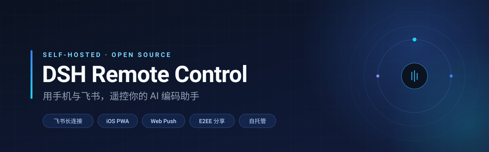
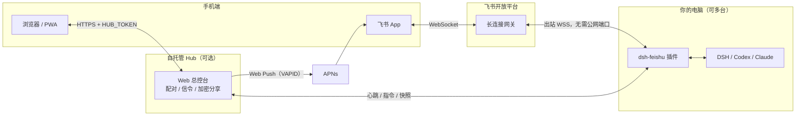

<p align="center">
  
</p>

<h1 align="center">DSH Remote Control</h1>

<p align="center">
  把正在运行的 AI 编码任务接到手机与飞书：看进度、批准工具调用、插话、继续。<br/>
  纯出站长连接，不开公网端口，不经过任何第三方中继服务器。
</p>

<p align="center">
  <a href="LICENSE"></a>
  = 20" />
  
  <a href="CONTRIBUTING.md"></a>
</p>

<p align="center">
  <a href="README.en.md">English</a> · <a href="#快速开始">快速开始</a> · <a href="#功能">功能</a> · <a href="SECURITY.md">安全模型</a> · <a href="#路线图">路线图</a>
</p>

---

## 它解决什么问题

你在电脑上让 AI 跑一个重构任务，然后出门。接下来一小时内，它可能：

- 卡在一个工具调用上，等你点「批准」；
- 跑完了，但你想立刻知道结果；
- 跑偏了，你想马上补一句「别动测试文件」。

飞书机器人 + 一个自托管的总控台，把这三件事搬到手机上。**电脑不需要公网 IP，路由器不需要端口映射**——所有连接都是本机主动向外发起的。

## 架构



- **只要飞书**：跑 `dsh-feishu` 插件就够了，Hub 可以完全不部署。
- **要远程建会话、多机切换、网页回放、锁屏推送**：加一个 Hub（Cloud Run 或本地都行）。

## 快速开始

### 30 秒：先看看界面（不需要飞书）

Hub 零运行时依赖，克隆下来直接跑：

```bash
git clone https://github.com/oscarka/deepseekharness-remotecontrol.git
cd deepseekharness-remotecontrol

HUB_TOKEN="$(openssl rand -hex 16)" PORT=8080 npm start
# 打开 http://localhost:8080 ，用上面这个 HUB_TOKEN 登录
```

或者用 Docker：

```bash
docker build -t dsh-remote .
docker run --rm -p 8080:8080 -e HUB_TOKEN=your-strong-token dsh-remote
```

### 10 分钟：接入飞书

<details>
<summary><b>第一步 · 创建飞书自建应用</b>（点开）</summary>

1. 在[飞书开放平台](https://open.feishu.cn/)创建**企业自建应用**，启用**机器人**能力。
2. 申请最小权限集：
   - `im:message.p2p_msg:readonly` —— 接收单聊消息
   - `im:message:send_as_bot` —— 以机器人身份发消息
   - （可选）群聊 @ 消息读取权限
3. 事件订阅：添加 `im.message.receive_v1`，订阅方式选 **长连接**（不需要回调地址）。
4. 发布版本并等管理员审核通过，然后把机器人加进你的单聊。

</details>

<details>
<summary><b>第二步 · 在电脑上装插件并写配置</b>（点开）</summary>

```bash
# 安装插件（Desktop App 用 desktop profile）
dsh plugin --profile desktop add /path/to/deepseekharness-remotecontrol/dsh-feishu
```

创建密钥文件（权限必须是 `0600`，插件启动时会校验）：

```bash
install -m 600 /dev/null ~/.dsh/feishu.env
cat > ~/.dsh/feishu.env <<'EOF'
FEISHU_HOST_NAME=办公Mac
FEISHU_APP_ID=cli_xxxxxxxxxxxxxxxx
FEISHU_APP_SECRET=xxxxxxxxxxxxxxxxxxxxxxxxxxxxxxxx
FEISHU_ALLOWED_OPEN_IDS=ou_xxxxxxxxxxxxxxxxxxxxxxxxxxxxx

# 可选：接入自托管 Hub
FEISHU_HUB_URL=https://your-service.run.app
FEISHU_HUB_TOKEN=你的总控台Token
EOF
chmod 600 ~/.dsh/feishu.env
```

> 不知道自己 `open_id`？先给机器人发一条消息，它会回你；或者暂时留空 `FEISHU_ALLOWED_OPEN_IDS` 跑一次诊断后再填。

</details>

<details>
<summary><b>第三步 ·（可选）部署 Hub 到 Cloud Run</b>（点开）</summary>

```bash
export PROJECT_ID="你的-gcp-project-id"
export REGION="asia-east1"
export HUB_TOKEN="自定义一个强密码"
./deploy-cloudrun.sh
```

部署完成后把输出的 Service URL 填进每台电脑的 `FEISHU_HUB_URL`。

</details>

## 功能

| 能力 | 说明 |
| --- | --- |
| **飞书日常控制** | `!sessions` 任务列表、`!new` 远程新建、`!steer` 运行中插话、`!files` 工作区浏览 |
| **审批与推送** | 工具调用卡片直接批准/拒绝；完成与异常推送到飞书，或经 Web Push 弹到 iPhone 锁屏与 Apple Watch |
| **多机主从** | 一个机器人管多台电脑，`!hosts` 一键切换当前受控主机，避免多机抢消息 |
| **一键迁移** | 网页上选「源 ➔ 目标」，加密打包 `~/.dsh` 会话与配置，切控制权，可选清空源机 |
| **网页总控台** | 会话回放（含思考过程与工具步骤）、文件树与安全预览、运行中打断重发 |
| **端到端加密分享** | AES-256-GCM，密钥只存在于 URL `#k=` 片段，服务端只存密文 |
| **设备指纹** | Ed25519 公钥锁定 + 12 位指纹，支持一键吊销与重置 |
| **手机接入** | 6 位配对码 / 免密链接登录，自托管 WebRTC 信令与 TURN 临时凭据 |
| **PWA** | 添加到 iPhone 主屏幕即为全屏 App，5 Tab 原生交互 |

### 支持的后端

| Harness | 状态 |
| --- | --- |
| DeepSeek Harness (DSH) | 完整支持（控制、审批、插话、会话管理） |
| Codex | 支持（观察 + 新建任务，取决于版本） |
| Claude Code | 支持（观察 + 新建任务，取决于版本） |
| Antigravity IDE | 实验性 |

> 各后端能力差异由 `dsh-feishu/lib/harness-router.js` 的能力矩阵决定；也可以在 `~/.dsh/feishu.env` 用 `FEISHU_ENABLED_HARNESSES=dsh,codex` 限定启用的后端。

## 飞书命令速查

| 飞书发送 | 作用 |
| --- | --- |
| `连接` / `!connect` | 开启远程模式（2 小时有效），汇总运行中任务、待审批与离线期间完成的任务 |
| `断开` / `!disconnect` | 退出远程模式，停止完成推送 |
| `!sessions` | 任务列表卡片（查看详情、停止运行中任务、继续已完成任务） |
| `!new <任务指令>` | 在当前电脑工作区新建会话并开始执行 |
| `!steer <补充指令>` | 向运行中的任务实时插话，或排入下一轮队列 |
| `!files [子目录]` | 查看当前任务工作区文件 |
| `!share` | 为当前任务生成端到端加密的对话回放链接 |
| `!hosts` / `主机` | 查看所有已接入电脑并一键切换控制权 |
| `!host <电脑名或ID>` | 直接切换到指定电脑 |
| `!web` | 获取 Web 总控台链接 |
| `!approve <code>` / `!deny <code>` | 批准或拒绝工具调用（卡片上也可直接点） |
| `!whoami` | 查看自己的飞书 `open_id` |

## 安全

这个项目持有飞书 `App Secret`、Hub Token 和设备私钥，所以安全边界写得很明确：

- **默认零入站端口**：飞书链路是纯出站长连接；Hub 是唯一对外暴露的面，且需要 `HUB_TOKEN`。
- **密钥文件强制 `0600`**，启动时校验，不合格直接拒绝启动。
- **白名单**：`FEISHU_ALLOWED_OPEN_IDS` 之外的发送者不会拿到任何会话信息。
- **审计日志**：`~/.dsh/feishu-audit.jsonl`，同样 `0600`。
- **分享加密**：服务端只见密文，解密密钥不出现在任何请求里。

完整威胁模型、已知限制与密钥轮换方法见 **[SECURITY.md](SECURITY.md)**。发现漏洞请走 GitHub Security Advisories，不要开公开 issue。

## 路线图

- [x] 飞书长连接控制 + 审批 + 完成推送
- [x] 自托管 Hub、多机切换、一键迁移
- [x] E2EE 分享、设备指纹、配对码、Web Push
- [ ] 无飞书的一键本地模式（单命令启动）
- [ ] 演示视频与截图
- [ ] 更多 Harness 适配与能力对齐
- [ ] 更完整的英文文档

## 参与

欢迎 issue 和 PR。开始之前请读 [CONTRIBUTING.md](CONTRIBUTING.md)，尤其是「不要提交任何真实密钥」这一条。

```bash
git clone https://github.com/oscarka/deepseekharness-remotecontrol.git
cd deepseekharness-remotecontrol

npm install                      # 前端构建依赖
npm --prefix dsh-feishu install  # 插件依赖（跑测试需要）
npm test
npm run dev                      # 调试 Web 总控台前端
```

> Hub 本身只用了 Node 内置模块，`npm start` 不需要任何依赖。

## 许可

[MIT](LICENSE) © 2026 oscarka

> **免责声明**：本项目为独立实现，与 DeepSeek、飞书、`dsh.r2049.cn`、`go.dshtui.com` 的运营方无隶属、合作或背书关系。请自行确认你的使用场景符合所在组织与相关服务条款的要求。
