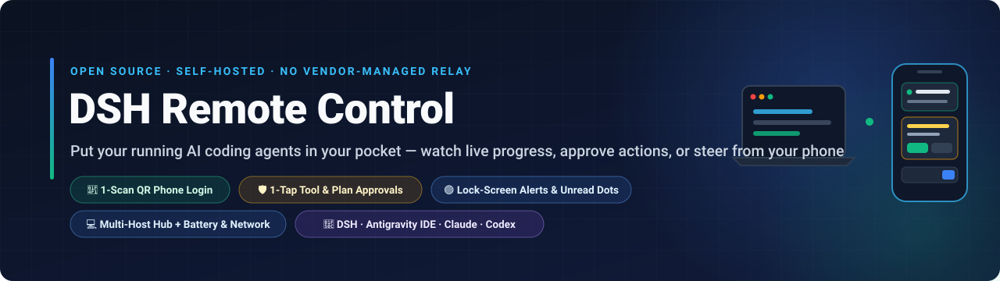
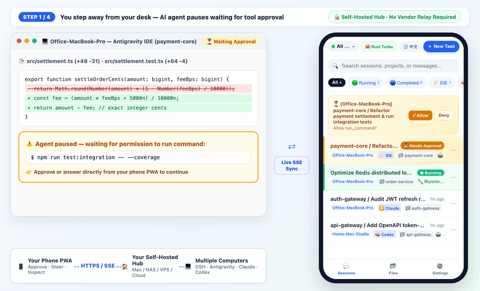
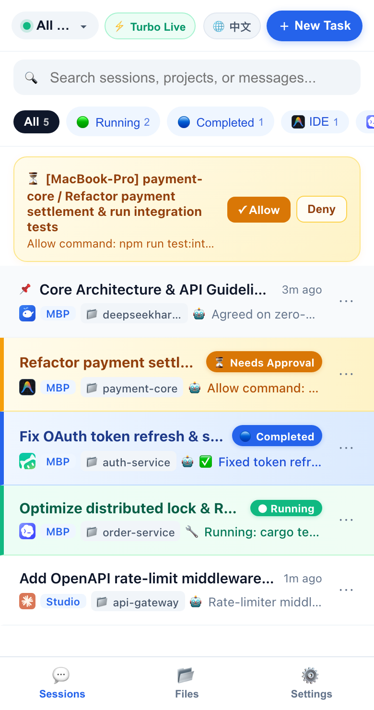
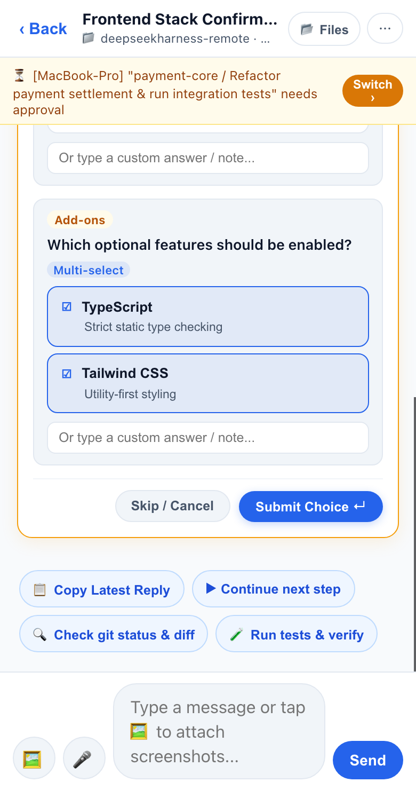
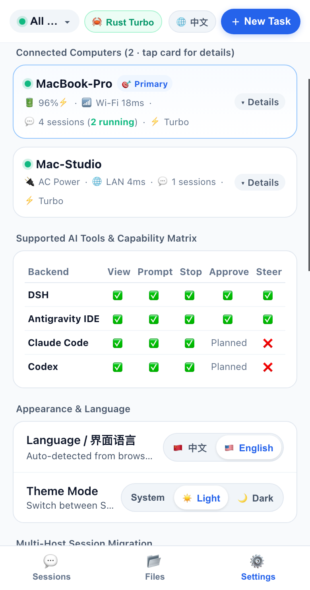
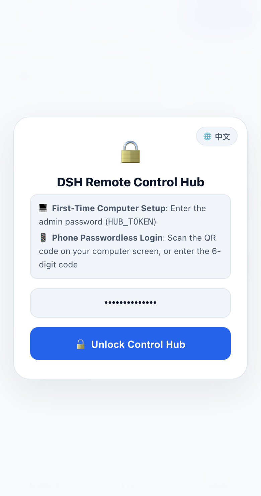
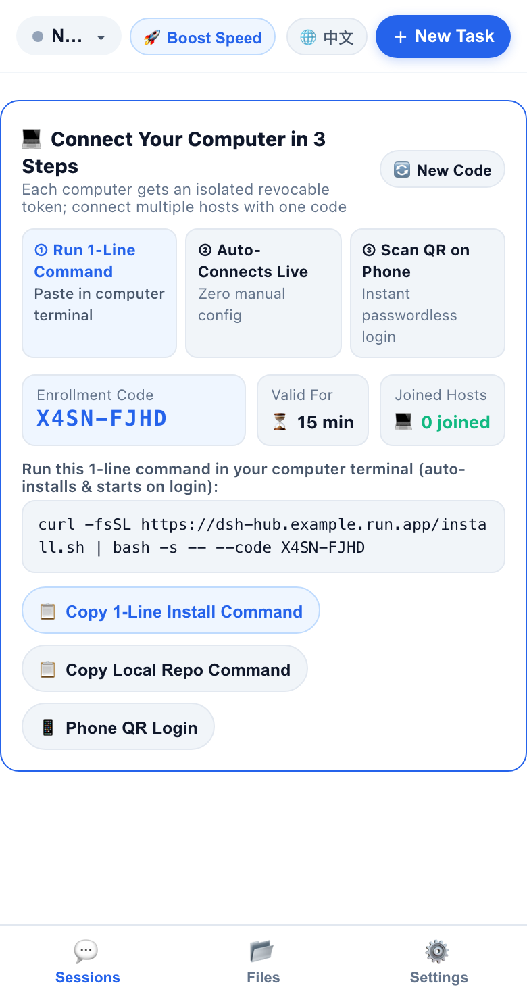
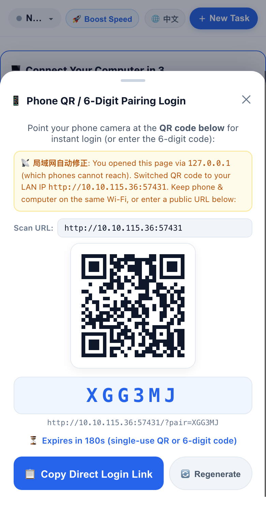

<div align="center">
  

  <p align="center">
    <strong>Your AI Coding Agents, Under Your Control — No Vendor-Managed Relay Required.<br/>Monitor live progress, steer running tasks, stop runaway loops, or tap to approve commands &amp; multiple-choice popups from your phone.<br/>Deploy your own self-hosted Control Hub on your computer, NAS, VPS, or Cloud Run.</strong>
  </p>

  <p align="center">
    
    
    = 20" />
    
  </p>

  <p align="center">
    <a href="https://railway.com/deploy/dsh-remote-control-hub?referralCode=44kg1p&amp;utm_medium=integration&amp;utm_source=template&amp;utm_campaign=generic"></a><br/>
    <sub>💡 Auto-generates a strong <code>HUB_TOKEN</code> password (or customize it to your own strong password before clicking Deploy).</sub>
  </p>

  <p align="center">
    <strong>🇺🇸 English</strong> · <a href="./README.zh-CN.md">🇨🇳 简体中文</a> · <a href="#get-started-in-3-steps">3-Step Setup</a> · <a href="#supported-ai-coding-tools">Supported Tools</a> · <a href="#whats-new">What's New</a> · <a href="#faq">FAQ</a>
  </p>
</div>

<div align="center">
  
  <br/>
  <sub><strong>🎬 15-Second Live Walkthrough:</strong> Computer pauses on a test command → Open mobile PWA &amp; tap <code>Submit ↵</code> → Computer immediately runs all 42 tests &amp; syncs the conclusion back to your phone.</sub>
</div>

<br/>

<table align="center">
  <tr>
    <td align="center" width="33%">
      <br/>
      <sub><strong>① Unified 5-Tool Session List</strong><br/>Live tasks across DSH, Antigravity IDE, Codex, WorkBuddy &amp; Claude with approval bar &amp; unread dot</sub>
    </td>
    <td align="center" width="33%">
      <br/>
      <sub><strong>② Approve &amp; Answer on Phone</strong><br/>Tap to approve shell commands or answer interactive multiple-choice popups</sub>
    </td>
    <td align="center" width="33%">
      <br/>
      <sub><strong>③ Multi-Host &amp; Telemetry</strong><br/>Monitor connected computers (battery %, AC power, Wi-Fi latency) &amp; switch EN/中文</sub>
    </td>
  </tr>
</table>

---

## Why DSH Remote Control?

When you kick off a long refactoring, test suite, or deployment in **DeepSeek Harness (DSH)**, **Antigravity IDE**, **OpenAI Codex**, **Tencent WorkBuddy**, or **Claude Code**, stepping away from your desk usually means flying blind:

- **Stuck on a popup**: The agent asks *"Allow `npm run test:integration`?"* or pops up an architecture multiple-choice question — and waits for hours until you return to your keyboard.
- **No visibility on the go**: You want to check whether the task finished, hold-to-talk a quick voice instruction, attach a phone screenshot, or hit emergency stop while away from your desk.
- **Multiple computers**: You have both an office Mac and home workstations running tasks and want one unified mobile view.

**DSH Remote Control** puts all of your computers' AI coding sessions into a clean mobile web app (with **WeChat-style Hold-to-Talk voice input + smart punctuation**, iOS 16.4+ Home Screen lock-screen push notifications, and automatic English/Chinese UI detection).

---

## How It Works: Self-Hosted Architecture (No Vendor Relay Required)

Before starting, it helps to understand the two lightweight pieces and how data flows between them:

```
┌──────────────────────────┐         HTTPS / Live SSE          ┌─────────────────────────────────┐
│     📱 Your Phone PWA    │  ◄─────────────────────────────►  │   🏠 Your Self-Hosted Hub       │
│  Approve · Steer · Files │                                   │  (Your Mac / NAS / VPS / Cloud) │
└──────────────────────────┘                                   └────────────────┬────────────────┘
                                                                                │ Outbound HTTPS
                                                       ┌────────────────────────┴────────────────────────┐
                                                       ▼                                                 ▼
                                      ┌─────────────────────────────────┐               ┌─────────────────────────────────┐
                                      │ 💻 Computer A (Office MacBook)  │               │ 💻 Computer B (Home Workstation)│
                                      │ DSH · Antigravity · Claude      │               │ DSH · Codex · Antigravity       │
                                      └─────────────────────────────────┘               └─────────────────────────────────┘
```

1. **Control Hub (`控制台`)**: A tiny, zero-dependency Node.js web server that you deploy yourself (on your computer, NAS, VPS, or your own Cloud Run/Railway account). You never have to route your sessions through a third-party vendor's central SaaS relay.
2. **Computer Daemon (`connect-host.sh`)**: A background agent installed on each of your Mac/Linux computers via a 1-line command. It watches your local AI coding sessions and connects outbound to your Control Hub (so your computer does **not** need a public IP or port forwarding).

> **Transparent Data Boundary**: Your self-hosted Control Hub holds recent session metadata and active conversation snapshots in memory so your phone can open chats instantly. Full project source files, screenshots, and videos stay on your computers and stream directly on demand over a dedicated reverse HTTP tunnel (`HTTP 206 Range` video scrubbing, smart thumbnails, and short-lived read-only `mediaTicket` URLs that never expose `HUB_TOKEN`). Share links (`/share/:id#k=...`) use client-side AES-256-GCM end-to-end encryption. See [`SECURITY.md`](./SECURITY.md) for full details.

---

## Get Started in 3 Steps

> **⚡ Zero-Config 1-Command Install via DSH Market / `dsh plugin` (Instant Same-Wi-Fi Control)**:
> If you already use **DeepSeek Harness (DSH >= 0.2.0)**, install directly from **DSH Market (`dsh-plugin-market`)** or run one command in your terminal:
> ```bash
> dsh plugin --profile desktop add github:oscarka/deepseekharness-remotecontrol
> # Or use --profile web if you run `dsh web`
> ```
> No configuration files needed! Right after enabling, the plugin automatically starts an embedded Local Control Hub on your computer (default `http://localhost:8788`, saving your local admin token to `~/.dsh/local-hub.token` and writing a 1-tap phone pairing URL to `~/.dsh/local-hub-info.json` and the startup log). Connect your phone to the same Wi-Fi to control everything immediately — or follow the 3 steps below anytime to upgrade to 24/7 cellular 4G/5G multi-computer control.

### Step 1: Start Your Control Hub (Pick 1 of 4 Ways)

Choose the deployment method that best fits how you use your phone:

#### 🌟 Option A: Google Cloud Run (Author's Daily Setup · Recommended for 24/7 4G/5G Access Anywhere)
If you want to control your home/office computers from anywhere on cellular 4G/5G without keeping a VPS running, deploy the Control Hub to Google Cloud Run (scales to zero when idle, free-tier friendly, built-in HTTPS):

```bash
git clone https://github.com/oscarka/deepseekharness-remotecontrol.git
cd deepseekharness-remotecontrol

# Replace with your GCP project ID and your chosen password
GCP_PROJECT_ID="your-gcp-project-id" \
HUB_TOKEN="choose-a-strong-password" \
./deploy-cloudrun.sh
```
Once deployed, the script prints your `https://dsh-remotecontrol-hub-xxx.run.app` URL.

#### 🏠 Option B: Run Locally on Your Computer (Fastest 30s Tryout · Same Wi-Fi, $0 Cost)
No cloud account or Docker needed. Clone the repo and start the Control Hub directly on your computer (requires Node.js >= 20):

```bash
git clone https://github.com/oscarka/deepseekharness-remotecontrol.git
cd deepseekharness-remotecontrol

# Replace choose-a-password with your own password
HUB_TOKEN="choose-a-password" PORT=8080 npm start
```
The terminal will print both `http://localhost:8080` and your LAN URL (e.g. `http://192.168.1.x:8080`).

#### ☁️ Option C: 1-Click Cloud Deploy on Railway (No CLI Required)
Click the **Deploy on Railway** button at the top of this README — the template automatically generates a random `HUB_TOKEN` password (which you can customize to your own strong password) and provisions your public `https://...` URL in ~1 minute.

#### 🐳 Option D: VPS / NAS / Raspberry Pi (Docker or Cloudflare Tunnel)
If you have a home server, NAS, or VPS, you can run the prebuilt Docker image (or run `npm start` + a free tunnel like `cloudflared tunnel --url http://localhost:8080`):

```bash
docker run -d --name dsh-hub \
  --restart unless-stopped \
  -p 8080:8080 \
  -v dsh-hub-data:/data \
  -e HUB_TOKEN="choose-a-password" \
  ghcr.io/oscarka/deepseekharness-remotecontrol:latest
```

<div align="center">
  <br/>
  <sub><strong>Step 1 Result:</strong> Open your Control Hub URL in your computer browser and enter your <code>HUB_TOKEN</code> password (tap <code>🌐 EN / 中文</code> top-right to switch language).</sub>
</div>

---

### Step 2: Connect Your Computer (1-Line Command)

After unlocking the Control Hub on your computer browser, you will see the **Connect Your Computer in 3 Steps** card with a 15-minute enrollment code:

1. Click **`📋 Copy 1-Line Install Command`** (or **`📋 Copy Local Repo Command`** if you already cloned the repo).
2. Paste and run it in your computer's terminal:
   ```bash
   curl -fsSL https://your-hub-url/install.sh | bash -s -- --code ABCD-1234
   ```
3. The script automatically registers your computer with a dedicated revocable credential, installs the background LaunchAgent/systemd service, and connects live within 2 seconds.

<div align="center">
  <br/>
  <sub><strong>Step 2 Screen:</strong> Copy the 1-line command from the onboarding card and run it in your computer terminal.</sub>
</div>

---

### Step 3: Scan QR Code on Your Phone (Passwordless Login)

1. In your computer browser, click **`📱 Phone QR Login`**.
2. Point your phone's camera at the QR code on screen — your phone logs in immediately without typing the password!
   - *Smart LAN Detection*: If you opened `http://localhost:8080` on your computer, the QR sheet automatically switches the QR code URL to your computer's LAN IP (`http://192.168.x.x:8080`) so your phone on the same Wi-Fi connects on the first try.
3. **Optional (Recommended on iPhone)**: In Safari, tap **Share → Add to Home Screen**, open the app from your Home Screen, and enable **Lock-Screen Push** in **Settings** to receive instant alerts when a task finishes or needs approval.

<div align="center">
  <br/>
  <sub><strong>Step 3 Screen:</strong> Scan the QR code with your phone camera for instant passwordless login.</sub>
</div>

---

## Supported AI Coding Tools

The background daemon automatically discovers local sessions across all 6 supported coding tools on your machine:

| AI Coding Tool | View Live Sessions | New / Resume Prompt | Emergency Stop | Mobile Approval & Question Popups | Live Mid-Run Steer |
| :--- | :---: | :---: | :---: | :---: | :---: |
| **DeepSeek Harness (DSH)** | ✅ | ✅ | ✅ | ✅ *(Shell approvals + `ask_user_question` / `exit_plan_mode` cards)* | ✅ |
| **Antigravity IDE** | ✅ | ✅ | ✅ | ✅ *(Connect-RPC + native keystroke injection)* | ✅ |
| **OpenAI Codex** | ✅ | ✅ *(`codex app-server` + `codex exec` fallback)* | ✅ | ✅ *(JSON-RPC approvals & question cards via `app-server`)* | ✅ |
| **Tencent WorkBuddy** | ✅ | ✅ *(ACP HTTP+SSE)* | ✅ | ✅ *(ACP permission popups)* | ✅ |
| **Claude Code** | ✅ | ✅ *(via `claude --resume`)* | ✅ | ⏳ *Planned* | — |
| **Doubao Desktop (`豆包电脑版`)** | ✅ *(Observe-only)* | — | — | — | — |

---

<a id="whats-new"></a>
## 📅 What's New (Recent Releases)

- **`2026-11-13 · v0.7.1` — Subagent Lifecycle Folding in Parent Chat & ChatGPT-Style Unboxed Document Flow**
  - **Automatic Subagent Folding & Orphan Subagent Filtering (`v0.7.1`)**: Recognizes subagent tasks across Antigravity IDE (`invoke_subagent` / `parentConversationId`), DSH (`origin: 'subagent'`), and Claude Code (`subagents/agent-*.jsonl`). Subagent runs fold directly into the parent conversation's collapsible tool steps (`🟢 Subagent Running: <Role>` → `🤖 Subagent Completed: <Role> ✅`) with full role, prompt, and reported findings inline, while standalone subagent chats are automatically filtered out across Host, Cloud Hub, and Mobile Web (also fixing protobuf `0x24` length-prefix collisions that previously surfaced raw 36-char UUIDs as session titles).
  - **ChatGPT-Style Unboxed Document Flow for AI Replies (`v0.7.1`)**: Removed the outer card border and background box around assistant messages so Markdown headings, tables, code blocks, thinking panels, and tool chips flow directly across the full mobile viewport width (`~15%` wider reading area), keeping only user prompts inside right-aligned pill bubbles.

- **`2026-11-12 · v0.7.0` — Official DSH Market Bundle Support, Zero-Config Embedded Local Hub & Universal Mobile Video Engine (`v0.6.9`)**
  - **1-Click DSH Market Install & Zero-Config Local Hub (`v0.7.0`)**: Full root-level DSH `>= 0.2.0` plugin bundle manifest (`dsh.bundle.patch`, `engines.dsh`, `icon.svg`, `locale/{en,zh,zh-CN}.json`, `cordis.patch.yml`). Installing from DSH Market or via `dsh plugin --profile desktop add github:oscarka/deepseekharness-remotecontrol` works out of the box with zero config — automatically starting an embedded Local Control Hub on port `8788` (`~/.dsh/local-hub.token` + 24h Wi-Fi pairing link) and seamlessly switching to remote Cloud Hub mode whenever `FEISHU_HUB_URL` is configured.
  - **3-Tier Adaptive Video Compatibility Engine & True Zero-Buffering Stream Tunnel (`v0.6.9`)**: Zero-dependency `< 2ms` ISO BMFF (`mp4`/`mov`) codec & `moov` parser automatically routes **L1 Direct Original**, **L2 Lossless `faststart` Remux**, and **L3 Hardware-First H.264 Transcoding** (`h264_videotoolbox` → `libx264` → macOS `/usr/bin/avconvert`), fixing `yuv444p`, `.mov`, `.webm`, and `.mkv` playback on iOS Safari; upgraded `/api/fs-tunnel` to zero-buffering stream piping (`TTFB < 100ms`) with multi-Range lossless downloads for `> 16 MiB` videos and stateless deterministic `mediaTicket` signing.

- **`2026-11-12 · v0.6.8` — Mobile Sandboxed HTML Live Preview, iOS-Safe Video Save/Share & Doubao Desktop Observe-Only Adapter**
  - **Mobile Interactive HTML Live Preview & Fullscreen Experience (`v0.6.8`)**: Open and interact with AI-generated `.html` pages right inside mobile DSH—from fenced ```` ```html ```` code blocks (`🌐 Live Preview`), `.html` file chips / artifact cards (`🌐 Live Preview ›`), or the project file browser. Runs inside an isolated `null`-origin `<iframe sandbox="allow-scripts allow-forms allow-modals allow-popups" srcdoc="...">` (never exposing `HUB_TOKEN` or `localStorage`), auto-injects mobile `<meta name="viewport">`, rewrites relative CSS/JS/images via read-only `mediaTicket` URLs, and includes a fullscreen overlay with a safe-area **`‹ Back to Chat`** bar and **`</> Source` / `🌐 Preview`** toggle.
  - **iOS Home Screen PWA In-Place Video Save/Share & Doubao Desktop Adapter (`v0.6.8`)**: Replaced raw `<a download>` navigation links (which trapped iOS standalone web apps on a system screen with no Back button) with in-place streaming `fetch` + native iOS/Android Share Sheet (`Save Video` to Photos / `Save to Files` / AirDrop); added observe-only session & coding board discovery for **Doubao Desktop (`豆包电脑版`)** with incremental LevelDB caching and `10m` stale-running cleanup.
  - **WeChat-Style Hold-to-Talk Voice, Smart Punctuation, Redesigned New Task Sheet & Pinned-First Sorting (`v0.6.3–v0.6.7`)**: Toggle between **`🎙️ Hold to Talk`** (release to send, slide left to cancel, slide right to edit, with `650ms` live pause commas & automatic Chinese sentence punctuation) and **`⌨️ Type`**; compact New Task sheet with single-row project pills + searchable folder drawer; pinned (`📌`) & unread completed (`🔵`) sessions sort above background running jobs; plus `state_delta` incremental SSE (`98%+` lower bandwidth, `v0.6.0–v0.6.1`).

- **`2026-11-11 · v0.5.8` — Tencent WorkBuddy Production Hardening, Dead-ACP Auto-Recovery & Direct Mobile Speech Recognition**
  - **WorkBuddy v5.9.3 Production Loop & Auto-Recovery**: Isolated `workbuddy-cli` OAuth credentials via `ACC_PRODUCT_CONFIG_PATH` (never logging out WorkBuddy Desktop, with standalone `node dsh-feishu/daemon.mjs --workbuddy-login` pre-auth), per-`cwd` `codebuddy --serve` ACP process pool with automatic dead-server eviction/respawn across new sessions, follow-up prompts, and live `steer()`, automatic `~/WorkBuddy/<timestamp>` Playground folder routing for mobile new tasks, and bidirectional `workbuddy.db` + `.jsonl` sync.
  - **Direct Mobile Native Speech Recognition (`v0.6.2`)**: Tapping `🎤` directly invokes the phone's built-in speech recognition without popping up the soft keyboard, with clear `audio-capture` conflict feedback and automatic fallback when restricted in iOS Home Screen containers.
  - **Sub-Second Desktop-to-Mobile Approval Dismissal & Zero-Keystroke Idempotency (`v0.5.7`)**: Shortened live trajectory summary cache TTL to `350ms` while approvals are pending and hardened `executeAntigravityIdeAction` so late mobile taps on desktop-settled approvals immediately return `connect-rpc-noop` (`alreadySettled: true`) instead of matching historical `requestedInteraction` fields or injecting fallback keystrokes.

- **`2026-11-11 · v0.5.6` — Streaming Reverse File Tunnel, Mobile `206 Range` Video Player, Zero-Flicker Chat & Cloud Run SSE Resilience**
  - **Reverse HTTP Streaming File Tunnel & Mobile Video Player**: Added a dedicated `/fs/list|read|stream` + `/api/fs-tunnel` binary channel with `0ms` Host SSE wakeup (`event: fs_req`), eliminating `/api/state` polling storms. Supports `HTTP 206 Partial Content` video scrubbing (`<video playsinline>`), 1-tap H.264 compatibility transcoding (`ffmpeg` / macOS `avconvert`), smart `sips` thumbnails that preserve tall-screenshot text sharpness with a 1-tap lossless toggle, `walkthrough.md` hot-cache pre-warming, and short-lived read-only HMAC `mediaTicket` URLs.
  - **Zero-Flicker Mobile Message Delivery & Cloud Run HTTP/2 Resilience**: Fixed optimistic chat bubble lifecycle and added Hub `inflightCommands` tracking so prompts sent over mobile/Cloud Run never vanish and reappear; added 240s graceful SSE rotation (`event: rotate`, avoiding Cloud Run's 300s hard connection reset) plus idempotent client command IDs with automatic silent retry on iOS `Load failed` blips.
  - **Deep Codex (`app-server`) & Tencent WorkBuddy (`ACP`) Integration**: Full managed JSON-RPC / ACP streaming, mid-run steering, mobile command approvals, interactive question popups, and dynamic model discovery, plus 99.9% lower steady-state traffic via lite heartbeats & Gzip (`v0.5.3–v0.5.4`).

- **`2026-11-09 · v0.5.0` — Bilingual Console (`EN` / `中文`), Inline Chat Images/File Chips & Fast-Flush File Preview**
  - **Bilingual Web Console**: Added automatic browser language detection (`en` / `zh`) plus a 1-tap `🌐 EN / 中文` switcher in the Login screen, Top Bar, and Settings.
  - **Inline Chat Images & Clickable File Chips**: Local images generated by DSH or Antigravity IDE (including `.gemini/antigravity/brain/` artifacts and `carousel` blocks) render directly inside mobile chat bubbles, and local `[file.py](file:///...)` links render as 1-tap code/asset preview chips with instant Hub blob caching and daemon fast-flush (`<200ms`).
  - **DSH Multiple-Choice & Plan Popups**: Full mobile support for DSH `ask_user_question` (single/multi-select + custom note) and `exit_plan_mode` plan confirmation cards.
  - **First-Time Onboarding & Cloud Run Resilience**: Automatic `~/.dsh/hub-state.json` fallback when running without Docker, automatic LAN IP substitution for `localhost` QR codes, and stateless `hst_...` host token auto-recovery across Cloud Run container scaling.
  - **Host Power & Network Telemetry**: Settings cards display real-time laptop battery percentage, charging/AC status, low-battery warnings, and Wi-Fi/LAN latency (`rttMs`).
- **`2026-11-07 · v0.4.0` — 1-Line Enrollment, Per-Host Revocable Credentials & Mobile Screenshot Upload**
  - Added 15-minute multi-host enrollment codes (`/install.sh`), per-host Ed25519 fingerprint pinning & independent token revocation, and mobile camera/photo-library screenshot attachments with client-side Canvas compression.
- **`2026-11-06 · v0.3.0` — Multi-Harness Support (Antigravity IDE, Claude Code, Codex) & Rust Turbo Engine**
  - Added unified session discovery and remote control for Antigravity IDE, Claude Code, and OpenAI Codex alongside DSH, powered by the `dsh-turbo` native accelerator and bidirectional SSE streaming.
- **`2026-11-05 · v0.2.0` — iOS 16.4+ Lock-Screen Web Push, Cross-Host Migration & E2EE Session Replay**
  - Added RFC 8291/8292 zero-dependency Web Push lock-screen notifications, 1-click cross-computer session migration, and AES-256-GCM end-to-end encrypted shareable replay links (`#k=`).

---

## Security & Privacy

- **Mandatory Password Gate**: The Control Hub refuses to start unless `HUB_TOKEN` is set, and protects login/pairing endpoints with brute-force rate limiting.
- **Per-Computer Isolated Tokens**: Each enrolled computer receives its own token (`hst_...`) and Ed25519 device fingerprint. You can revoke any single computer in **Settings** without affecting other machines.
- **End-to-End Encrypted Sharing**: When you generate a session replay link, encryption happens on your computer using AES-256-GCM; the decryption key stays in the URL `#k=` fragment and is never sent to the server.
- **Transparent Plugin Permissions Disclosure**: When installed as a DSH plugin, this package reads local AI coding session directories on your machine (`~/.dsh`, Antigravity, Codex, Claude Code, WorkBuddy, Doubao) and streams workspace files only on explicit user preview requests. It contains **zero third-party telemetry and zero vendor relay calls** — listening locally with token/pairing authentication by default, and connecting outbound only if you explicitly configure your own `FEISHU_HUB_URL` or Feishu self-built app credentials.

---

## FAQ

<details>
<summary><strong>1. I clicked "Approve" on my phone, why didn't Antigravity IDE press confirm on my Mac?</strong></summary>
<br/>
On macOS, open <strong>System Settings → Privacy &amp; Security → Accessibility</strong> and enable the switch for Terminal / Node (or tap <strong>🚀 Boost Speed → Unlock Accessibility Permission</strong> inside the mobile console to pop up the macOS authorization dialog remotely).
</details>

<details>
<summary><strong>2. Why didn't my iPhone receive lock-screen push notifications?</strong></summary>
<br/>
iOS only allows Web Push for web apps added to the Home Screen. Open your Control Hub URL in <strong>Safari</strong>, tap <strong>Share → Add to Home Screen</strong>, launch it from your Home Screen icon, and tap <strong>Settings → Enable Push</strong>.
</details>

<details>
<summary><strong>3. How do I uninstall or stop the background agent on my computer?</strong></summary>
<br/>
Run <code>./connect-host.sh --uninstall</code> in the repo directory, or unload the LaunchAgent with:<br/>
<code>launchctl unload ~/Library/LaunchAgents/com.dsh.remotecontrol.plist</code>
</details>

<details>
<summary><strong>4. Why did Tencent WorkBuddy ask for a one-time browser login, or why didn't an already-open Desktop tab refresh live?</strong></summary>
<br/>
• <strong>One-time CLI OAuth</strong>: WorkBuddy Desktop encrypts its GUI token via OS Keychain, so the daemon isolates a dedicated <code>workbuddy-cli</code> OAuth credential (<code>workbuddy-cli.info</code>) so neither side logs the other out. On your first mobile prompt (or via <code>node dsh-feishu/daemon.mjs --workbuddy-login</code>), click <strong>Authorize</strong> once in the browser window opened on your computer.<br/>
• <strong>Desktop session cache</strong>: Mobile turns sync directly to <code>~/.workbuddy/projects/*.jsonl</code> and <code>workbuddy.db</code>. Because WorkBuddy Desktop caches already-opened conversations in memory without watching external file appends, quit and reopen WorkBuddy Desktop (<code>Cmd + Q</code>) when back at your Mac to view mobile turns inside previously opened tabs.
</details>

---

## License

Released under the [MIT License](./LICENSE).
