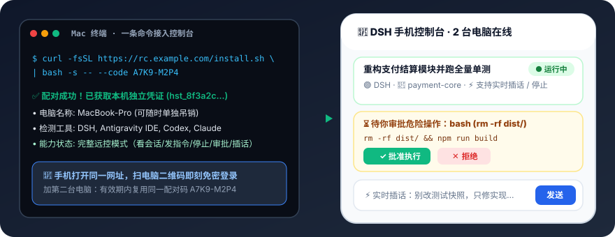

<p align="center">
  
</p>

<h1 align="center">DSH Remote Control</h1>

<p align="center">
  <strong>在手机上盯着并指挥你的 AI 编码任务——看进度、发指令、停止，装了 DSH 还能直接批准危险操作。</strong><br/>
  不是“又一个 ChatGPT 客户端”，也不是“托管服务”。数据留在你自己机器上，控制台放哪由你决定。
</p>

<p align="center">
  <a href="https://railway.app/template?referralCode=dsh-remote"></a>
  <a href="LICENSE"></a>
  
  = 20" />
  <a href="SECURITY.md"></a>
</p>

<p align="center">
  
</p>

---

## 1. 支持矩阵（功能边界诚实版）

界面严格按这张表渲染：**做不到的就不显示按钮，绝不放假按钮**。安装时会自动检测本机已装的工具并明确提示当前所处模式。

| 后端工具 | 看会话 | 发指令 | 停止 | **手机审批** | 实时插话 |
|---|:---:|:---:|:---:|:---:|:---:|
| **DSH (DeepSeek Harness)** | ✅ | ✅ | ✅ | ✅ | ✅ |
| **Antigravity IDE** | ✅ | ✅ | ✅ | ✅ | ✅ |
| **Claude Code** | ✅ | ✅ | ✅ | 计划中 | ❌ |
| **Codex** | ✅ | ✅ | ✅ | 计划中 | ❌ |

> 只装了 Codex 或 Claude Code 时，安装脚本会直接提示：“当前为观察模式，审批功能需要 DSH（支持看会话、发指令、停止）”。

---

## 2. 30 秒跑起来（Docker 一条命令）

镜像支持多架构（`linux/amd64`、`linux/arm64`、`linux/arm/v7`），苹果电脑、普通服务器、NAS、树莓派都能直接跑；强制要求设置管理员密码 `HUB_TOKEN`（不带密码拒绝启动），并挂载 `/data` 持久化数据卷：

```bash
docker run -d --name dsh-hub \
  --restart unless-stopped \
  -p 8080:8080 \
  -v dsh-hub-data:/data \
  -e HUB_TOKEN="自定义一个强密码" \
  ghcr.io/oscarka/deepseekharness-remotecontrol:latest
```

或者使用源码直接启动（零第三方运行时依赖）：

```bash
git clone https://github.com/oscarka/deepseekharness-remotecontrol.git
cd deepseekharness-remotecontrol
HUB_TOKEN="自定义一个强密码" PORT=8080 npm start
```

---

## 3. 完整七步流程（唯一主线）

无论你把控制台部署在哪里，使用流程只有这一条主线（**不需要配置飞书也能完整使用**）：

| 步骤 | 在哪台设备 | 做什么 |
|:---:|---|---|
| **①** | 部署平台 | 部署控制台，得到 **一个网址 + 一个密码**（启动日志会直接打印） |
| **②** | **电脑** | 打开网址，输入管理员密码登录 |
| **③** | **电脑** | 页面提示“本机未接入”，给出一条 **安装命令** + 一个 **配对码** |
| **④** | **电脑** | 复制命令到终端执行（自动装好、自动连上、注册开机自启） |
| **⑤** | **电脑** | 页面自动刷新，出现这台电脑 |
| **⑥** | **手机** | 打开同一网址，**扫电脑上的二维码**直接登录（不用在手机上输密码） |
| **⑦** | **手机** | 看任务、发指令、停止、批准危险操作（取决于后端能力） |

- **加第二台电脑**：重复 ②–⑤，直接用同一个配对码（15 分钟有效期内可多次使用），无需重启控制台。
- **三个东西各司其职**：**网址**是唯一入口，**密码**证明你是主人，**配对码**让电脑加入并为每台电脑签发可单独吊销的独立凭证。

---

## 4. 部署方式选择表（六条路，同一个终点）

所有部署方式最后都汇入上面的**七步流程**。完整配置详见 **[docs/self-hosting.md](docs/self-hosting.md)**：

| 你的情况 | 方案 | 成本 | 难度 | 入口 / 说明 |
|---|---|---|:---:|---|
| 小白，想最快试 | **Railway 一键部署** | 30 天免费试用，之后约 \$5/月 | ★ | [](https://railway.app/template?referralCode=dsh-remote) |
| 有云服务器 | **Docker + 域名 HTTPS** | 服务器本身 | ★★ | 使用仓库自带 `docker-compose.yml` + Caddy/Nginx |
| 有域名、无公网 IP | **Cloudflare 固定隧道** | 域名年费 | ★★ | 本地跑 Docker，`cloudflared tunnel` 暴露 HTTPS |
| 国内网络、要稳定 | **国内内网穿透服务** | 0 起（免费版有限制） | ★★ | 本地跑 Docker + cpolar / frp / natapp |
| 能顺利登录 Tailscale | **Tailscale Funnel** | 0 | ★★★ | `tailscale serve` / `tailscale funnel`（国内登录可能需代理） |
| 只在家用 | **局域网 / NAS / 树莓派** | 0 | ★ | 直接跑上面的 Docker 命令，手机连家庭 Wi-Fi 访问 |

<details>
<summary><b>可选扩展：同时接入飞书机器人通知与卡片控制</b>（点开查看）</summary>

不配飞书，网页与手机 PWA 功能一点不少。如果你希望在飞书里也收到任务完成卡片与审批提醒：
1. 在[飞书开放平台](https://open.feishu.cn/)创建企业自建应用，启用机器人，申请 `im:message.p2p_msg:readonly` 与 `im:message:send_as_bot` 权限，事件订阅选择**长连接**并添加 `im.message.receive_v1`。
2. 在本机 `~/.dsh/feishu.env` 中补充 `FEISHU_APP_ID`、`FEISHU_APP_SECRET`、`FEISHU_ALLOWED_OPEN_IDS` 即可。

</details>

---

## 5. 为什么手机审批目前只有 DSH / Antigravity 能用 + 路线图

AI 编码工具的危险操作审批（如执行 `rm`、联网或写盘命令）需要工具本体暴露“执行前拦截挂钩（Pre-Tool Hook）”或进程内 RPC 接口：

- **DSH 与 Antigravity IDE**：已内置实时插件/RPC 通道，因此能做到手机端一键批准/拒绝、45 秒超时保护与冲突拦截。
- **后续审批扩展路线图（P3）**：
  1. **Claude Code 审批（优先）** —— 官方提供 `PreToolUse` 执行前钩子与权限代理机制，技术路径明确。
  2. **Codex 审批** —— 需从单次 CLI 续聊切换到常驻服务模式。
  3. **通用终端兜底** —— 终端抓屏 + 远程按键注入，覆盖其余 CLI 工具。

### 明确不做

- ❌ **不做托管服务** —— 数据留在你自己的机器与控制台里。
- ❌ **不做多渠道抽象（Telegram / 微信）** —— 保持轻量聚焦。
- ❌ **不做多实例集群** —— 单实例 + `/data` 持久化卷就是最简单可靠的设计前提。

---

## 6. 安全说明

- **不带密码拒绝启动**：控制台未配置 `HUB_TOKEN` 时直接报错退出，杜绝公网空密码裸奔。
- **每台电脑独立凭证、可随时单独吊销**：电脑通过配对码加入后自动获取受限的独立凭证（`hst_...`），仅能上报本机心跳，不能查看其他电脑或调用管理接口；在网页上点一下「吊销」即可立即切断该电脑权限，无需更换主密码。
- **防伪造真实 IP 限流 + 配对码熔断**：默认取底层 Socket 真实 IP（可信反代下取最右侧网关追加 IP），并对配对码设置全局失败次数熔断，防止伪造 `X-Forwarded-For` 暴力枚举。
- **非 root 容器运行**：Docker 镜像以非特权 `node` 用户运行，本机 `~/.dsh/feishu.env` 强制校验 `0600` 权限。
- **端到端加密分享**：会话分享采用 AES-256-GCM 浏览器本地加解密，密钥仅存在于 URL `#key=` 锚点中，服务端只存密文。

完整威胁模型与漏洞披露流程见 **[SECURITY.md](SECURITY.md)**。

---

## 7. 贡献与许可

欢迎提交 Issue 与 PR，开始前请阅读 **[CONTRIBUTING.md](CONTRIBUTING.md)** 与详细工程计划 **[docs/PLAN.md](docs/PLAN.md)**。

```bash
npm install                      # 安装前端构建依赖
npm --prefix dsh-feishu install  # 安装插件测试依赖
npm test                         # 运行完整单元测试与集成测试套件
npm run build                    # 构建前端静态产物
```

[MIT](LICENSE) © 2026 oscarka
