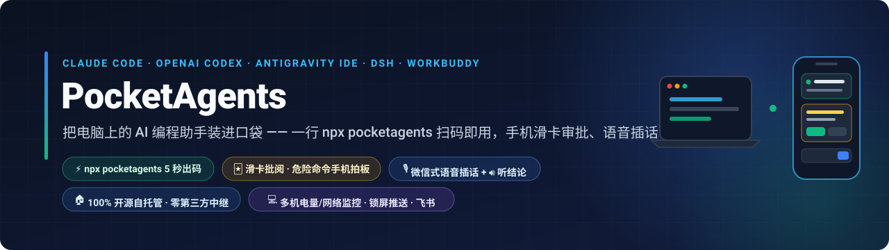
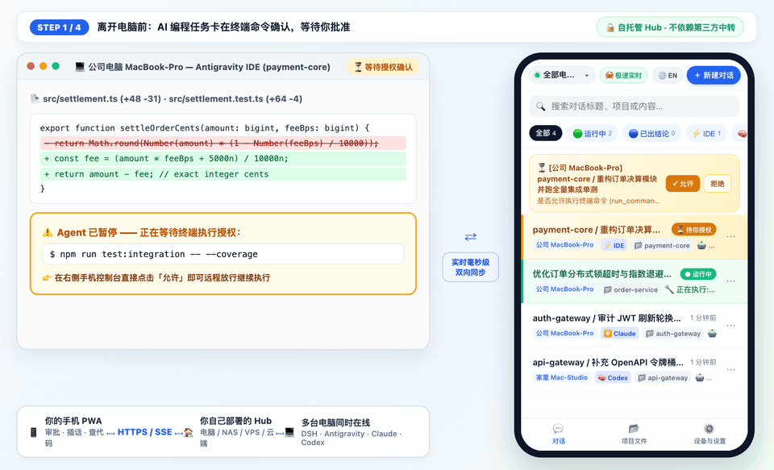
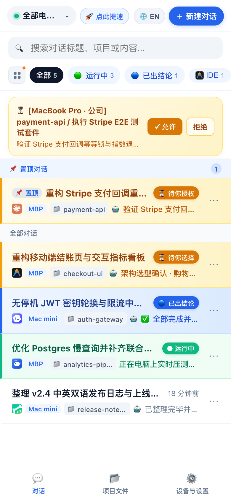
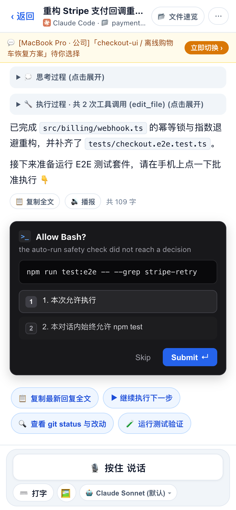
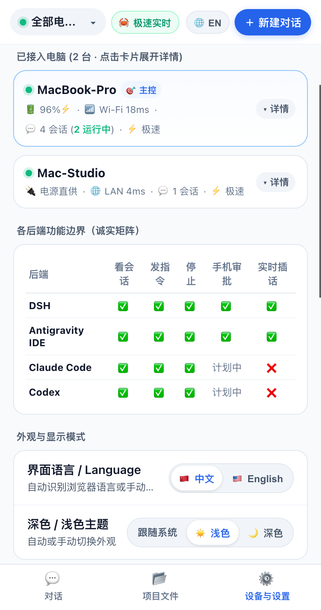
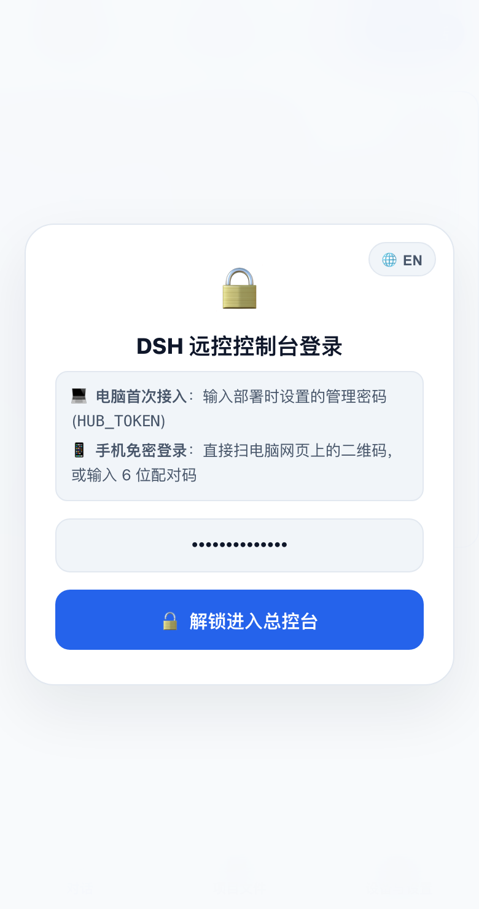
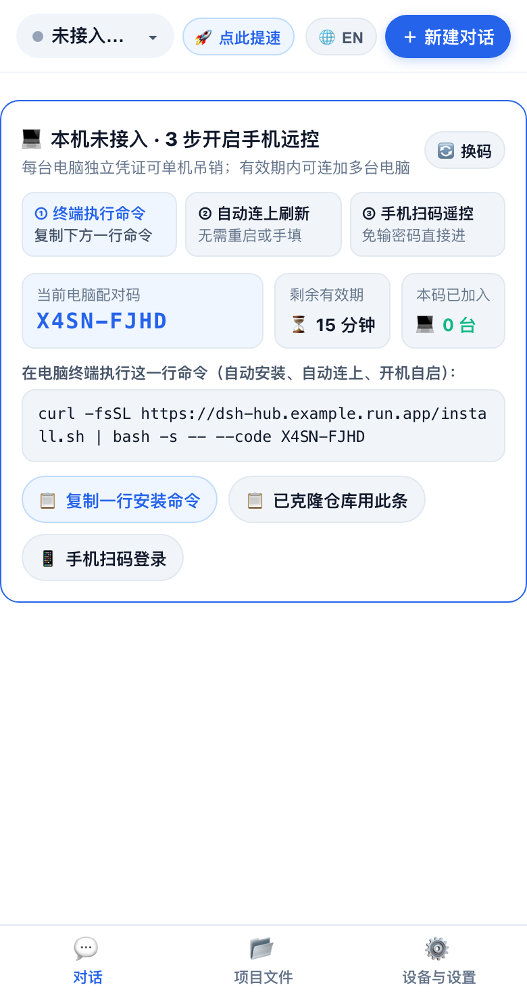
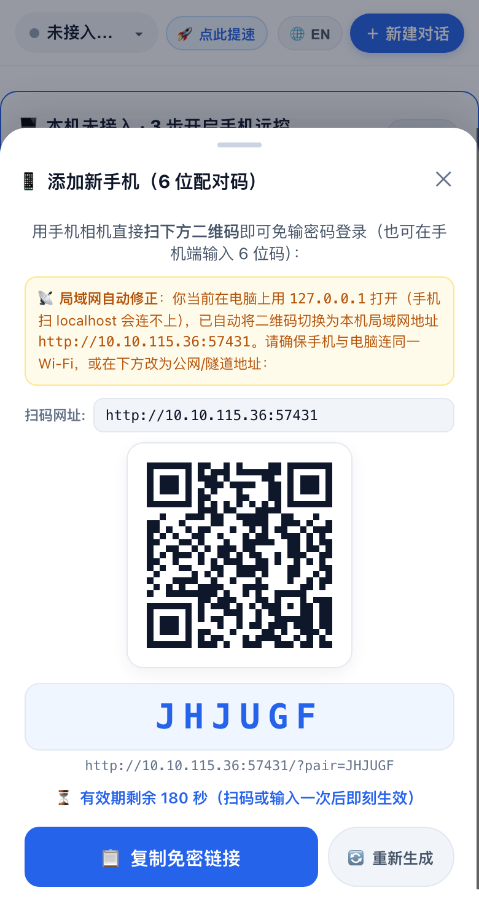

<div align="center">
  

  <p align="center">
    <strong>你的 AI 编程工具，由你自己掌控 —— 不必依赖任何第三方厂商的固定中转服务。<br/>随时在手机上看 AI 编程进度、发指令、紧急叫停，或者点一下批准危险命令与多选弹窗。<br/>支持将控制台一键部署在你自己的 Railway 账号、VPS、NAS 或本机电脑上。</strong>
  </p>

  <p align="center">
    
    
    = 20" />
    
  </p>

  <p align="center">
    <a href="https://railway.com/deploy/dsh-remote-control-hub?referralCode=44kg1p&amp;utm_medium=integration&amp;utm_source=template&amp;utm_campaign=generic"></a><br/>
    <sub>💡 官方模板会自动生成随机强密钥 <code>HUB_TOKEN</code>（部署时也可改成你自己好记的强密码）。</sub>
  </p>

  <p align="center">
    <a href="./README.md">🇺🇸 English</a> · <strong>🇨🇳 简体中文</strong> · <a href="#三步快速上手">三步上手</a> · <a href="#支持的-ai-编程工具">支持工具</a> · <a href="#最近版本更新记录">版本更新</a> · <a href="#常见问题">常见问题</a>
  </p>
</div>

<div align="center">
  
  <br/>
  <sub><strong>🎬 15 秒完整流程演示：</strong>左边电脑卡在单测命令授权 → 打开右侧手机控制台点一下 <code>Submit ↵</code> 批准 → 左边电脑瞬间继续跑完 42 项单测并把最新结论同步回手机。</sub>
</div>

<br/>

<table align="center">
  <tr>
    <td align="center" width="33%">
      <br/>
      <sub><strong>① 五大工具会话一屏总览</strong><br/>同时管理 DSH、Antigravity IDE、Codex、WorkBuddy 与 Claude，待审批与完结未读一目了然</sub>
    </td>
    <td align="center" width="33%">
      <br/>
      <sub><strong>② 手机拍板命令与多选题</strong><br/>遇到终端命令授权或架构选型提问弹窗，在手机上点选即可让电脑继续往下跑</sub>
    </td>
    <td align="center" width="33%">
      <br/>
      <sub><strong>③ 多电脑管理 + 电量/网络监控</strong><br/>集中查看多台电脑的电池百分比、充电状态、Wi-Fi 延迟，支持一键切换中英文与浅色/深色</sub>
    </td>
  </tr>
</table>

---

## 为什么要做这个？

当你在电脑上用 **DeepSeek Harness (DSH)**、**Antigravity IDE**、**OpenAI Codex**、**腾讯 WorkBuddy** 或 **Claude Code** 跑一个长任务（重构代码、跑全量测试、部署服务）时，人一离开工位往往就会遇到这些痛点：

- **卡在弹窗干等**：AI 跑到一半弹出一个 *"是否允许执行 `npm run test:integration`？"* 或弹出一个多选确认框，你不点同意它就一直停在那里。
- **出门在外两眼一抹黑**：下楼买咖啡、在地铁上或躺在沙发上时，想看一眼任务跑完没有、按住语音像发微信一样说一句补充指令、传一张手机截图，或者发现跑偏了立即叫停。
- **多台电脑来回切**：公司一台 Mac、家里两台 Mac mini 都在跑任务，想在一个手机页面里统一看管。

**DSH Remote Control** 把你电脑上正在跑的 AI 编程会话装进手机浏览器里（内置**微信同款「按住说话」语音转文字 + 智能中文标点**、**`🔊 播报` 纯算法一键听回复（支持 `⚡ 重点` / `📖 全文` 切换与原地无损倍速）**，支持 iOS 16.4+ 添加到主屏幕开启原生锁屏推送，支持中英文自动识别与一键切换）。

---

## 先花 10 秒搞懂：自托管架构（不依赖任何第三方厂商中转）

整个系统只有两个极轻量的部分，控制权完全掌握在你自己手里：

```
┌──────────────────────────┐        HTTPS / 实时 SSE         ┌─────────────────────────────────┐
│     📱 你的手机 PWA      │  ◄─────────────────────────────►  │   🏠 你自己部署的控制台 Hub     │
│  审批 · 插话 · 查代码    │                                   │  (本机 / NAS / VPS / 你的云端)  │
└──────────────────────────┘                                   └────────────────┬────────────────┘
                                                                                │ 电脑主动向外连接 (免公网 IP)
                                                       ┌────────────────────────┴────────────────────────┐
                                                       ▼                                                 ▼
                                      ┌─────────────────────────────────┐               ┌─────────────────────────────────┐
                                      │ 💻 电脑 A (公司 MacBook-Pro)    │               │ 💻 电脑 B (家里主机 Mac-Studio) │
                                      │ DSH · Antigravity · Codex       │               │ DSH · Codex · WorkBuddy         │
                                      └─────────────────────────────────┘               └─────────────────────────────────┘
```

1. **控制台 (`Control Hub`)**：一个零外部依赖的轻量级 Node.js 网页服务，由你自己选择部署位置（首选 Railway 一键上云，也可部署在你自己的 VPS + Cloudflare CDN、NAS、本机电脑或 Cloud Run 上），不需要绑定到任何第三方厂商统一托管的 SaaS 中转服务。
2. **电脑端后台服务 (`connect-host.sh`)**：在你写代码的 Mac / Linux 电脑上用一行命令装好的后台小助手。它负责读取本机正在跑的 AI 任务并主动连上你的控制台（因此**你的电脑不需要公网 IP，也不用配路由器端口映射**）。

> **透明的数据边界说明**：你自己部署的控制台 Hub 会在内存中保存近期会话元信息与活跃对话快照，以便手机端秒开查看；你的项目完整源代码、截图与演示视频留在电脑本地，仅当你在手机里点开时通过独立反向 HTTP 流式隧道按需读取（支持 `HTTP 206 Range` 视频拖动分片秒播、长截图保真智能缩略图，以及不暴露主密码的短效只读 `mediaTicket` 票据）。生成的回放分享链接 (`/share/:id#k=...`) 采用浏览器端 AES-256-GCM 端到端加密。完整边界说明见 [`SECURITY.md`](./SECURITY.md)。

---

## 三步快速上手

> **⚡ DSH 插件市场 / 一行命令零配置体验（同 Wi-Fi 免部署即装即用）**：
> 如果你已经安装了 **DeepSeek Harness (DSH >= 0.2.0)**，可以直接在 **DSH 插件市场 (`dsh-plugin-market`)** 搜索安装，或在终端执行一行命令安装到 DSH 桌面端 / 网页端：
> ```bash
> dsh plugin --profile desktop add github:oscarka/deepseekharness-remotecontrol
> # 若使用 dsh web，可将 desktop 换成 web
> ```
> 安装启用后无需填写任何配置，插件会自动在本机启动局域网总控台（默认 `http://localhost:8788`，自动生成本机密码保存于 `~/.dsh/local-hub.token`，并在 `~/.dsh/local-hub-info.json` 与启动日志中输出手机免密配对链接），手机连同一 Wi-Fi 即可直接遥控！若想出门在外用 **4G/5G 跨网随时遥控多台电脑**，继续按下方 3 步配置云端总控台即可自动切换。

### 第 1 步：启动你的控制台（4 种方式任选其一）

你可以根据自己的使用场景，从下面 4 种方式里选最顺手的一种启动控制台：

#### 🌟 方式 A：Railway 网页一键部署（首选推荐 · 免装命令行，1 分钟搞定 24 小时 4G/5G 跨网远控）
如果你想在地铁、咖啡馆用手机 4G/5G 随时遥控家里或公司的电脑，又不想在本地折腾云平台 CLI 或自己维护服务器，直接点击本页顶部的 **Deploy on Railway** 按钮（或[直接打开官方一键模板](https://railway.com/deploy/dsh-remote-control-hub?referralCode=44kg1p&utm_medium=integration&utm_source=template&utm_campaign=generic)）：
- 模板会自动预生成随机强密码 `HUB_TOKEN`（你也可以在部署页直接改成自己好记的强密码）。
- 点一下 **Deploy** 约 1 分钟即自动分配公网 `https://` 域名，原生支持 SSE 实时长连接，多台电脑 24 小时在线常驻费用固定可控（Hobby 计划约 $5/月）。

#### 🏠 方式 B：克隆代码在电脑本机直接跑（最快 30 秒体验 · 同一 Wi-Fi 下 0 成本）
不需要云服务器，也不需要装 Docker。只要电脑有 Node.js（>= 20），克隆仓库加密码参数直接启动：

```bash
git clone https://github.com/oscarka/deepseekharness-remotecontrol.git
cd deepseekharness-remotecontrol

# 把「自定义一个密码」换成你自己的密码
HUB_TOKEN="自定义一个密码" PORT=8080 npm start
```
终端会同时打印出本机地址 `http://localhost:8080` 和局域网地址 `http://192.168.1.x:8080`。

#### 🐳 方式 C：自有云服务器 / VPS / NAS / 树莓派（Docker 或搭配 Cloudflare CDN / 隧道）
如果你有自己的轻量云服务器 / VPS（推荐搭配 Nginx + Cloudflare 边缘 CDN 开启 HTTP/2 &amp; HTTP/3 加速）、群晖 NAS 或软路由，可以直接用一行 Docker 命令启动（或者本机 `npm start` 搭配 `cloudflared` / `cpolar` / `Tailscale`）：

```bash
docker run -d --name dsh-hub \
  --restart unless-stopped \
  -p 8080:8080 \
  -v dsh-hub-data:/data \
  -e HUB_TOKEN="自定义一个密码" \
  ghcr.io/oscarka/deepseekharness-remotecontrol:latest
```

#### ☁️ 方式 D：Google Cloud Run 云端脚本部署
如果你习惯使用 GCP `gcloud` 命令行部署，可直接运行项目自带的一键脚本（提示：由于接入的电脑守护进程会 24 小时保持 SSE 与心跳长连接，电脑在线期间 Cloud Run 实例会保持常驻计费而不会缩容到 0；多机长期在线更推荐上面的 Railway 或轻量 VPS 方案）：

```bash
git clone https://github.com/oscarka/deepseekharness-remotecontrol.git
cd deepseekharness-remotecontrol

# 把 your-gcp-project-id 换成你的 Google Cloud 项目 ID，密码换成你自己的密码
GCP_PROJECT_ID="your-gcp-project-id" \
HUB_TOKEN="自定义一个安全密码" \
./deploy-cloudrun.sh
```
脚本跑完后会直接打印出你的专属 `https://dsh-remotecontrol-hub-xxx.run.app` 控制台网址。

<div align="center">
  <br/>
  <sub><strong>第 1 步对应画面：</strong>在电脑浏览器打开你的控制台网址，输入刚才设置的 <code>HUB_TOKEN</code> 密码解锁（右上角可随时一键切换中/英文）。</sub>
</div>

---

### 第 2 步：把你的电脑连上控制台（复制一行命令回车）

在电脑浏览器解锁进入控制台后，首页会直接显示**「💻 本机未接入 · 3 步开启手机远控」**引导卡片（自带 15 分钟有效的配对码）：

1. 点击卡片上的 **「📋 复制一行安装命令」**（如果你刚才已经克隆了仓库，也可以点「📋 已克隆仓库用此条」）。
2. 打开你电脑的终端（Terminal），粘贴并回车：
   ```bash
   curl -fsSL https://你的控制台网址/install.sh | bash -s -- --code ABCD-1234
   ```
3. 脚本会自动为这台电脑申请独立凭证、注册开机后台自启服务，2 秒内网页就会自动刷新显示「电脑已接入」！

<div align="center">
  <br/>
  <sub><strong>第 2 步对应画面：</strong>直接点击卡片上的「📋 复制一行安装命令」到电脑终端粘贴运行，无需手动改任何配置文件。</sub>
</div>

---

### 第 3 步：拿出手机扫码，免密直接遥控

1. 在电脑浏览器的控制台页面上，点击 **「📱 手机扫码登录」**。
2. 拿出手机打开相机扫一扫屏幕上的二维码 —— **不用在手机上敲长密码**，扫码即刻解锁进入！
   - *贴心防坑*：如果你在电脑上是用 `http://localhost:8080` 打开的，弹窗会自动识别并把二维码网址切换为你电脑的局域网 IP（如 `http://192.168.1.x:8080`），确保手机连同一 Wi-Fi 时一扫就能通。
3. **iPhone 锁屏通知（强烈推荐）**：在手机 Safari 点底部 **「分享 → 添加到主屏幕」**，从桌面图标打开进入 **「设备与设置 → 📲 开启推送」**，任务跑完或需要你拍板时手机锁屏就会直接弹窗提醒。

<div align="center">
  <br/>
  <sub><strong>第 3 步对应画面：</strong>点击「📱 手机扫码登录」，用手机相机扫一扫即可免输密码直接登录。</sub>
</div>

---

## 支持的 AI 编程工具

电脑接入后，后台服务会自动扫描并同步你电脑上以下 6 款工具的真实会话：

| AI 编程工具 | 手机看实时进度 | 新建 / 续聊发指令 | 紧急停止 | 手机批准命令与多选题弹窗 | 运行中实时插话 |
| :--- | :---: | :---: | :---: | :---: | :---: |
| **DeepSeek Harness (DSH)** | ✅ | ✅ | ✅ | ✅ *(支持命令审批 + `ask_user_question` 多选卡 + 方案确认卡)* | ✅ |
| **Antigravity IDE** | ✅ | ✅ | ✅ | ✅ *(Connect-RPC + 原生按键注入)* | ✅ |
| **OpenAI Codex** | ✅ | ✅ *(`codex app-server` + `codex exec` 兜底)* | ✅ | ✅ *(通过 `app-server` JSON-RPC 支持命令审批与提问卡)* | ✅ |
| **Tencent WorkBuddy** | ✅ | ✅ *(ACP HTTP+SSE)* | ✅ | ✅ *(支持 ACP 权限确认弹窗)* | ✅ |
| **Claude Code** | ✅ | ✅ *(通过 `claude --resume`)* | ✅ | ⏳ *计划中* | — |
| **豆包电脑版 (`Doubao Desktop`)** | ✅ *(只读观测)* | — | — | — | — |

---

<a id="最近版本更新记录"></a>
## 📅 最近版本更新记录

<details>
<summary><strong><code>2026-11-19 · v0.8.12</code> — 用户已发截图气泡缩略图与点击大图预览 &amp; 根治消息流突变跳回旧对话顽疾</strong></summary>

- **用户气泡内已发图片直接展示缩略图并支持点开大图（`v0.8.12`）**：移除蓝色用户消息气泡中裸露的 `[手机端上传图片附件...]` 本地路径长文本，自动解析并渲染为固定比例缩略图卡片（同时兼容刚发送时的本地即时预览与历史会话落盘读取，支持 `.dsh-uploads` 与 `.user_uploaded` 主备路径自动回退），点击即可在抽屉中打开高清大图、缩放或长按保存（[`controller.js`](hub/web/src/controller.js) / [`app.css`](hub/web/src/styles/app.css) / [`workspace-ops.js`](dsh-feishu/lib/workspace-ops.js)）。
- **根治看会话时因图片加载或正文补齐突然跳回早先对话的 Bug（`v0.8.12`）**：升级为基于真实上滑手势的贴底状态机（`chatPinnedToBottom`）+ 捕获阶段 `` 解码 `load` 与 `ResizeObserver` 实时贴底锁——只要未主动手势上滑翻历史，前序多张截图异步撑高或全文补齐时始终稳稳钉在最新消息底部；主动上滑阅读或加载早先记录时保持当前位置不乱跳（[`controller.js`](hub/web/src/controller.js)）。

</details>

<details>
<summary><strong><code>2026-11-19 · v0.8.11</code> — 交付文档与改动文件默认收起不占屏 &amp; 补齐交付文档折叠按钮 &amp; 确认后按钮消失</strong></summary>

- **双卡片默认缩略收起与确认按钮清理（`v0.8.11`）**：点进任意会话时，「📋 AI 交付文档 / Walkthrough (N)」与「📄 N Files With Changes」默认均以单行缩略栏呈现（不再把 10+ 份文档直接撑满屏幕）；为「AI 交付文档」新增 `展开 ⌄` / `收起 ⌃` 缩略切换按钮，并使「确认已阅」在点击确认后直接消失不再常驻占屏（仅在后续产生新文件改动时重新出现）（[`controller.js`](hub/web/src/controller.js) / [`app.css`](hub/web/src/styles/app.css)）。

</details>

<details>
<summary><strong><code>2026-11-19 · v0.8.10</code> — 修复改动文件卡片折叠/确认按钮与「查看改动」专页</strong></summary>

- **改动文件卡片底栏交互闭环修复（`v0.8.10`）**：将此前无点击事件的 `📄 N Files With Changes ⌃` 升级为可持久记忆的折叠/展开开关（`⌃` ↔ `⌄`）；将原与目录浏览重复的占位 `Accept all` 按钮替换为真实的**「确认已阅」**（`✓ 已确认`）交互并自动收起卡片（有新改动时自动恢复待确认态）；「查看改动」升级为在抽屉内秒开本会话改动文件专页，并修复再次点开目录抽屉时残留上次文件预览的问题（[`controller.js`](hub/web/src/controller.js) / [`app.css`](hub/web/src/styles/app.css)）。

</details>

<details>
<summary><strong><code>2026-11-19 · v0.8.9</code> — 交付文档/改动文件卡片主题配色与排版重构 &amp; 文件预览抽屉手动上拉展开近全屏</strong></summary>

- **交付文档与改动文件卡片浅/深色自适应重构（`v0.8.9`）**：移除 `.agy-session-artifacts-card` 与 `.agy-files-changed-card` 硬编码的纯黑 `#18181b` 底色与整行等宽字体（[`app.css`](hub/web/src/styles/app.css) / [`controller.js`](hub/web/src/controller.js)），改用自适应浅/深色语义变量与系统原生无衬线字体（仅 `+302 -165` 改动数保留等宽对齐），并修复长文件名重复显示及挤掉右侧 `体验网页 ›` / `打开 ›` 标签的裁切 Bug。
- **文件预览抽屉支持手动上拉展开显示更多（`v0.8.9`）**：为 `#inChatFileSheet`（[`Sheets.tsx`](hub/web/src/components/Sheets.tsx) / [`controller.js`](hub/web/src/controller.js)）新增原生双挡位上拉手势（`80dvh` ↔ `97dvh - safe-top`）——按住顶部横条/标题栏**向上拉**（或轻点横条 / 右上角 `⤢` 按钮）即可平滑展开至近全屏，图片/视频/HTML/代码预览高度同步放大；展开后中度下拉回弹回默认高度、继续下拉关闭抽屉。

</details>

<details>
<summary><strong><code>2026-11-18 · v0.8.8</code> — 发前防丢件箱（WAL）&amp; 严禁选图/上传中途后台自动重载</strong></summary>

- **带图消息防丢件箱（WAL）与上传防打断保护（`v0.8.8`）**：移除 `/sw.js` 激活时的强制 `client.navigate()` 刷新（[`server.js`](hub/server.js)），并在 [`controller.js`](hub/web/src/controller.js) 中严禁在**会话打开中、系统相册选图中、带有待发截图或上传请求未完成**时触发后台版本重载；新增 `dsh_inflight_outbox_v1` 预写式发件箱并将带图上传超时延长至 `45s`——点击发送后仅在服务端真正返回 `200 OK` 后才销账并提示已发送，若中途遭遇切后台重载或断网中断，重进后自动将文字与截图无损还原回输入框。

</details>

<details>
<summary><strong><code>2026-11-18 · v0.8.7</code> — 点开会话零跳变直出完整全文 &amp; 根治底部交付卡片被压成细线</strong></summary>

- **点进会话第 0 秒直出完整全文与底部卡片防挤压修复（`v0.8.7`）**：修复此前移动端长期停留在 `lite=1`（280 字预览）导致点开会话第 1 秒显示半截断句、1 秒后才突变全文并跳动滚动条的问题——首屏通过 `lite=1` 秒开列表后，立即在后台静默补齐热会话完整正文（48,000 字无截断）并将 SSE 切至完整增量流（[`controller.js`](hub/web/src/controller.js) / [`hub-core.js`](hub/hub-core.js)）；同时为 `.chat-messages > *` 增加 `flex-shrink: 0`（[`app.css`](hub/web/src/styles/app.css)），彻底消除长回复超出屏高时底部 `AI 交付文档` 与 `Files With Changes` 卡片被 Flexbox 压扁成两条横线的 Bug。

</details>

<details>
<summary><strong><code>2026-11-18 · v0.8.6</code> — 下拉刷新重阻尼防误触调优 &amp; 深拉实时蓄力百分比</strong></summary>

- **重阻尼下拉防误触与深拉百分比进度（`v0.8.6`）**：为列表下拉手势新增前 `32px` 零抖动死区，并将第一段静默同步阈值从 `58px` 提高 `2.7 倍` 至 **`155px`**（不再弹出顶部重连黄条），将第二段清缓存强制重刷阈值从 `128px` 提高 `2.2 倍` 至 **`285px`** 并实时展示深拉百分比（[`controller.js`](hub/web/src/controller.js)），平时随手滑到列表顶部绝不误刷，只有刻意使劲拉到底才会触发强制重载。

</details>

<details>
<summary><strong><code>2026-11-18 · v0.8.5</code> — iOS 主屏幕 PWA 全屏双向跟手左滑/右滑返回 &amp; 流式刷新防断触保护</strong></summary>

- **会话详情页全区域双向左滑/右滑跟手返回（`v0.8.5`）**：针对 iOS「添加到主屏幕」独立模式下系统原生侧滑后退被禁用、原手势存在热区盲区与横向溢出误判的问题，重构 [`controller.js`](hub/web/src/controller.js) 与 [`app.css`](hub/web/src/styles/app.css)——支持在对话任意区域**左滑（`dx < 0`）或右滑（`dx > 0`）** 双向 60fps 顺滑跟手退回列表；为 `.chat-messages` 增加 `overflow-x: hidden` 防止长路径/代码撑宽导致整个消息区吞掉左滑手势；加入单手拇指弧线起手容差、长按选字防抢占保护，并在手指按住期间暂缓 SSE 实时流重绘 `#chatMessages`，确保边输出边滑动也绝不断触。

</details>

<details>
<summary><strong><code>2026-11-18 · v0.8.4</code> — 主屏幕 PWA 二段式下拉刷新 &amp; 使劲深拉一键清缓存强制升新版</strong></summary>

- **二段式阻尼下拉刷新与深拉强制更新前端（`v0.8.4`）**：专为 iOS「添加到主屏幕」后无浏览器地址栏刷新按钮的场景打造（[`App.tsx`](hub/web/src/App.tsx) / [`app.css`](hub/web/src/styles/app.css) / [`controller.js`](hub/web/src/controller.js)）——在列表顶部**轻拉（`>= 58px`）** 即时刷新最新会话与实时连接，**使劲深拉（`>= 128px`）** 触发高亮胶囊与震动反馈，松手一键清空本地旧应用壳缓存并强制重载最新前端版本（全程保留锁屏推送订阅不丢失）；同时在设置页底部提供 `🔄 强制刷新前端版本` 按钮，并在 `/sw.js` 激活时通过 `WindowClient.navigate` 自动救活旧版主屏幕窗口（[`server.js`](hub/server.js)）。

</details>

<details>
<summary><strong><code>2026-11-18 · v0.8.3</code> — 修复 SW 锁旧包、跨洋 4s/30fps HLS 防卡顿、新建任务支持选目录/建新工作区、滑卡全英文 &amp; iOS 会话秒显与手势返回修复</strong></summary>

- **Service Worker 自动换壳与跨洋 60 帧视频 HLS 零卡顿调优（`v0.8.3`）**：为 `/sw.js` 嵌入动态构建号 `dsh-app-shell-v1-<uiBuild>`（[`server.js`](hub/server.js)）并修正前端实际脚本哈希识别与 `?_r=` 破缓存升级（[`controller.js`](hub/web/src/controller.js)），彻底解决 iOS Safari / 主屏幕 PWA 升级后被锁在旧前端包的问题；将 [`hls-streamer.js`](dsh-feishu/lib/hls-streamer.js) 调优为 `4 秒` 切片 + `-fpsmax 30` 手机预览限帧（单片 `~400 KB` 即可支撑 `4.0 秒` 播放，跨洋传输省去一半握手开销、3 倍缓冲富余零卡顿）。
- **新建任务选目录/建新工作区、四宫格滑卡全英文、会话手势返回 &amp; iOS 空白瓦片修复（`v0.8.3`）**：在新建任务面板新增 `📂 选择目录`（远程电脑目录树逐级浏览选定）与 `＋ 新工作区`（输入新目录名自动展开 `~` 并 `mkdir -p` 创建）（[`Sheets.tsx`](hub/web/src/components/Sheets.tsx) / [`controller.js`](hub/web/src/controller.js) / [`hub-agent.js`](dsh-feishu/lib/hub-agent.js)）；完善四宫格滑卡批阅全英文模式（[`triage-deck.js`](hub/web/src/triage-deck.js)）；恢复会话详情页顺滑手势后退（兼容左侧/中区右滑拖回与右边缘左滑返回）并根治 iOS WebKit 点开会话因离屏滚动层裁切导致需轻触才出内容的空白问题（[`app.css`](hub/web/src/styles/app.css)）。

</details>

<details>
<summary><strong><code>2026-11-18 · v0.8.2</code> — 全面升级行业标准 HLS 切片视频流（<code>m3u8</code> + <code>2s .ts</code> + 全平台 <code>hls.js</code> &amp; 本地缓存自动清理）</strong></summary>

- **行业标准 HLS 切片流媒体引擎与缓存自动回收（`v0.8.2`）**：摒弃单文件整片重压等待方案，全面切换至工业级 **RFC 8216 HLS（`index.m3u8` + `2 秒 .ts` 原子切片）** 流架构（[`hls-streamer.js`](dsh-feishu/lib/hls-streamer.js) / [`server.js`](hub/server.js) / [`hlsPlayer.js`](hub/web/src/utils/hlsPlayer.js)）——毫秒级解析 MP4 `mvhd` 真实总时长直出完整 VOD 进度条，低码率兼容片源直接 `-c:v copy` 零重编码秒切，百 MB 级高码率渲染成片按 `2 秒` 一片（仅约 `300 KB`）边播边切（首片 `< 300ms` 就绪、支持任意拖动进度条按需跳切与停止观看 `25s` 自动停编码释放 CPU）；苹果 Safari 原生直读，Windows / Linux / 安卓 / Chrome / 飞书 WebView 按需懒加载内置 `hls.js` 播放，旧版守护进程自动无感回退 `/fs/stream`；全链路补齐 Host SSE 与媒体流 `X-Accel-Buffering: no` 反代零缓冲头，并内置 `~/.dsh/cache/hls` 自动垃圾回收（`2 小时` 空闲过期、`512 MiB` / `24` 目录上限与每 `10 分钟` 后台巡检自动清扫）。

</details>

<details>
<summary><strong><code>2026-11-18 · v0.8.1</code> — 根治每次升级后首次打开慢（SW 本地壳秒开、HTTP/2 并行预拉取、Brotli 内存预压 &amp; 启动自动暖 CDN）</strong></summary>

- **升级后首次打开零等待加速（`v0.8.1`）**：彻底打掉每次升级后「跨洋拉 HTML → 新哈希 JS/CSS 冷缓存回源 → 等 JS 解析完才串行拉状态」的三段式慢启动瀑布流（[`server.js`](hub/server.js) / [`hub-core.js`](hub/hub-core.js) / [`index.html`](hub/web/index.html) / [`controller.js`](hub/web/src/controller.js)）——为 `/sw.js` 增配自动注册的原子级 **Stale-While-Revalidate 本地应用壳缓存（`dsh-app-shell-v1`）**，即使服务端刚升完级，手机点开也直接从本地闪存 `< 100ms` 秒出界面并在后台静默预热新包；在 `<head>` 内联脚本中与下载 JS/CSS **同一毫秒并行发起** `/api/state?lite=1`（`window.__dshPreloadState`），省去一整趟跨洋 RTT；进一步剥离 `lite=1` 中未使用的历史文件预览/目录缓存与冗余字段，首屏状态包体积再降约 65%；服务端新增静态资源内存级 Brotli-6 / Gzip-9 预压缩直出，并在进程启动 `800ms` 后自动访问 `PUBLIC_URL` 预热 Cloudflare 分层边缘缓存，确保第一个真实用户点开即命中边缘缓存。

</details>

<details>
<summary><strong><code>2026-11-18 · v0.8.0</code> — 滑卡批阅模式、手机端 <code>?lite=1</code> 极速秒开、热更新防白屏保护 &amp; 原生 iOS 主屏幕高清图标</strong></summary>

- **滑卡批阅模式（`Triage Deck`，`v0.8.0`）**：在筛选栏左侧新增四宫格入口，支持以沉浸式手势卡片栈（[`TriageDeck.tsx`](hub/web/src/components/TriageDeck.tsx) / [`triage-deck.js`](hub/web/src/triage-deck.js) / [`triage-deck.css`](hub/web/src/styles/triage-deck.css)）逐张快速处理待审批命令、多选提问卡、未读结论与中断任务——右滑已读/批准、左滑稍后处理、支持 `↩ 撤回` 与原地展开上下文详情。
- **手机端 `?lite=1` 轻量首屏秒开、独立验密防误报 &amp; SSE 序列对齐防卡死（`v0.8.0`）**：为 `/api/state?lite=1` 与 `/api/events?lite=1` 新增首屏精简传输协议（[`hub-core.js`](hub/hub-core.js) / [`server.js`](hub/server.js) / [`controller.js`](hub/web/src/controller.js)），首屏体积直降约 75%，点开历史或运行中长会话时按需无感拼接完整上下文；新增超轻量 `POST /api/auth/verify` 独立验密接口与登录代数防竞态锁，彻底消除跨洋弱网下误报「密码错误」与未登录 `401` 轮询风暴；修复 `lite=1` 模式下 SSE `stateSeq` 不对齐引发的反复重拉与全量 `/transcript` 并发挤爆阻塞；收敛本地快照缓存有效期（`1 小时`）并补齐 iOS 锁屏/切后台回前台（`visibilitychange` / `pageshow`）即时静默重连刷新。
- **热更新零白屏自愈机制 &amp; 原生 iOS 主屏幕高清 PNG 图标（`v0.8.0`）**：移除服务端构建号变更时强行打断当前页面的 `window.location.reload()`，改为切入后台且无未发草稿时静默无感升级（[`controller.js`](hub/web/src/controller.js)）；服务端新增旧哈希 `/assets/index-*.js|.css` 的 `no-store` 平滑兜底与全静态路由 `HEAD` 方法支持（[`server.js`](hub/server.js)），前端补齐 `vite:preloadError` 自动重试与首次解锁同步骨架态（[`index.html`](hub/web/index.html)）；重绘并内置全尺寸高清光栅 PNG 图标（`180×180` `/apple-touch-icon.png`、`192×192`、`512×512` 与 `favicon.ico`），彻底修复 iOS Safari「添加到主屏幕」因拒收 SVG 而退化为灰色字母 `D` 的问题。

</details>

<details>
<summary><strong><code>2026-11-18 · v0.7.9</code> — 修复带代码的 AI 回复语音播报中途断停（防 GC 保活 &amp; 代码块围栏精准配对）</strong></summary>

- **带代码的 AI 回复从头到尾不断流完整播报（`v0.7.9`）**：根治 `🔊 播报` 在朗读代码类长回复时中途自动停掉的 4 项问题（[`speech.js`](hub/web/src/utils/speech.js) / [`controller.js`](hub/web/src/controller.js)）——将活跃 `SpeechSynthesisUtterance` 挂入全局强引用池（`window.__dshPinnedUtterances`）防止后台 SSE 刷新触发浏览器 GC 回收导致半句哑火，并改为按句单条接力串联 + `900ms` 防假死看门狗 + 单句异常自动跳过续读；按 CommonMark §4.5 规范升级代码围栏配对（校验反引号数量与行内三反引号 ```` ```html``` ````），彻底杜绝嵌套代码块或代码内模板字符串吃掉后半篇中文总结（多行代码块自动播报「这里附了一段代码，共 N 行某某语言」）；剥除 `<video>` 等尖括号/花括号防止呛死系统 SSML 语音内核，修正 `video.src` 等对象属性被误读为视频文件的问题，并将 Chromium 单片时长压至 `<= 11s` 避开 15 秒超时断流；默认模式改为 **`📖 全文`**（仍可一键切换 **`⚡ 重点`**）并补齐播报期间 `WakeLock` 防息屏锁。

</details>

<details>
<summary><strong><code>2026-11-18 · v0.7.8</code> — 零外部依赖 WebRTC P2P 视频直连加速 &amp; Cloud Run 小分片防超时流水线</strong></summary>

- **零外部依赖 WebRTC `RTCDataChannel` 点对点媒体直连引擎（`v0.7.8`）**：基于 Node.js 原生内置模块手写完整 WebRTC 服务端协议栈（[`webrtc-p2p.js`](dsh-feishu/lib/webrtc-p2p.js)：ICE 局域网 / Tailscale / STUN `srflx` UDP 打洞 + DTLS 1.2 `ECDHE-ECDSA-AES128-GCM-SHA256` 含 RFC 7627 `extended_master_secret` + SCTP CRC-32c 与滑动窗口 `SACK` 丢包重传，零 npm 运行时依赖，老机器免重装依赖直接生效），配合前端按机器复用的连接池（[`webrtcMedia.js`](hub/web/src/utils/webrtcMedia.js)）与 `/fs/rtc-offer` 信令交换；手机看视频（`⚡ P2P 极速直连 · 零缓冲秒播`）与点击 **`⬇️ 保存/分享视频`** 自动优先走手机 ⇄ Mac 直连通道，跨网严格对称 NAT 打不通时 `1.5s` 内无感回退 HTTP 小分片流水线。
- **Cloud Run 小分片防超时流水线、720p 手机极速秒看流与 `fs_abort` 断流秒停（`v0.7.8`）**：根治 Google Cloud Run 前端网关缓冲整包 HTTP/1.1 请求体导致 `16 MiB` 单分片在跨洋上行抖动时触发 `60s -> HTTP 504` 超时及死包占满带宽的问题（[`workspace-ops.js`](dsh-feishu/lib/workspace-ops.js) / [`hub-core.js`](hub/hub-core.js) / [`hub-agent.js`](dsh-feishu/lib/hub-agent.js) / [`controller.js`](hub/web/src/controller.js)）——视频首包限幅 **`1 MiB`** 秒开首帧、后续分片限幅 **`2 MiB`**；`> 4 MiB` 大视频在线预览默认启用 **`720p` 硬件加速轻量秒看流（`?preview=1`）**（保留 **`🎞️ 尝试原片直出`** 一键切换，且 **`⬇️ 保存/分享视频`** 始终拉取 100% 无损原片，升级为 **`2 MiB × 3` 路并发 + 单片 3 次自动重试 + `WakeLock` 防锁屏断流**）；新增 Host SSE `event: fs_abort` 实时掐断手机已取消的废弃上传流；修复 `504` 网络波动被误判成编码不兼容触发二次重压转码的问题，并放开 `/tmp` 临时目录安全音视频/图片只读预览。

</details>

<details>
<summary><strong><code>2026-11-17 · v0.7.7</code> — 修复已发送消息偶发残留在输入框草稿中的问题</strong></summary>

- **已送达消息草稿自愈清理 &amp; iOS 输入法 / 5G 切后台防残影回写（`v0.7.7`）**：彻底根治已发出的消息在重新打开会话时偶发回到输入框的问题（[`controller.js`](hub/web/src/controller.js) / [`ChatStage.tsx`](hub/web/src/components/ChatStage.tsx)）——发送时同步收起手机输入法缓冲并加装 `lastSentComposerGuard` 拦截 iOS 系统键盘听写/拼音延迟回写；5G 切后台锁屏触发 `Load failed` 时先向服务端核验 `clientCmdId` 与对话尾部记录，已送达则绝不误回填；新增基于消息基线计数的 `reconcileDeliveredComposerDraft` 对账机制，自动清除跨端已发或旧版遗留在 `localStorage` 中的陈旧草稿，同时完整保留用户真正重打的同词未发草稿。

</details>

<details>
<summary><strong><code>2026-11-17 · v0.7.6</code> — 交付文档胶囊去重防截断、手机长按存图修复 &amp; 待发图片按会话隔离</strong></summary>

- **交付文档胶囊去重与长文件名省略号修复（`v0.7.6`）**：修复 Antigravity IDE 自定义 `.md` 报告在对话中途重复注入 `📋 **[stem: stem.md]**` + 灰色引用块摘要、孤立 `📋` 断行以及长胶囊文字半字硬截断的问题（[`antigravity-ide.js`](dsh-feishu/lib/antigravity-ide.js) / [`markdown.ts`](hub/web/src/utils/markdown.ts) / [`app.css`](hub/web/src/styles/app.css)），同时前端内置兼容清洗（`stripRedundantInjectedArtifactBlocks`），即使远端旧守护进程尚未重启也能自动合并干净。
- **手机端长按保存图片与防误选「`📎 引用`」修复（`v0.7.6`）**：修复抽屉下滑手势零死区抢占长按事件及 iOS 桌面主屏幕图标模式（Standalone PWA）屏蔽原生图片菜单并误选右上角 **`📎 引用`** 的问题（[`controller.js`](hub/web/src/controller.js) / [`app.css`](hub/web/src/styles/app.css)）——抽屉手势避让 `img` / `.file-preview-body` 并加 `14px` 死区，主屏幕模式支持长按 `450ms` 松手直接弹出系统原生保存/分享面板（同时提供一键 **`⬇️ 保存图片`** 按钮），并为面包屑与操作按钮加上 `user-select: none` 彻底杜绝误选文字。
- **未发送图片附件按会话独立隔离（`v0.7.6`）**：将聊天待发送图片从全局共享数组升级为按 `sessionId` 独立映射 + `sessionStorage` 持久化草稿（[`controller.js`](hub/web/src/controller.js)），与文字草稿完全对齐——在 A 会话上传图片未发送时切换到 B 会话绝不串台，切回 A 会话时图片与文字草稿原样保留。

</details>

<details>
<summary><strong><code>2026-11-17 · v0.7.5</code> — 手机原生语音识别精度跃升 &amp; 双端推送（iPhone + 飞书）高信噪比提纯</strong></summary>

- **手机原生语音识别防截断与同音改字去重（`v0.7.5`）**：在零外部 API Key、零本地模型体积的前提下彻底修复手机系统语音识别（`SpeechRecognition` / `webkitSpeechRecognition`）的 4 项准度瓶颈（[`useVoiceInput.ts`](hub/web/src/hooks/useVoiceInput.ts) / [`controller.js`](hub/web/src/controller.js)）——移除松手后 `380ms` 强行掐断逻辑，改为监听到系统整句上下文同音字修正定稿（`isFinal: true`）或 `onend` 后 `60ms` 极速发送（仅保留 `1200ms` 防挂起兜底）；为 `mergeSpeechResults` 增加最长公共子序列对齐与多候选置信度择优（`maxAlternatives = 3`），兼容系统回溯修正前文同音字而不出现「错句 + 正句」重复拼接；将换气断流续接延迟从 `150–180ms` 压至 `25ms` 消除吞首字盲区；补齐连续听写直接点「发送」（`flushVoiceInputBeforeSend`）与连按两条语音时的尾音/标点自动收尾保护。
- **iPhone 锁屏通知与飞书推送卡片高信噪比提纯（`v0.7.5`）**：新增零大模型共用推送提纯引擎（[`push-formatter.js`](hub/push-formatter.js)，同步接入 [`hub-core.js`](hub/hub-core.js) 与 [`bridge.js`](dsh-feishu/lib/bridge.js)）——单台电脑自动隐藏冗余机器全名（多机接入时采用 `办公·MBP · ` 极简消歧短名），自动剥除 Markdown 标记、代码块、`file://` 长路径、环境变量前缀、`run_command (BypassSandbox)` 内部代号与开场客套话，并智能保留句末追问；双端同步屏蔽后台子智能体（Subagent）通知、为未确认瞬态审批增加 `1.5s` 防闪断去抖、按 `session-<id>` 自动顶替同会话过期横幅、修复 `running → approval → idle` 完成漏推问题；飞书长回复推送卡片改为顶部直接展露 3 行核心结论 + 底部折叠完整正文。

</details>

<details>
<summary><strong><code>2026-11-16 · v0.7.4</code> — AI 回复一键语音播报（<code>🔊 播报</code>）、Cloud Run 流式加固 &amp; 多实例同步</strong></summary>

- **零配置纯算法 AI 回复语音播报（`v0.7.4`）**：在每条 AI 回复底部的 `📋 复制全文` 右侧新增 **`🔊 播报`** 胶囊。内置 `< 5ms` 零大模型、零词表的纯算法 Markdown 语音清洗与抽句引擎（[`speech.js`](hub/web/src/utils/speech.js)），自动跳过代码块、表格、长路径、Commit 哈希与环境变量并口语化数字/费率/时间；支持 **`⚡ 重点`**（TextRank 自动提炼 30 秒结论）与 **`📖 全文`** 一键切换、优选系统高品质单嗓子不断气中英混读、按下 `🎤` 录音时自动静音防串音，以及**原地无损切换 `1x / 1.25x / 1.5x` 倍速**（基于 `onboundary` 分词游标 + 时间推算双兜底，切倍速直接从当前字往后念，绝不跳回开头）。
- **Cloud Run 流式隧道断连自愈、多 `language_server` 仲裁 & 视频按需预载（`v0.7.4`）**：打通 `/fs/list|read|stream` 与 `/api/fs-tunnel` 的客户端断连 `AbortController` 信号透传与流关闭清理，杜绝手机端滑走/切后台残留僵尸流槽位；修复本机同时存在多个 Antigravity `language_server` / `agy --hub` 进程时旧轨迹摘要覆盖新消息的问题；聊天内嵌视频改为 `preload="none"` 避免多视频争抢带宽；优化 [`deploy-cloudrun.sh`](deploy-cloudrun.sh)（`--memory 1Gi --concurrency 200 --cpu-boost`）。
- **版本更新记录折叠收纳 & 发布流水线防撞车（`v0.7.4`）**：将 README 历史版本记录全部收敛为单行 `<details>` 折叠抽屉，并为 `publish-npm.yml` 与 `docker-publish.yml` 增加 `concurrency` 串行锁与已发布版本幂等跳过保护。

</details>

<details>
<summary><strong><code>2026-11-15 · v0.7.3</code> — 正式收录官方插件市场 &amp; OIDC 免密溯源发布</strong></summary>

- **正式收录 `awesome-dsh-plugin` 官方列表 & OIDC 可信发布（`v0.7.3`）**：补齐 `screenshots.json` 规范并合并入社区官方插件目录；切换为 GitHub Actions OIDC 免密可信发布（`npm publish --provenance`），附带 Sigstore SLSA v1 溯源签名与防并发撞车保护。

</details>

<details>
<summary><strong><code>2026-11-14 · v0.7.2</code> — OpenAI Codex 全功能深度远控引擎（<code>app-server</code> + <code>codex exec</code>）</strong></summary>

- **Codex 发消息与多轮续聊 100% 稳定化 & 单写者锁自动恢复（`v0.7.2`）**：全面修复 `codex app-server` 与 `codex exec resume` 的 8 项通信卡点——每轮对话结束自动发送 `thread/unsubscribe` 释放 `~/.codex/thread-writer-locks/<id>.lock` 防止与桌面端 `Codex.app` 抢锁冲突；遇到残留锁冲突自动清理并恢复连接；通过 `mergeCodexTranscripts` 无损合并磁盘历史与实时流式吐字；过滤非法占位模型名（`codex`/`default`/`auto`）；修正 `codex exec --skip-git-repo-check --sandbox workspace-write --json ... resume --all` 参数顺序，并接入 `250ms` 极速状态推送。
- **推理强度档位切换、实时计划清单、修改文件 Diff 卡片与 MCP 手机审批（`v0.7.2`）**：对齐官方 `Codex.app` 与高星远控项目全部能力——支持在手机端切换推理深度（`GPT-5.4 (High 推理)`、`GPT-5.4 (xHigh 极客推理)` 等）、实时展示 `📋 执行计划` 步骤打勾进度、统计并渲染 `Files With Changes` 修改文件增删行数卡片（`+新增/-删除`）、实时透传终端命令输出流（`outputDelta`）/ 网页搜索（`webSearch`）/ 子智能体协作，并补齐 MCP 工具调用手机端授权审批（`item/mcpToolCall/requestApproval`）。

</details>

<details>
<summary><strong><code>2026-11-13 · v0.7.1</code> — 子智能体（Subagent）自动归并父对话 &amp; ChatGPT 无边框排版</strong></summary>

- **Subagent 子智能体任务自动归并入父会话 & 过滤僵尸子会话（`v0.7.1`）**：全链路识别 Antigravity IDE（`invoke_subagent` / `parentConversationId`）、DSH（`origin: 'subagent'`）与 Claude Code（`subagents/agent-*.jsonl`）派生的子智能体任务；在父对话的「已执行 N 项操作」折叠块中实时追踪子智能体状态（`🟢 子智能体运行中: <角色>` → `🤖 子智能体已完成: <角色> ✅`）并内嵌展示分配任务与汇报结果，同时在宿主机、云端 Hub 与手机前端三层同步剔除独立的孤儿 Subagent 聊天（顺手修复 protobuf 摘要长度字节 `0x24` 误将 36 位 UUID 识别为会话标题的问题）。
- **ChatGPT App 同款「无边框文档流」AI 回复排版（`v0.7.1`）**：移除 AI 回复外层的卡片气泡背景与边框，让 Markdown 标题、表格、代码块、思考过程与操作折叠面板直接平铺在页面画布上（手机端有效阅读宽度提升约 `15%`），仅保留用户提问为右侧圆角胶囊气泡，阅读长篇分析与代码更清爽。

</details>

<details>
<summary><strong><code>2026-11-12 · v0.7.0</code> — 上架 DSH Market 插件市场、零配置本地总控 &amp; 全格式视频引擎</strong></summary>

- **DSH 插件市场一键安装与零配置即装即用（`v0.7.0`）**：完整适配 DSH `>= 0.2.0` 官方 Bundle 插件规范与社区 DSH Market（支持 `dsh plugin --profile desktop add github:oscarka/deepseekharness-remotecontrol` 一键安装）；未配置云端地址时自动在后台拉起本机嵌入式总控台（默认端口 `8788`，自动生成 `~/.dsh/local-hub.token` 与局域网免密扫码地址），装完 10 秒即可在同一 Wi-Fi 下用手机遥控，配置 `FEISHU_HUB_URL` 后无缝切换云端跨网总控。
- **三档自适应视频兼容引擎与全链路真流式隧道（`v0.6.9`）**：纯 Node.js `< 2ms` 解析 `.mp4` / `.mov` 编码结构，自动分流 **原画直出**、**毫秒级无损 `faststart` 重封装**与 **macOS 硬件加速 / `libx264` 兼容转码**（彻底解决 `yuv444p`、`.mov`、`.webm`、`.mkv` 在 iPhone 上黑屏或无法播放的问题）；反向文件隧道升级为零缓冲真流式直通（TTFB `< 100ms`），并支持 `> 16 MiB` 大视频多段无损拼接下载与无状态确定性 `mediaTicket`。

</details>

<details>
<summary><strong><code>2026-11-12 · v0.6.8</code> — 手机端 HTML 交互预览、iOS 视频原地保存 &amp; 豆包电脑版观测</strong></summary>

- **手机端直接打开体验 HTML 网页（`v0.6.8`）**：无论 AI 在对话里给你发一段 ```` ```html ```` 代码块（点击右上角 **`🌐 交互预览`**）、给出本地 `.html` 胶囊路径 / 产物卡片（点击 **`🌐 体验网页 ›`**），还是在「项目文件」中点开 `.html`，均可在无同源权限隔离沙盒 `<iframe sandbox="allow-scripts allow-forms allow-modals allow-popups" srcdoc="...">` 中直接点击交互（绝不暴露 `HUB_TOKEN` 与 `localStorage`）；自动注入移动端 `<meta name="viewport">`，通过只读 `mediaTicket` 自动加载相对路径 CSS/JS/图片资源，并配备带顶部安全区 **`‹ 返回对话`** 按钮与 **`</> 源码` / `🌐 预览`** 切换的全屏体验浮层。
- **修复手机点击下载视频无返回键死胡同 & 接入豆包电脑版（`v0.6.8`）**：将视频/文件的 `<a download>` 顶层跳转改为原地流式拉取（实时百分比进度）后直接唤起系统原生分享菜单（一键「存储视频」到相册 /「存储到“文件”」/ 隔空投送 / 发微信，不离开当前页面）；新增**豆包电脑版 (`Doubao Desktop`)** 会话与 `aiboard` 编程任务只读观测适配器（支持增量单文件 LevelDB 缓存与 10 分钟僵尸运行态超时清理）。
- **微信同款「按住 说话」、智能中文标点、全新「新建任务」面板与置顶/完结优先排序（`v0.6.3–v0.6.7`）**：底部支持切换「`🎙️ 按住 说话`」（直接松手发送、左滑取消、右滑转文字编辑，内置 `650ms` 换气逗号与疑问句自动标点）与「`⌨️ 打字`」；紧凑重构「新建任务」面板；修正列表排序使置顶会话（`📌`）固定最顶部、已出结论未读（`🔵`）排在运行中任务上方，叠加 `state_delta` 增量流式同步（节省 **98%+** 实时流量，`v0.6.0–v0.6.1`）。

</details>

<details>
<summary><strong><code>2026-11-11 · v0.5.8</code> — 腾讯 WorkBuddy 进程自愈、手机原生语音识别 &amp; 审批防误敲</strong></summary>

- **腾讯 WorkBuddy（v5.9.3）生产闭环与进程自愈**：通过 `ACC_PRODUCT_CONFIG_PATH` 隔离独立 `workbuddy-cli` OAuth 凭证（与桌面端钥匙串登录态互不顶号，支持 `node dsh-feishu/daemon.mjs --workbuddy-login` 独立一键预授权）；按项目 `cwd` 隔离 `codebuddy --serve` 进程池并在进程退出/断连时自动重拉恢复（覆盖新建、追问与实时插话）；手机新建会话自动创建 `~/WorkBuddy/<时间戳>` Playground 目录，并与 `workbuddy.db` 及 `.jsonl` 双向落盘同步。
- **移动端直接原生语音识别（`v0.6.2`）**：点击输入框 `🎤` 按钮不弹软键盘、直接调起手机系统自带语音识别实时上屏（支持后台麦克风占用检测与桌面图标受限模式自动回退引导）。
- **电脑点完手机亚秒级消失 & 迟到点击防误敲 `"1"`（`v0.5.7`）**：待审批期间将实时轨迹缓存缩短至 `350ms`；当电脑端已先点击通过、手机端再点残留按钮时，严格校验 `CORTEX_STEP_STATUS_WAITING` 并直接幂等返回 `alreadySettled: true`，彻底杜绝回退模拟按键向电脑聊天框误敲数字 `"1"`。

</details>

<details>
<summary><strong><code>2026-11-11 · v0.5.6</code> — 反向流式文件隧道、手机 <code>206 Range</code> 视频秒播 &amp; 防断加固</strong></summary>

- **反向 HTTP 流式文件直连隧道 & 手机原生视频播放**：新增 `/fs/list|read|stream` 与 `/api/fs-tunnel` 二进制直连通道，配合 Host SSE `event: fs_req` `0ms` 唤醒本地读取，彻底消除 `/api/state` 轮询风暴；全面支持手机 `<video playsinline>` 拖动进度条分片秒播（`206 Partial Content`）、一键 H.264 转码兼容播放（`ffmpeg` / macOS `avconvert`）、保长截图清晰度的 `sips` 智能省流缩略图（可一键切换无损原图）、`walkthrough.md` 热缓存预热，以及不暴露 `HUB_TOKEN` 的短效只读 `mediaTicket` 票据。
- **手机发送消息零闪烁 & Cloud Run 审批无感防断**：新增服务端 `inflightCommands` 追踪消除已发送气泡消失重现空窗；新增 `/api/events` 240 秒优雅轮转（`event: rotate`，彻底避开 Cloud Run 300 秒强制截断）与客户端幂等 `id` + 网络闪断（`Load failed`）自动静默重试。
- **OpenAI Codex (`app-server`) 与腾讯 WorkBuddy (`ACP`) 深度接入**：完整支持 JSON-RPC / ACP 实时流式输出、运行中实时插话、手机命令/权限审批、多选题卡片与模型自动发现，并叠加 `v0.5.3–v0.5.4` 极速轻量心跳（稳态流量降低 99.9%）与 Antigravity `walkthrough` 产物卡片渲染。

</details>

<details>
<summary><strong><code>2026-11-09 · v0.5.0</code> — 中英双语控制台、聊天内嵌本地图片 &amp; 文件速览胶囊</strong></summary>

- **控制台支持中英双语 (`中文` / `English`)**：自动根据浏览器语言识别中英文，并在登录框、顶栏与设置页提供 `🌐 EN / 中文` 一键切换按钮。
- **聊天直接渲染本地生成图 + 可点击文件胶囊**：DSH 与 Antigravity IDE 在本机生成的渲染对比图（含 `.gemini/antigravity/brain/` 产物与 `carousel` 轮播图）直接在手机聊天气泡内加载显示；对话中的 `[file.py](file:///...)` 路径自动渲染为可点击胶囊，配合 Hub 6 小时缓存与电脑端毫秒级 Fast-Flush 立即回传，点开代码和图片速度提升约 3–5 倍。
- **DSH 选择题与方案审批弹窗**：完整支持在手机端直接点选回答 DSH 的 `ask_user_question`（单选/多选/自定义输入）与 `exit_plan_mode` 方案确认弹窗。
- **新用户首次部署防坑闭环与 Cloud Run 自动重连**：非 Docker 直接运行 `npm start` 时自动回退持久化状态至 `~/.dsh/hub-state.json`；电脑用 `localhost` 打开生成手机二维码时自动修正为本机局域网 IP；Cloud Run 容器重部署或缩容重启后自动恢复已配对电脑的 `hst_...` 凭证。
- **多电脑电量与网络延迟监控**：在「设备与设置」卡片中实时展示笔记本电池百分比、充电/电源直供状态、低电量预警与 Wi-Fi/局域网延迟 (`rttMs`)。

</details>

<details>
<summary><strong><code>2026-11-07 · v0.4.0</code> — 一行命令配对接入、单机独立凭证吊销 &amp; 手机传截图</strong></summary>

- 新增 15 分钟有效的多机配对码与 `/install.sh` 一键接入流程；每台电脑分配独立可吊销的访问凭证与 Ed25519 设备指纹；支持在手机对话与新建任务时直接上传相册截图并自动压缩。

</details>

<details>
<summary><strong><code>2026-11-06 · v0.3.0</code> — 四大 AI 编程工具统一接入 &amp; Rust 极速实时引擎</strong></summary>

- 在 DSH 基础上新增对 Antigravity IDE、OpenAI Codex 与 Claude Code 的统一会话发现与远程控制，内置 `dsh-turbo` 原生加速模块与 SSE 双向实时流。

</details>

<details>
<summary><strong><code>2026-11-05 · v0.2.0</code> — iOS 16.4+ 锁屏 Web Push 推送、跨电脑迁移 &amp; 加密分享</strong></summary>

- 支持零外部依赖的 iPhone 主屏幕 Web Push 锁屏通知、跨电脑一键打包迁移 `~/.dsh` 会话，以及 AES-256-GCM 端到端加密会话回放分享链接 (`#k=`)。

</details>

---

## 安全与隐私设计

- **强制密码保护**：未设置 `HUB_TOKEN` 时服务端拒绝裸奔启动，登录与配对接口均内置防暴力破解限流。
- **一机一证随时吊销**：每台接入的电脑使用独立凭证 (`hst_...`)，如果某台旧电脑不用了，在手机「设置 → 已接入电脑」里点一下 **「🚫 吊销凭证」** 即可单独断开，不影响其他电脑。
- **端到端加密回放分享**：生成的会话分享链接在你的电脑本地完成 AES-256-GCM 加密，解密密钥只存在于链接末尾的 `#k=` 锚点中，不经过服务端。
- **插件本地权限透明披露**：作为 DSH 插件运行时，仅读取本机已安装 AI 编程工具的本地会话状态（如 `~/.dsh`、Antigravity、Codex、Claude Code、WorkBuddy、豆包会话目录）及你在手机端主动点开的工作区文件；**内置零第三方遥测与零外部厂商中转**，默认仅在本机局域网监听（需本机随机强密码或一次性配对码鉴权），仅在你主动配置 `FEISHU_HUB_URL` 或飞书自建应用凭证时才会向你指定的地址发起连接。

---

## 常见问题

<details>
<summary><strong>1. 手机上点了「允许」，为什么 Mac 上的 Antigravity IDE 没自动点确认？</strong></summary>
<br/>
首次在 macOS 使用时，打开电脑的<strong>「系统设置 → 隐私与安全性 → 辅助功能」</strong>，把你的终端（Terminal / iTerm）或 Node 勾上即可（也可以在手机控制台顶部点 <strong>「⚡ 极速 → 🔓 在电脑弹出辅助功能授权框」</strong> 一键唤起）。
</details>

<details>
<summary><strong>2. 为什么我的 iPhone 没收到锁屏推送通知？</strong></summary>
<br/>
苹果 iOS 规定只有「添加到主屏幕」的网页应用才能发锁屏推送。请用 iPhone 的 <strong>Safari</strong> 打开控制台网址，点底部 <strong>「分享 → 添加到主屏幕」</strong>，然后从手机桌面上的新图标点进去，在「设备与设置」里点「📲 开启推送」即可。
</details>

<details>
<summary><strong>3. 怎么在电脑上停止或卸载后台服务？</strong></summary>
<br/>
在项目目录执行 <code>./connect-host.sh --uninstall</code>，或者在终端运行：<br/>
<code>launchctl unload ~/Library/LaunchAgents/com.dsh.remotecontrol.plist</code>
</details>

<details>
<summary><strong>4. 手机给腾讯 WorkBuddy 发消息提示登录授权，或电脑上已打开的会话没实时刷出新消息？</strong></summary>
<br/>
• <strong>首次一次浏览器授权</strong>：WorkBuddy 桌面端通过系统钥匙串加密保存 GUI 登录态，因此守护进程为独立 CLI 隔离了专用 OAuth 凭证（<code>workbuddy-cli.info</code>），与桌面端互不顶号。首次从手机发消息时电脑会自动弹出浏览器授权页（也可在电脑运行 <code>node dsh-feishu/daemon.mjs --workbuddy-login</code> 提前完成），点一次「确认授权」即永久生效。<br/>
• <strong>桌面端缓存刷新</strong>：手机收发的消息均实时写入 <code>~/.workbuddy/projects/</code> 与 <code>workbuddy.db</code>；若某个会话此前已在电脑 WorkBuddy 窗口点开过（受桌面端内存缓存机制影响），回到电脑前按 <code>Cmd + Q</code> 重开一次 WorkBuddy 桌面端即可完整加载手机期间的全部记录。
</details>

---

## 开源协议

本项目基于 [MIT License](./LICENSE) 开源。

