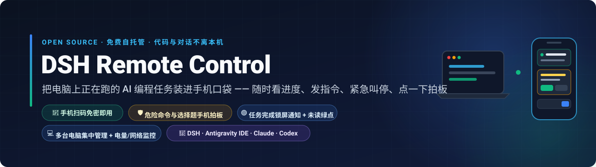
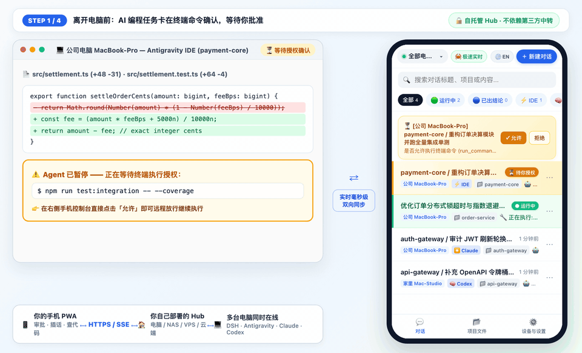
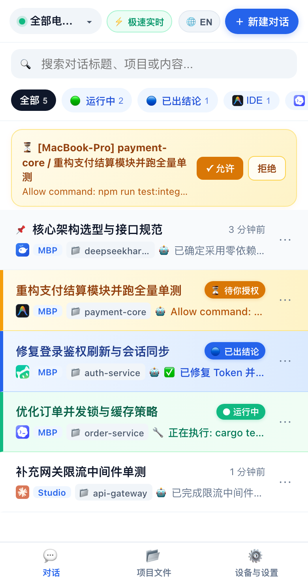
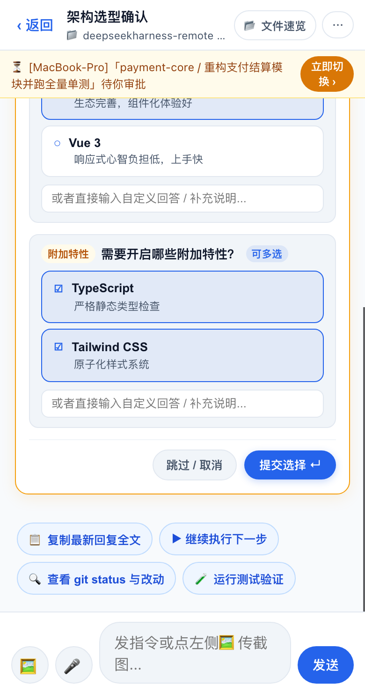
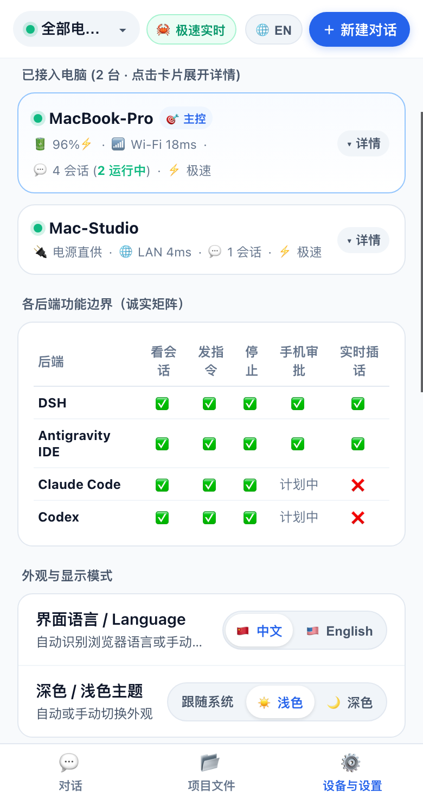
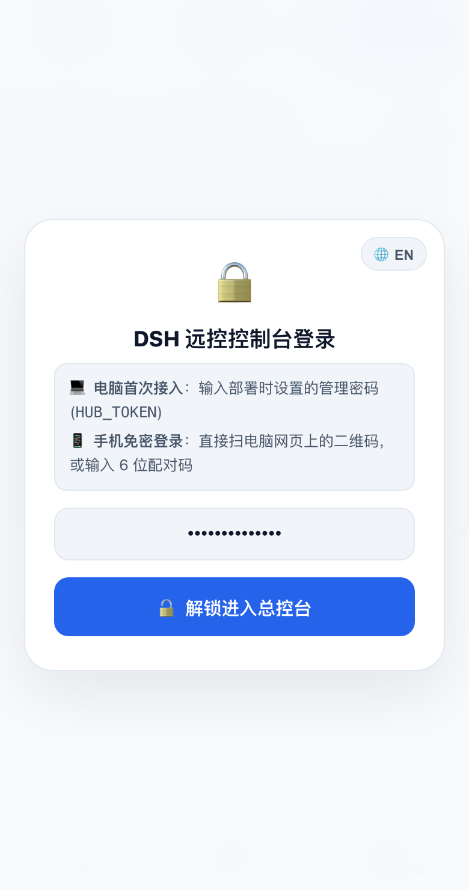
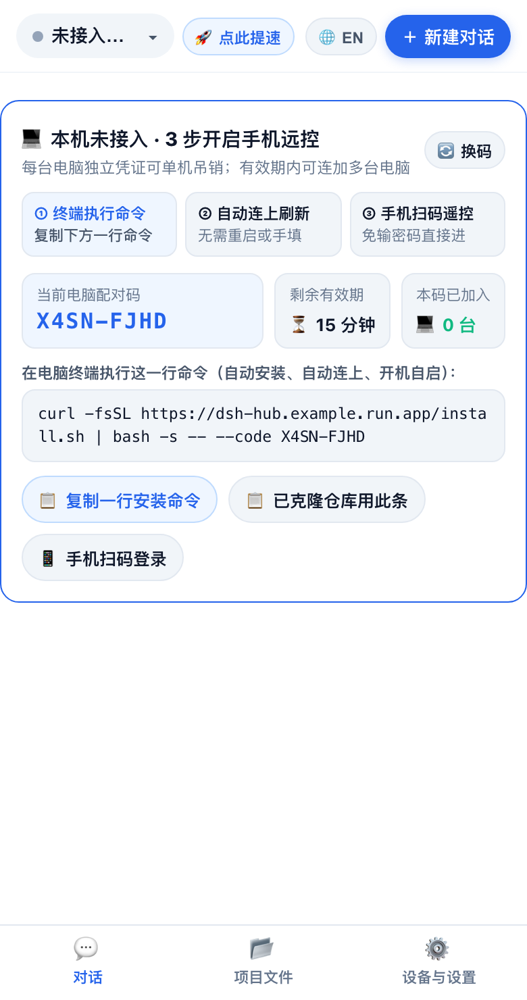
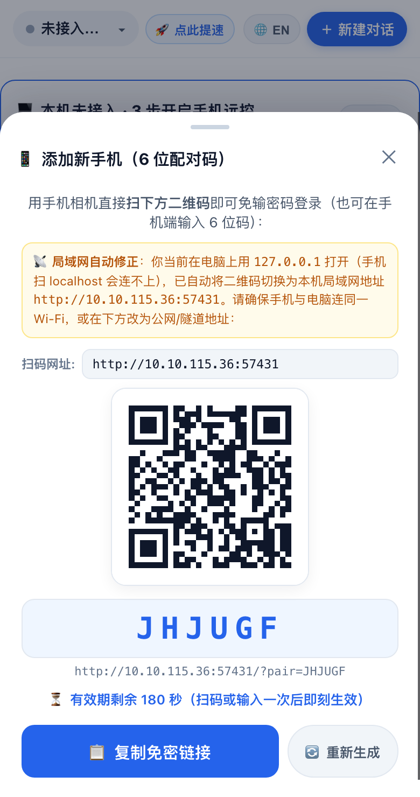

<div align="center">
  

  <p align="center">
    <strong>你的 AI 编程工具，由你自己掌控 —— 不必依赖任何第三方厂商的固定中转服务。<br/>随时在手机上看 AI 编程进度、发指令、紧急叫停，或者点一下批准危险命令与多选弹窗。<br/>支持将控制台免费部署在你自己的电脑、NAS、VPS 或你自己的 Cloud Run / Railway 账号上。</strong>
  </p>

  <p align="center">
    
    
    = 20" />
    
  </p>

  <p align="center">
    <a href="https://railway.com/new/template?template=https%3A%2F%2Fgithub.com%2Foscarka%2Fdeepseekharness-remotecontrol"></a>
  </p>

  <p align="center">
    <a href="./README.md">🇺🇸 English</a> · <strong>🇨🇳 简体中文</strong> · <a href="#三步快速上手">三步上手</a> · <a href="#支持的-ai-编程工具">支持工具</a> · <a href="#最近版本更新记录">版本更新</a> · <a href="#常见问题">常见问题</a>
  </p>
</div>

<div align="center">
  
  <br/>
  <sub><strong>🎬 15 秒完整流程演示：</strong>左边电脑卡在单测命令授权 → 打开右侧手机控制台点一下 <code>Submit ↵</code> 批准 → 左边电脑瞬间继续跑完 42 项单测并把最新结论同步回手机。</sub>
</div>

<br/>

<table align="center">
  <tr>
    <td align="center" width="33%">
      <br/>
      <sub><strong>① 多工具会话一屏总览</strong><br/>同时管理 DSH、Antigravity IDE、Claude 与 Codex，顶部待审批黄条与完结未读提示一目了然</sub>
    </td>
    <td align="center" width="33%">
      <br/>
      <sub><strong>② 手机拍板命令与多选题</strong><br/>遇到终端命令授权或架构选型提问弹窗，在手机上点选即可让电脑继续往下跑</sub>
    </td>
    <td align="center" width="33%">
      <br/>
      <sub><strong>③ 多电脑管理 + 电量/网络监控</strong><br/>集中查看多台电脑的电池百分比、充电状态、Wi-Fi 延迟，支持一键切换中英文与浅色/深色</sub>
    </td>
  </tr>
</table>

---

## 为什么要做这个？

当你在电脑上用 **DeepSeek Harness (DSH)**、**Antigravity IDE**、**Claude Code** 或 **Codex** 跑一个长任务（重构代码、跑全量测试、部署服务）时，人一离开工位往往就会遇到这些痛点：

- **卡在弹窗干等**：AI 跑到一半弹出一个 *"是否允许执行 `npm run test:integration`？"* 或弹出一个多选确认框，你不点同意它就一直停在那里。
- **出门在外两眼一抹黑**：下楼买咖啡、在地铁上或躺在沙发上时，想看一眼任务跑完没有、顺手发一句补充指令、传一张手机截图，或者发现跑偏了立即叫停。
- **多台电脑来回切**：公司一台 Mac、家里一台主力机都在跑任务，想在一个手机页面里统一看管。

**DSH Remote Control** 把你电脑上正在跑的 AI 编程会话装进手机浏览器里（支持 iOS 16.4+ 添加到主屏幕开启原生锁屏推送，支持中英文自动识别与一键切换）。

---

## 先花 10 秒搞懂：自托管架构（不依赖任何第三方厂商中转）

整个系统只有两个极轻量的部分，控制权完全掌握在你自己手里：

```
┌──────────────────────────┐        HTTPS / 实时 SSE         ┌─────────────────────────────────┐
│     📱 你的手机 PWA      │  ◄─────────────────────────────►  │   🏠 你自己部署的控制台 Hub     │
│  审批 · 插话 · 查代码    │                                   │  (本机 / NAS / VPS / 你的云端)  │
└──────────────────────────┘                                   └────────────────┬────────────────┘
                                                                                │ 电脑主动向外连接 (免公网 IP)
                                                       ┌────────────────────────┴────────────────────────┐
                                                       ▼                                                 ▼
                                      ┌─────────────────────────────────┐               ┌─────────────────────────────────┐
                                      │ 💻 电脑 A (公司 MacBook-Pro)    │               │ 💻 电脑 B (家里主机 Mac-Studio) │
                                      │ DSH · Antigravity · Claude      │               │ DSH · Codex · Antigravity       │
                                      └─────────────────────────────────┘               └─────────────────────────────────┘
```

1. **控制台 (`Control Hub`)**：一个零外部依赖的轻量级 Node.js 网页服务，由你自己选择部署位置（本机、NAS、VPS，或你自己的 Cloud Run / Railway 账号），不需要绑定到任何第三方厂商统一托管的 SaaS 中转服务。
2. **电脑端后台服务 (`connect-host.sh`)**：在你写代码的 Mac / Linux 电脑上用一行命令装好的后台小助手。它负责读取本机正在跑的 AI 任务并主动连上你的控制台（因此**你的电脑不需要公网 IP，也不用配路由器端口映射**）。

> **透明的数据边界说明**：你自己部署的控制台 Hub 会在内存中保存近期会话元信息与活跃对话快照，以便手机端秒开查看；你的项目完整源代码留在电脑本地，仅当你在手机里点开某个文件或图片时才按需读取。生成的回放分享链接 (`/share/:id#k=...`) 采用浏览器端 AES-256-GCM 端到端加密。完整边界说明见 [`SECURITY.md`](./SECURITY.md)。

---

## 三步快速上手

### 第 1 步：启动你的控制台（4 种方式任选其一）

你可以根据自己的使用场景，从下面 4 种方式里选最顺手的一种启动控制台：

#### 🌟 方式 A：Google Cloud Run 云端部署（作者本人日常使用同款 · 推荐出门用 4G/5G 随时遥控）
如果你想在地铁、咖啡馆用手机 4G/5G 随时遥控家里或公司的电脑，又不想自己买一台 24 小时开机的云服务器，直接用项目自带的一键脚本部署到 Google Cloud Run（自带 HTTPS 域名，闲置时自动缩容到 0 几乎不花钱）：

```bash
git clone https://github.com/oscarka/deepseekharness-remotecontrol.git
cd deepseekharness-remotecontrol

# 把 your-gcp-project-id 换成你的 Google Cloud 项目 ID，密码换成你自己的密码
GCP_PROJECT_ID="your-gcp-project-id" \
HUB_TOKEN="自定义一个安全密码" \
./deploy-cloudrun.sh
```
脚本跑完后会直接打印出你的专属 `https://dsh-remotecontrol-hub-xxx.run.app` 控制台网址。

#### 🏠 方式 B：克隆代码在电脑本机直接跑（最快 30 秒体验 · 同一 Wi-Fi 下 0 成本）
不需要云服务器，也不需要装 Docker。只要电脑有 Node.js（>= 20），克隆仓库加密码参数直接启动：

```bash
git clone https://github.com/oscarka/deepseekharness-remotecontrol.git
cd deepseekharness-remotecontrol

# 把「自定义一个密码」换成你自己的密码
HUB_TOKEN="自定义一个密码" PORT=8080 npm start
```
终端会同时打印出本机地址 `http://localhost:8080` 和局域网地址 `http://192.168.1.x:8080`。

#### ☁️ 方式 C：Railway 网页一键部署（免敲命令上云）
不想在本地装命令行工具？直接点击本页顶部的 **Deploy on Railway** 按钮，在网页里填一个 `HUB_TOKEN`（你的控制台密码），1 分钟就能拿到公网 `https://` 网址。

#### 🐳 方式 D：自有云服务器 / NAS / 树莓派（Docker 或内网穿透）
如果你有自己的 VPS、群晖 NAS 或软路由，可以直接用一行 Docker 命令启动（或者本机 `npm start` 搭配 `cloudflared` / `cpolar` / `Tailscale`）：

```bash
docker run -d --name dsh-hub \
  --restart unless-stopped \
  -p 8080:8080 \
  -v dsh-hub-data:/data \
  -e HUB_TOKEN="自定义一个密码" \
  ghcr.io/oscarka/deepseekharness-remotecontrol:latest
```

<div align="center">
  <br/>
  <sub><strong>第 1 步对应画面：</strong>在电脑浏览器打开你的控制台网址，输入刚才设置的 <code>HUB_TOKEN</code> 密码解锁（右上角可随时一键切换中/英文）。</sub>
</div>

---

### 第 2 步：把你的电脑连上控制台（复制一行命令回车）

在电脑浏览器解锁进入控制台后，首页会直接显示**「💻 本机未接入 · 3 步开启手机远控」**引导卡片（自带 15 分钟有效的配对码）：

1. 点击卡片上的 **「📋 复制一行安装命令」**（如果你刚才已经克隆了仓库，也可以点「📋 已克隆仓库用此条」）。
2. 打开你电脑的终端（Terminal），粘贴并回车：
   ```bash
   curl -fsSL https://你的控制台网址/install.sh | bash -s -- --code ABCD-1234
   ```
3. 脚本会自动为这台电脑申请独立凭证、注册开机后台自启服务，2 秒内网页就会自动刷新显示「电脑已接入」！

<div align="center">
  <br/>
  <sub><strong>第 2 步对应画面：</strong>直接点击卡片上的「📋 复制一行安装命令」到电脑终端粘贴运行，无需手动改任何配置文件。</sub>
</div>

---

### 第 3 步：拿出手机扫码，免密直接遥控

1. 在电脑浏览器的控制台页面上，点击 **「📱 手机扫码登录」**。
2. 拿出手机打开相机扫一扫屏幕上的二维码 —— **不用在手机上敲长密码**，扫码即刻解锁进入！
   - *贴心防坑*：如果你在电脑上是用 `http://localhost:8080` 打开的，弹窗会自动识别并把二维码网址切换为你电脑的局域网 IP（如 `http://192.168.1.x:8080`），确保手机连同一 Wi-Fi 时一扫就能通。
3. **iPhone 锁屏通知（强烈推荐）**：在手机 Safari 点底部 **「分享 → 添加到主屏幕」**，从桌面图标打开进入 **「设备与设置 → 📲 开启推送」**，任务跑完或需要你拍板时手机锁屏就会直接弹窗提醒。

<div align="center">
  <br/>
  <sub><strong>第 3 步对应画面：</strong>点击「📱 手机扫码登录」，用手机相机扫一扫即可免输密码直接登录。</sub>
</div>

---

## 支持的 AI 编程工具

电脑接入后，后台服务会自动扫描并同步你电脑上以下 4 款工具的真实会话：

| AI 编程工具 | 手机看实时进度 | 新建 / 续聊发指令 | 紧急停止 | 手机批准命令与多选题弹窗 | 运行中实时插话 |
| :--- | :---: | :---: | :---: | :---: | :---: |
| **DeepSeek Harness (DSH)** | ✅ | ✅ | ✅ | ✅ *(支持命令审批 + `ask_user_question` 多选卡 + 方案确认卡)* | ✅ |
| **Antigravity IDE** | ✅ | ✅ | ✅ | ✅ *(Connect-RPC + 原生按键注入)* | ✅ |
| **Claude Code** | ✅ | ✅ *(通过 `claude --resume`)* | ✅ | ⏳ *计划中* | — |
| **OpenAI Codex** | ✅ | ✅ *(通过 `codex exec resume`)* | ✅ | ⏳ *计划中* | — |

---

## 📅 最近版本更新记录

- **`2026-11-09 · v0.5.0` — 中英双语控制台、聊天内嵌本地图片/文件速览胶囊与极速文件读取**
  - **控制台支持中英双语 (`中文` / `English`)**：自动根据浏览器语言识别中英文，并在登录框、顶栏与设置页提供 `🌐 EN / 中文` 一键切换按钮。
  - **聊天直接渲染本地生成图 + 可点击文件胶囊**：DSH 与 Antigravity IDE 在本机生成的渲染对比图（含 `.gemini/antigravity/brain/` 产物与 `carousel` 轮播图）直接在手机聊天气泡内加载显示；对话中的 `[file.py](file:///...)` 路径自动渲染为可点击胶囊，配合 Hub 6 小时缓存与电脑端毫秒级 Fast-Flush 立即回传，点开代码和图片速度提升约 3–5 倍。
  - **DSH 选择题与方案审批弹窗**：完整支持在手机端直接点选回答 DSH 的 `ask_user_question`（单选/多选/自定义输入）与 `exit_plan_mode` 方案确认弹窗。
  - **新用户首次部署防坑闭环与 Cloud Run 自动重连**：非 Docker 直接运行 `npm start` 时自动回退持久化状态至 `~/.dsh/hub-state.json`；电脑用 `localhost` 打开生成手机二维码时自动修正为本机局域网 IP；Cloud Run 容器重部署或缩容重启后自动恢复已配对电脑的 `hst_...` 凭证。
  - **多电脑电量与网络延迟监控**：在「设备与设置」卡片中实时展示笔记本电池百分比、充电/电源直供状态、低电量预警与 Wi-Fi/局域网延迟 (`rttMs`)。
- **`2026-11-07 · v0.4.0` — 一行命令配对接入、单机独立凭证吊销与手机传截图**
  - 新增 15 分钟有效的多机配对码与 `/install.sh` 一键接入流程；每台电脑分配独立可吊销的访问凭证与 Ed25519 设备指纹；支持在手机对话与新建任务时直接上传相册截图并自动压缩。
- **`2026-11-06 · v0.3.0` — 四大 AI 编程工具统一接入与 Rust 极速实时引擎**
  - 在 DSH 基础上新增对 Antigravity IDE、Claude Code 与 OpenAI Codex 的统一会话发现与远程控制，内置 `dsh-turbo` 原生加速模块与 SSE 双向实时流。
- **`2026-11-05 · v0.2.0` — iOS 16.4+ 锁屏 Web Push 推送、跨电脑一键迁移与端到端加密分享**
  - 支持零外部依赖的 iPhone 主屏幕 Web Push 锁屏通知、跨电脑一键打包迁移 `~/.dsh` 会话，以及 AES-256-GCM 端到端加密会话回放分享链接 (`#k=`)。

---

## 安全与隐私设计

- **强制密码保护**：未设置 `HUB_TOKEN` 时服务端拒绝裸奔启动，登录与配对接口均内置防暴力破解限流。
- **一机一证随时吊销**：每台接入的电脑使用独立凭证 (`hst_...`)，如果某台旧电脑不用了，在手机「设置 → 已接入电脑」里点一下 **「🚫 吊销凭证」** 即可单独断开，不影响其他电脑。
- **端到端加密回放分享**：生成的会话分享链接在你的电脑本地完成 AES-256-GCM 加密，解密密钥只存在于链接末尾的 `#k=` 锚点中，不经过服务端。

---

## 常见问题

<details>
<summary><strong>1. 手机上点了「允许」，为什么 Mac 上的 Antigravity IDE 没自动点确认？</strong></summary>
<br/>
首次在 macOS 使用时，打开电脑的<strong>「系统设置 → 隐私与安全性 → 辅助功能」</strong>，把你的终端（Terminal / iTerm）或 Node 勾上即可（也可以在手机控制台顶部点 <strong>「⚡ 极速 → 🔓 在电脑弹出辅助功能授权框」</strong> 一键唤起）。
</details>

<details>
<summary><strong>2. 为什么我的 iPhone 没收到锁屏推送通知？</strong></summary>
<br/>
苹果 iOS 规定只有「添加到主屏幕」的网页应用才能发锁屏推送。请用 iPhone 的 <strong>Safari</strong> 打开控制台网址，点底部 <strong>「分享 → 添加到主屏幕」</strong>，然后从手机桌面上的新图标点进去，在「设备与设置」里点「📲 开启推送」即可。
</details>

<details>
<summary><strong>3. 怎么在电脑上停止或卸载后台服务？</strong></summary>
<br/>
在项目目录执行 <code>./connect-host.sh --uninstall</code>，或者在终端运行：<br/>
<code>launchctl unload ~/Library/LaunchAgents/com.dsh.remotecontrol.agent.plist</code>
</details>

---

## 开源协议

本项目基于 [MIT License](./LICENSE) 开源。

