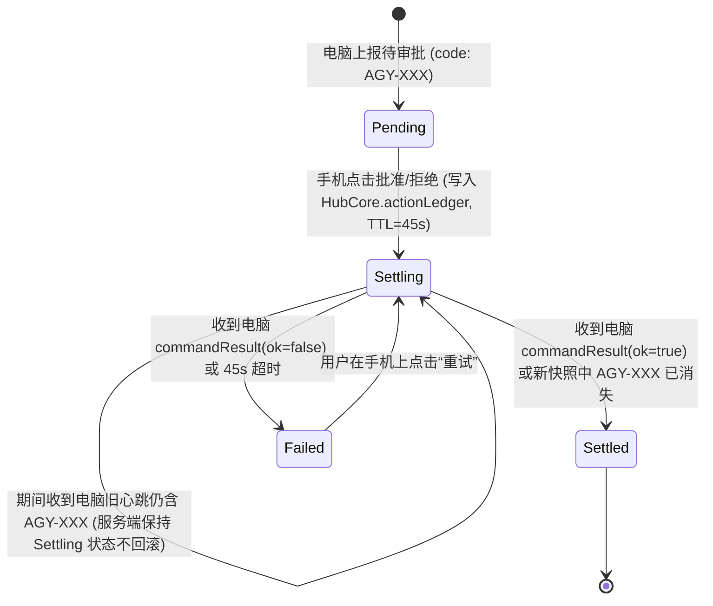
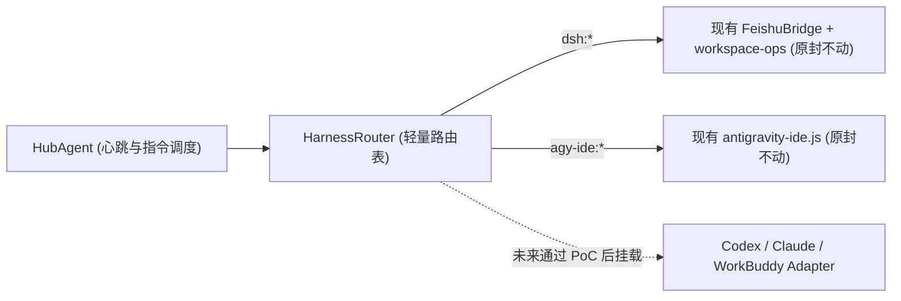
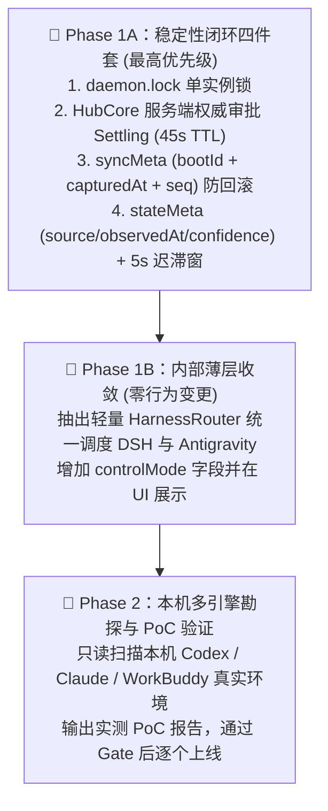

# DeepSeek Harness Remote Control · 稳定性加固与多引擎（Multi-Harness）架构升级完整方案

> **文档版本**：v2.0（已深度融合架构评审 8 条核心修正意见）  
> **适用仓库**：`deepseekharness-remotecontrol`  
> **核心目标**：  
> 1. **状态稳如磐石**：彻底解决手机端遥控电脑时的「审批回弹、状态闪烁、双进程互踩、报错被吞、重启假死」五大顽疾。  
> 2. **多引擎诚实接入**：在不破坏现有 `DSH` 与 `Antigravity IDE` 稳定性的前提下，建立一套分层、诚实、可验证的 `HarnessAdapter` 体系，规范化评估和接入 `Codex CLI`、`Claude Code`、`WorkBuddy` 等外部工具。

---

## 目录

1. [通俗复盘：为什么之前会出现“状态不稳定”？](#一通俗复盘为什么之前会出现状态不稳定)
2. [架构评审意见采纳与修正总表](#二架构评审意见采纳与修正总表)
3. [第一部分：稳定性加固四大核心工程细节（Phase 1A）](#三第一部分稳定性加固四大核心工程细节phase-1a)
   - [3.1 单实例守护进程锁（Lockfile 机制）](#31-单实例守护进程锁lockfile-机制)
   - [3.2 服务端权威动作账本（Action Ledger）与审批 Settling 过渡态](#32-服务端权威动作账本action-ledger与审批-settling-过渡态)
   - [3.3 防回滚版本协议（Boot Epoch + 采集时打点 + 显式 Revision）](#33-防回滚版本协议boot-epoch--采集时打点--显式-revision)
   - [3.4 带置信度的状态分层与防闪烁迟滞窗（StateMeta & Hysteresis）](#34-带置信度的状态分层与防闪烁迟滞窗statemeta--hysteresis)
4. [第二部分：多 Harness 引擎薄层收敛与准入架构（Phase 1B & Phase 2）](#四第二部分多-harness-引擎薄层收敛与准入架构phase-1b--phase-2)
   - [4.1 先做“极薄路由层”，绝不边改协议边大搬家](#41-先做极薄路由层绝不边改协议边大搬家)
   - [4.2 核心认知纠偏：外部引擎的 3 种真实控制等级（Control Modes）](#42-核心认知纠偏外部引擎的-3-种真实控制等级control-modes)
   - [4.3 关于 `dsh-turbo` Rust 扫描器的实事求是改造说明](#43-关于-dsh-turbo-rust-扫描器的实事求是改造说明)
   - [4.4 Codex / Claude / WorkBuddy 的 PoC 准入清单（Gate Checklist）](#44-codex--claude--workbuddy-的-poc-准入清单gate-checklist)
5. [分步实施路线图与单测验收矩阵](#五分步实施路线图与单测验收矩阵)

---

## 一、通俗复盘：为什么之前会出现“状态不稳定”？

用日常生活的场景来比喻，之前手机遥控电脑时遇到的几个怪现象，背后其实有 **4 个非常具体的原因**：

### 现象 1：手机上明明点了“批准”，卡片消失了，但过 1 秒又弹出来一次
* **大白话原因（“快递时间差”）**：
  1. `10:00:00.000`：你在手机上点击「批准」，手机界面为了响应快，先把弹窗藏起来了，同时把“批准指令”发给云端服务器。
  2. `10:00:00.200`：此时电脑还没拉取到这条“批准指令”，电脑刚好按每 1.5 秒一次的节奏，把 `10:00:00.100` 拍下的“还在等待审批”的旧照片发给了云端。
  3. `10:00:00.300`：云端把这张旧照片原封不动转给手机，手机一看“咦，照片里还有审批”，于是刚藏起来的弹窗又啪地弹了出来！
* **怎么根治**：不能让手机自己偷偷藏卡片，必须让**云端服务器当裁判（服务端权威账本）**。只要你在手机点了批准，云端立刻给这个审批贴上**「⏳ 正在同步到电脑端...」**的封条（持续最多 45 秒）。在这期间，就算电脑发来 10 张旧照片说“还在等审批”，云端也知道“指令还在路上”，手机上稳稳显示「⏳ 处理中」，直到电脑明确回信说“批成功了”（卡片彻底消失）或者“批失败了”（卡片变红报错）。

### 现象 2：电脑上有两个守护进程在“抢方向盘”
* **大白话原因**：之前启动脚本 `connect-host.sh` 让系统后台服务（LaunchAgent）去拉起守护进程，但系统拉起有时候需要半秒钟。脚本没立即看到进程，误以为启动失败，又自己用 `nohup` 额外启动了一个守护进程。结果电脑上 **两个进程同时往云端发心跳**，一个读到了新状态、一个还拿着旧缓存，手机画面就会左右互搏。
* **怎么根治**：在守护进程代码入口加一把**“单实例文件锁（Lockfile）”**。就像卫生间门锁一样，谁先进去谁把自己的进程号（PID）写在门锁文件上；第二个进程启动一看门锁着、而且里面的进程还活着，直接自己退出，绝不抢方向盘。

### 现象 3：只靠读磁盘文件末尾，猜不准 AI 到底在干嘛
* **大白话原因**：有些工具（比如 Antigravity IDE）在写磁盘日志 `transcript.jsonl` 时，可能先写了一条“请求审批”，紧接着另一个并行的后台任务又往日志末尾写了一条普通输出。如果只看日志最后一行，就会误以为“审批已经结束了”；反过来，有时候电脑上你已经勾选了“始终允许（Always Allow）”，电脑直接放行了，但磁盘日志里还留着工具调用记录，只看磁盘又会误以为“还要手机审批”。
* **怎么根治**：给状态来源分等级（RPC 内存实时接口 > 磁盘结构化日志 > 进程/文件修改时间推断），并且给每次状态打上**「来源标签（Source）+ 观测时间（ObservedAt）+ 可信度（Confidence）」**。高可信度刚说的话，低可信度在 5 秒内不能随便插嘴推翻。

---

## 二、架构评审意见采纳与修正总表

针对第一版草案，架构评审提出了 8 条关键意见。经核查源码，**8 条意见全部切中要害，全盘采纳并修正如下**：

| 评审项 | 评审结论 | 为什么评审是对的（源码核实） | 本方案最终落地方案 |
| :--- | :---: | :--- | :--- |
| **1. 单实例锁** | ✅ 做，用 `lockfile` 不用 `flock` | Node.js 标准库无原生跨平台 `flock(2)`，引入 C++ 插件或外部命令反而增加部署故障点。 | 使用 `fs.openSync('~/.dsh/daemon.lock', 'wx')` 原子创建 + `process.kill(pid, 0)` 存活探测 + `--replace` 优雅接管。 |
| **2. Action Ledger 与审批 `settling`** | ✅ 做，服务端权威、显示“处理中”、放宽 TTL | 纯前端隐藏会导致多端不一致；15 秒 TTL 在电脑刚唤醒或网络抖动时不够用，容易超时回弹。 | 账本设在 [`HubCore`](../../hub/hub-core.js)，审批点击后进入 `settling` 态（**TTL 45s**），UI 显示「⏳ 正在同步到电脑端...」并禁用重复点击；失败则内联显示错误。 |
| **3. `hostSeq` / `sessionRev`** | ⚠️ 必须加采集打点、`bootEpoch`、显式 revision、旧协议兼容 | 若只用简单自增 `seq++`，守护进程重启归零后会被云端当成“旧包”永久拒收；发送时打点则会把慢采集的旧快照标成新序号。 | 引入 `{ bootId, bootEpochMs, seq, capturedAt }` 四元组：在**采集开始前**记录 `capturedAt`，重启后凭新 `bootId` 自动切换基准，未传该字段的旧协议自动兼容放行。 |
| **4. Tier 1/2/3 状态分层** | ⚠️ 不承诺“100% 真相”，加 `source / observedAt / confidence` | 哪怕是 LanguageServer RPC，在跨步骤流式间隙或多窗口下也有毫秒级盲区，不能盲信。 | 每个会话附加 `stateMeta: { source, observedAt, confidence }`，配合 5 秒迟滞保护窗（Hysteresis），防止低置信度信号抖动。 |
| **5. Adapter 分层** | ✅ 先做薄层、先覆盖 DSH/Antigravity，不同时大重构 | 同时改动状态同步协议 + 搬迁所有业务文件风险极高，容易破坏现有 46 项测试。 | Phase 1B 仅在 [`HubAgent`](../../dsh-feishu/lib/hub-agent.js) 内抽离 80 行以内的 `HarnessRouter` 薄委托层，不动 [`antigravity-ide.js`](../../dsh-feishu/lib/antigravity-ide.js) 内部实现。 |
| **6. Codex / Claude 对接** | ⚠️ 先做 PoC，不能假设 `CLI resume` 能接管运行中交互会话 | 用户在终端里正开着的交互式 `codex/claude` 独占 TTY 和内存，后台跑 `exec resume` 根本无法替前台终端敲 `y/n`，还会引发冲突。 | 严格区分 **`managed`（受管可审批）**、**`idle-resumable`（空闲可续跑）**、**`observe-only`（终端独立运行中，仅只读观测）** 三种模式，先 PoC 后排期。 |
| **7. WorkBuddy 对接** | ❌ 证据不足，GUI AX 不是“USB”，PoC 不通过不排期 | GUI 辅助功能（模拟按键/聚焦窗口）受锁屏、焦点、输入法影响极大，绝不能算稳定接口。 | 将 WorkBuddy 列为独立勘探项：先核查本机是否存在本地结构化存储或 CLI/IPC 接口，PoC 未通过前绝不排入正式开发周期。 |
| **8. `dsh-turbo` 通用扫描** | ❌ 原说法不成立，Rust 硬编码了 Antigravity 目录结构 | 核查 [`dsh-turbo/src/main.rs:186`](../../dsh-turbo/src/main.rs#L186-L190)，`scan_brain_dirs` 确实写死了 `.system_generated/logs/transcript.jsonl`。 | 放弃“直接把其他目录塞给现有 `fast-scan`”的错误假设；新引擎优先用 Node 层 `mtime` 缓存，确需加速时再为 Rust 增加通用扫描子命令。 |

---

## 三、第一部分：稳定性加固四大核心工程细节（Phase 1A）

### 3.1 单实例守护进程锁（Lockfile 机制）

#### 通俗解释
每次启动 [`dsh-feishu/daemon.mjs`](../../dsh-feishu/daemon.mjs) 时，先去 `~/.dsh/daemon.lock` 挂牌登记。如果牌子已经挂上了，先看牌子上的进程号（PID）是不是还活着：
- 如果那个进程早就退出了（比如电脑断电留下的旧牌子），直接摘掉旧牌子，挂上自己的新牌子。
- 如果那个进程还活着：
  - 普通启动（比如定时任务误触发）：自己默默退出，不去打扰正在干活的进程。
  - 强制重启（比如运行 `./connect-host.sh` 升级代码，带 `--replace` 参数）：礼貌通知旧进程下班（发 `SIGTERM`），等它把锁摘掉后，新进程再正式上岗。

#### 技术细节与文件结构
* **新增模块**：`dsh-feishu/lib/daemon-lock.js`
* **锁文件路径**：`~/.dsh/daemon.lock`
* **锁文件 JSON 格式**：
  ```json
  {
    "pid": 37774,
    "bootId": "boot-9f8e7d6c-1122",
    "startedAt": 1793957660000,
    "hostId": "macbook-air",
    "script": "/Users/dev/deepseekharness-remote/dsh-feishu/daemon.mjs"
  }
  ```
* **核心获取流程**：
  1. 尝试 `fs.openSync(lockPath, 'wx')`（排他创建，若文件已存在会立即抛 `EEXIST`）。
  2. 若抛 `EEXIST`，读取现有 JSON，调用 `isPidAlive(lock.pid)`（内部用 `process.kill(pid, 0)`，返回 `true` 或 `ESRCH`）。
  3. 若 `!isPidAlive`：删除陈旧锁文件，重试步骤 1。
  4. 若 `isPidAlive && argv.includes('--replace')`：发送 `process.kill(lock.pid, 'SIGTERM')`，每 100ms 轮询一次最多等待 3000ms，旧进程退出后删除旧锁并重试步骤 1。
  5. 注册 `process.once('exit')`、`SIGINT`、`SIGTERM`，仅当锁文件中的 `bootId === currentBootId` 时删除锁文件（防止误删后来者的锁）。

---

### 3.2 服务端权威动作账本（Action Ledger）与审批 `Settling` 过渡态

#### 通俗解释
以前手机点「批准」像是往河里扔漂流瓶，扔出去就不管了，卡片先自己消失，万一河水把旧漂流瓶冲回来，卡片又诈尸弹出来。
现在我们在云端 [`HubCore`](../../hub/hub-core.js) 设立一个**「官方办事大厅进度表（Action Ledger）」**：
1. 手机点击「批准」$\rightarrow$ 办事大厅立刻把这条审批的状态改成 **「⏳ 正在同步到电脑端（`settling`）」**，有效期 **45 秒**。
2. 手机界面看到 `settling: true`，不会把卡片藏起来，而是把按钮变成不可点击的 **「⏳ 正在请求电脑放行 (预计 1~3 秒)...」**。
3. 接下来只有两种结局：
   - **结局 A（成功）**：电脑执行完 Connect-RPC 汇报 `ok: true`，或者电脑发来的新快照里该审批确实已经没了 $\rightarrow$ 办事大厅核销这笔账，卡片彻底消失，弹绿色轻提示「✅ 电脑端已放行」。
   - **结局 B（失败或超时）**：电脑汇报 `ok: false, error: "RPC 拒绝"` 或 45 秒内电脑断网没响应 $\rightarrow$ 办事大厅把状态改成 `failed`，手机卡片直接恢复可点击状态，并在卡片正上方用醒目红字写出失败原因：「⚠️ 电脑端放行失败：xxx，请重试」。



#### 技术细节与字段契约
* **修改文件**：[`hub/hub-core.js`](../../hub/hub-core.js)、[`hub/web/src/controller.js`](../../hub/web/src/controller.js)
* **`HubCore` 新增账本结构**：
  ```js
  // key: `${hostId}:${approvalCode}`
  this.approvalLedger = new Map()
  // value:
  {
    actionId: 'cmd-8a9b0c',
    hostId: 'macbook-air',
    agentId: 'agy-ide:5ce97dab...',
    code: 'AGY-5CE97D-12',
    decision: 'approve',       // 'approve' | 'deny'
    optionIndex: 1,
    status: 'settling',        // 'settling' | 'settled' | 'failed'
    requestedAt: 1793958000000,
    expiresAt: 1793958045000,  // 45 秒宽限期
    error: ''
  }
  ```
* **`HubCore.getFullState()` 合成规则**：
  - 遍历 `host.bridgeState.approvals`：
    - 若对应 `code` 在 `approvalLedger` 中为 `settled` 且未超过 15 秒冷却期：过滤隐藏，防止刚结算完的残留旧心跳闪回；
    - 若对应 `code` 在 `approvalLedger` 中为 `settling`（未超时）：保留该审批项，但注入 `settling: true, settlingDecision: entry.decision, settlingAt: entry.requestedAt`；
    - 若对应 `code` 在 `approvalLedger` 中为 `failed`：注入 `lastError: entry.error, failedAt: entry.failedAt`。

---

### 3.3 防回滚版本协议（Boot Epoch + 采集时打点 + 显式 Revision）

#### 通俗解释
怎么防止“慢路上跑来的旧心跳包”把“新状态”覆盖掉，同时又不会因为守护进程重启导致序号归零被拒收？
我们在每次心跳包裹上贴一张**“双层时间戳快递单（`syncMeta`）”**：
1. **第一层：`bootId`（本次开机/进程启动的唯一随机身份证）+ `bootEpochMs`（进程启动时间）**。只要守护进程重启了，身份证号就换新的，云端一看是新身份证且启动时间合理，立刻认新身份证，绝不会拿上辈子的序号来卡这辈子的包裹。
2. **第二层：`seq`（本次启动后的第几个包裹）+ `capturedAt`（拍下这张状态照片那一刻的时间，而不是寄出包裹的时间）**。同一个身份证下，只收序号比上一次更大的包裹。
3. **兼容老快递**：如果旧版脚本或单元测试没贴这张新快递单（没有 `syncMeta` 字段），云端照常签收，保证 100% 向后兼容。

#### 技术细节与协议定义
* **修改文件**：[`dsh-feishu/lib/hub-agent.js`](../../dsh-feishu/lib/hub-agent.js)、[`hub/hub-core.js`](../../hub/hub-core.js)
* **心跳上报新增 `syncMeta` 字段**：
  ```json
  {
    "hostId": "macbook-air",
    "syncMeta": {
      "bootId": "boot-9f8e7d6c-1122",
      "bootEpochMs": 1793957660000,
      "seq": 42,
      "capturedAt": 1793957723105
    },
    "bridgeState": { ... }
  }
  ```
* **`HubAgent.tick()` 打点位置要求**：
  - **必须在调用 `refreshDshStats()` 和 `bridge.getSnapshotState()` 之前**记录 `const capturedAt = Date.now()` 和 `const seq = ++this.heartbeatSeq`，确保序号反映的是**快照采集时刻**而非 HTTP 发送时刻。
* **会话级显式 `sessionRev`**：
  - 每个任务对象新增确定性版本串：
    ```js
    task.sessionRev = `${task.transcript?.length || 0}:${task.lastStepIndex ?? -1}:${task.status}:${task.turnState || ''}:${task.pendingApproval?.code || ''}`
    ```

---

### 3.4 带置信度的状态分层与防闪烁迟滞窗（StateMeta & Hysteresis）

#### 通俗解释
电脑判断一个任务是不是在运行、要不要审批，有三个渠道：
- **渠道 1（实时专线 `ls-rpc`）**：直接问 Antigravity 的后台服务“现在卡在哪一步？”。可信度 `high`（高）。
- **渠道 2（磁盘账本 `jsonl-tail`）**：读硬盘上的 `transcript.jsonl` 最后几行。可信度 `medium`（中）。
- **渠道 3（侧面打听 `ps-heuristic / mtime-decay`）**：看系统里有没有命令在跑、文件几秒没改了。可信度 `low`（低）。

**防吵架规则（5 秒迟滞保护窗）**：如果 3 秒前「高可信度专线」刚明确说“正在等待审批”或“已经执行完毕”，这时候「低可信度侧面打听」跳出来说“不对，我猜它还在跑”，系统会在 5 秒保护期内忽略低可信度的瞎猜，并在数据里清楚写明当前状态是谁报的（`source`）、什么时候看的（`observedAt`）、可信度多高（`confidence`）。

#### 技术细节
* 每个会话 `task` 对象新增 `stateMeta`：
  ```json
  "stateMeta": {
    "source": "ls-rpc",
    "observedAt": 1793957723100,
    "confidence": "high"
  }
  ```

---

## 四、第二部分：多 Harness 引擎薄层收敛与准入架构（Phase 1B & Phase 2）

### 4.1 先做“极薄路由层”，绝不边改协议边大搬家

为了保证现有 `DSH` 和 `Antigravity IDE` 的 46 个单元测试及线上体验零回退，我们在 Phase 1B **不拆分、不重写 [`antigravity-ide.js`](../../dsh-feishu/lib/antigravity-ide.js)**，只在 [`dsh-feishu/lib/hub-agent.js`](../../dsh-feishu/lib/hub-agent.js) 旁新增一个轻量级委托器 `dsh-feishu/lib/harness-router.js`（约 80 行）：



---

### 4.2 核心认知纠偏：外部引擎的 3 种真实控制等级（Control Modes）

为什么接入 `Codex CLI`、`Claude Code` 或 `WorkBuddy` 不能简单假设“调个命令行就能干所有事”？
因为 **你在电脑终端窗口里亲手敲命令启动的交互式进程，它的键盘输入（stdin）攥在那个终端窗口手里**，后台守护进程如果不做特殊接管，是没法替你往那个窗口里敲 `y`（同意审批）的。

因此，我们在协议和手机 UI 上，必须诚实地把任何引擎的会话标记为以下 **3 种控制模式（`controlMode`）** 之一：

| 控制模式 (`controlMode`) | 手机端徽标 | 适用条件与底层原理 | 手机端能做什么？ | 手机端不能做什么（UI 诚实禁用并提示） |
| :--- | :--- | :--- | :--- | :--- |
| **`managed`**<br/>（完全受管模式） | `🟢 完全遥控` | ① 像 Antigravity IDE 这样有本地 Connect-RPC 接口；<br/>② 或由守护进程通过受管管道/Server 模式拉起并持有句柄的会话。 | ✅ 实时看对话<br/>✅ 发消息续聊<br/>✅ **运行中远程点审批**<br/>✅ 强制中断任务 | 无限制 |
| **`idle-resumable`**<br/>（空闲可续跑模式） | `🔵 空闲可续聊` | 电脑终端里的 `codex` / `claude` 进程当前**已结束回合或已退出**，磁盘上有完整会话日志，支持 `codex exec resume <id>` 或 `claude --resume <id>`。 | ✅ 看历史对话<br/>✅ **在手机发新指令拉起下一轮**<br/>✅ 新建受管任务 | ⚠️ 当你在电脑独立终端里正跑着它时，不能抢占审批 |
| **`observe-only`**<br/>（只读观测模式） | `👀 终端运行中(只读)` | 检测到电脑上有一个非受管的独立终端正在运行该会话，或该工具仅有本地日志、无可靠 RPC/CLI 控制口。 | ✅ 手机实时同步查看 AI 思考、工具调用与输出进度 | 🚫 禁用审批与发送框，明确提示：「该任务正在电脑独立终端运行，请在电脑端操作或等其空闲后在手机续聊」 |

> [!IMPORTANT]
> **这一设计的价值**：永远不给用户“假按钮”。手机上只要亮起「批准」或「发送」按钮，就代表后台真的有权限、有通道能把指令送进去；如果当前会话在独立终端里跑着没法被后台插手，手机上就大大方方显示「👀 电脑终端独立运行中（仅同步画面）」，体验反而最清晰、最可控。

---

### 4.3 关于 `dsh-turbo` Rust 扫描器的实事求是改造说明

经核查 [`dsh-turbo/src/main.rs`](../../dsh-turbo/src/main.rs#L186-L190)，现有 `fast-scan` 子命令内部写死了：
```rust
let logs_dir: PathBuf = entry.path().join(".system_generated").join("logs");
```
这是专门针对 Antigravity IDE `brain/<uuid>/.system_generated/logs/transcript.jsonl` 结构的专用扫描器，**不能直接用于扫描 Codex（`~/.codex/sessions/YYYY/MM/DD/*.jsonl`）或 Claude（`~/.claude/projects/*/*.jsonl`）**。

* **务实处理方案**：
  1. Phase 1 保持 `dsh-turbo` 专注服务 Antigravity IDE，不做虚假通用承诺；
  2. 后续接入其他引擎时，在 Node.js 层采用基于目录 `mtime` 的增量缓存扫描（几十个会话文件耗时仅 `1~3ms`）；
  3. 仅当某个新引擎的会话文件超过上千个时，再在 `dsh-turbo/src/main.rs` 中新增一个独立的 `scan-jsonl-tree <root> <maxDepth>` 子命令并重新编译二进制。

---

### 4.4 Codex / Claude / WorkBuddy 的 PoC 准入清单（Gate Checklist）

在正式把任何一个新 Harness 写进生产代码之前，必须先在本机执行 **只读环境勘探与独立小脚本 PoC**，填完下面这张准入表：

| 准入检查项 | OpenAI Codex CLI (`codex`) | Claude Code (`claude`) | WorkBuddy (`workbuddy`) |
| :--- | :--- | :--- | :--- |
| **Gate 1：本机是否已安装 & 会话落盘格式是否明确？** | 探查 `~/.codex/sessions` 下 JSONL 结构与字段 | 探查 `~/.claude/projects` 下 JSONL 结构与字段 | 探查 `~/Library/Application Support/WorkBuddy` 或 `~/.workbuddy` 存储格式（SQLite/JSON） |
| **Gate 2：如何准确判断会话是“空闲”还是“外部终端运行中”？** | `ps` / `lsof` 检查是否有活跃 `codex` 进程打开该 rollout 文件 | 检查是否有活跃 `claude` 进程关联该 session UUID | 检查 WorkBuddy 进程及本地锁/日志活动状态 |
| **Gate 3：空闲状态下能否通过 CLI 无头续跑？** | 验证 `codex exec resume <id> "<prompt>" --json` | 验证 `claude --resume <id> -p "<prompt>" --output-format stream-json` | 待探查是否有官方 CLI 或本地 HTTP/IPC 接口（**严禁把脆弱的 GUI 按键注入当成主力方案**） |
| **Gate 4：准入结论与排期策略** | 通过 Gate 1~3 后作为首个扩展 Adapter（支持 `idle-resumable` + 新建 `managed` 会话） | 通过 Gate 1~3 后作为第二个扩展 Adapter | **若无可靠 CLI/IPC 接口，仅做只读观测或暂不排期** |

---

## 五、分步实施路线图与单测验收矩阵

我们将整个升级拆解为 **3 个清晰、独立、可随时回滚的阶段**：



### 阶段验收清单（每个阶段必须 100% 通过以下自动化测试）

| 阶段 | 核心改动文件 | 必须新增并通过的自动化单测用例 | 预期效果 |
| :--- | :--- | :--- | :--- |
| **Phase 1A**<br/>稳定性闭环 | - `dsh-feishu/lib/daemon-lock.js`<br/>- [`dsh-feishu/daemon.mjs`](../../dsh-feishu/daemon.mjs)<br/>- [`dsh-feishu/lib/hub-agent.js`](../../dsh-feishu/lib/hub-agent.js)<br/>- [`hub/hub-core.js`](../../hub/hub-core.js)<br/>- [`hub/web/src/controller.js`](../../hub/web/src/controller.js) | 1. **双进程锁测试**：模拟第二个守护进程启动自动退出，以及 `--replace` 优雅替换旧进程。<br/>2. **审批 Settling 防闪烁测试**：手机下发审批后，模拟电脑连续发来 2 次仍带旧 `approval.code` 的心跳，验证服务端保持 `settling: true` 不弹回；模拟返回 `ok: false` 时验证卡片展示错误。<br/>3. **乱序心跳与重启兼容测试**：同一 `bootId` 下小 `seq` 被拒；切换新 `bootId` 后 `seq=1` 正常接纳；无 `syncMeta` 的旧请求正常兼容。<br/>4. **置信度防抖测试**：`ls-rpc (high)` 状态在 5 秒内不被 `ps-heuristic (low)` 覆盖。 | 彻底消灭双守护进程、审批回弹、乱序覆盖与重启死锁。 |
| **Phase 1B**<br/>薄层路由收敛 | - `dsh-feishu/lib/harness-router.js`<br/>- [`dsh-feishu/lib/hub-agent.js`](../../dsh-feishu/lib/hub-agent.js) | 5. **全量回归测试**：现有 46 项测试 + Phase 1A 新增测试 100% 通过，且每个会话输出明确的 `controlMode` 与 `capabilities`。 | 代码结构干净解耦，为新引擎留好标准插槽，线上体验零风险。 |
| **Phase 2**<br/>本机勘探与新引擎 PoC | - [`scripts/probe-harnesses.mjs`](../../scripts/probe-harnesses.mjs)（只读勘探脚本）<br/>- [`dsh-feishu/lib/harnesses/codex-adapter.js`](../../dsh-feishu/lib/harnesses/codex-adapter.js)<br/>- [`dsh-feishu/lib/harnesses/claude-adapter.js`](../../dsh-feishu/lib/harnesses/claude-adapter.js) | 6. **Adapter 专项测试**：针对通过 Gate 1~3 的引擎（Codex / Claude Code），验证 `observe-only`（有外部进程时禁止写操作）与 `idle-resumable`（空闲时续跑）状态切换。 | 诚实、稳定地扩展本机真实可用的更多 Harness。 |

---

## 六、执行与实测验收记录（2026-11-06）

1. **Phase 1A 稳定性闭环四件套（已完成并通过单测）**：
   - **单实例文件锁**：[`dsh-feishu/lib/daemon-lock.js`](../../dsh-feishu/lib/daemon-lock.js) + [`dsh-feishu/daemon.mjs`](../../dsh-feishu/daemon.mjs) 使用 `openSync(lockPath, 'wx')` 排他锁与 PID 存活探针，支持 `--replace` 平滑接管。
   - **服务端权威审批账本 (`approvalLedger`)**：[`hub/hub-core.js`](../../hub/hub-core.js) 与 [`hub/web/src/controller.js`](../../hub/web/src/controller.js) 实现 `settling`（45s TTL，前端置灰显示「⏳ 正在同步到电脑端...」）、`settled`（15s 冷却）、`failed`（红字内联报错）。
   - **采集前打点与重启纪元 (`syncMeta`)**：[`dsh-feishu/lib/hub-agent.js`](../../dsh-feishu/lib/hub-agent.js) 在采集前打上 `bootId`、`bootEpochMs`、`seq`、`capturedAt`，配合确定性 `sessionRev`，在同一 `bootId` 内拦截乱序旧包，并在重启切换 `bootId` 时平滑接纳。
   - **状态置信度与 5 秒防抖 (`stateMeta`)**：[`dsh-feishu/lib/antigravity-ide.js`](../../dsh-feishu/lib/antigravity-ide.js) 实现 `applyStateHysteresis()`，保护 `ls-rpc (high)` 在 5 秒内不被 `ps-heuristic (low)` 降级。
2. **Phase 1B 薄层路由收敛（已完成并通过单测）**：
   - [`dsh-feishu/lib/harness-router.js`](../../dsh-feishu/lib/harness-router.js) 封装 `HarnessRouter` 与 `decorateTaskMetadata()`，统一输出 `controlMode`（`managed` / `idle-resumable` / `observe-only`）与 `capabilities`。
3. **Phase 2 本机勘探与新引擎接入（已完成并通过单测）**：
   - 运行 [`scripts/probe-harnesses.mjs`](../../scripts/probe-harnesses.mjs) 实测结果：
     - **OpenAI Codex (`codex`)**：✅ 通过 Gate 1~3（本机检测到二进制 `~/.codex/plugins/.plugin-appserver/codex` `0.144.0-alpha.4` 及 `~/.codex/sessions` 下 22 个真实会话），已上线 [`CodexAdapter`](../../dsh-feishu/lib/harnesses/codex-adapter.js)。
     - **Claude Code (`claude`)**：✅ 通过 Gate 1~3（本机检测到 `/opt/homebrew/bin/claude` `2.1.92` 及 `~/.claude/projects` 下 137 个会话文件），已上线 [`ClaudeAdapter`](../../dsh-feishu/lib/harnesses/claude-adapter.js)。
     - **WorkBuddy (`workbuddy`)**：❌ 未通过 Gate 1（`~/.workbuddy` 仅含 `skills/` 目录，本机未安装 WorkBuddy 客户端或 CLI，0 个会话文件），按评审原则标记为 `NOT_INSTALLED` 暂不排期。
   - 全量自动化单测：**48 / 48 全部通过**（`npm test`）。


